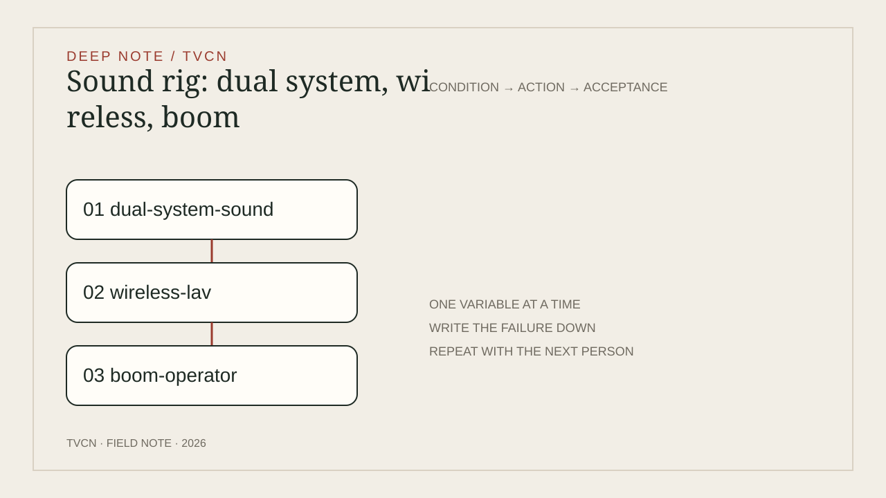

Reliable location sound comes from dual system, wireless backup and boom position, not one expensive mic. One page of &amp;quot;Dual-System Sound: Slate and Timecode&amp;quot; solves one local problem; joining &amp;quot;Dual-System Sound: Slate and Timecode&amp;quot;, &amp;quot;Wireless Lav: Hide It, Back It Up&amp;quot; and &amp;quot;Boom Operator: Follow the Action, Not the Line&amp;quot; exposes the real failure: conditions are missing, too many variables move, and the result cannot be reproduced.

<!-- DEEP_DIVE_START -->
<!-- DIAGRAM_START -->
<h2>图解</h2>
<figure>
  
  <figcaption>Read &quot;Dual-System Sound: Slate and Timecode&quot; and &quot;Wireless Lav: Hide It, Back It Up&quot;: write the condition first, then check whether the failure can be recorded.</figcaption>
</figure>
<!-- DIAGRAM_END -->

<section><h2 id="section-1">Problem</h2>
The problem is not a lack of methods; each step works alone, but together they fail because the condition was not written, too many variables moved and the result cannot be reproduced.

The order is condition, judgement, one variable and evidence. A step is complete only when the next person can repeat it.
</section>
<section><h2 id="section-2">Judgement</h2><ul><li>First gate in &quot;Dual-System Sound: Slate and Timecode&quot;: Every take starts with three claps visible and audible.</li><li>Second gate in &quot;Wireless Lav: Hide It, Back It Up&quot;: Timecode or slate notes are complete enough for post to match audio by scene.</li><li>Third gate in &quot;Boom Operator: Follow the Action, Not the Line&quot;: After sync, playback stays in lip-sync from head to tail.</li></ul>
If one gate fails, return to its single page; do not hide an unsolved point inside a longer chain.
</section>
<section><h2 id="section-3">Method</h2><ol><li>Write the condition first: turn &quot;Clap three times at the head so camera and recorder both capture it.&quot; from &quot;Dual-System Sound: Slate and Timecode&quot; into three rows: material, environment, acceptance.</li><li>Run one minimal action: follow &quot;Dual-System Sound: Slate and Timecode&quot; for 30 seconds and do not add the second page yet.</li><li>Attach the second page: Jam timecode or announce the scene and take at the end of each run..</li><li>Use the third page as a control: Sync on the clap frame or timecode in post, then check each take for drift..</li><li>Change one variable at a time; write the other conditions down instead of remembering them.</li><li>Film the failure too: put failure and success side by side to see which step cannot be skipped.</li><li>Ask the next person to reproduce from the record; if they cannot, the record is not finished.</li></ol></section>
<section><h2 id="section-4">Field test</h2>
A reproducible test, not a client case: take 30 seconds of material, make version A using &quot;Every take starts with three claps visible and audible.&quot; from &quot;Dual-System Sound: Slate and Timecode&quot;, then version B using &quot;Timecode or slate notes are complete enough for post to match aud…&quot; from &quot;Wireless Lav: Hide It, Back It Up&quot;; only one variable may differ. Put them side by side and record what breaks first in &quot;Boom Operator: Follow the Action, Not the Line&quot;: condition, action or acceptance. If it works on the first try, add one real constraint and run it again.
</section>
<section><h2 id="section-5">Failure table</h2>
<table class="data-table"><thead><tr><th>Symptom</th><th>Cause</th><th>Replacement action</th></tr></thead><tbody><tr><td>Do not rely on waveform auto-align; without a clap or timecode, d…</td><td>Condition was not written</td><td>Return to page one and rewrite the three rows</td></tr><tr><td>Do not drop the transmitter in a pocket or record one track; rub …</td><td>Condition was not written</td><td>Return to page one and rewrite the three rows</td></tr><tr><td>Do not swing the boom on every line; the tip will enter frame and…</td><td>Condition was not written</td><td>Return to page one and rewrite the three rows</td></tr></tbody></table>
</section>
<section><h2 id="section-6">Acceptance</h2><ul><li>Every take starts with three claps visible and audible.</li><li>Timecode or slate notes are complete enough for post to match audio by scene.</li><li>After sync, playback stays in lip-sync from head to tail.</li><li>At a new setup, clap first: sharp and close to the mic</li><li>Then slate so the words are readable</li><li>Then shoot the timecode on camera</li><li>Write scene, shot, and take on the slate</li><li>Always run the camera scratch mic</li><li>The thirty-second test has no cloth rub, AC hum, or plosive.</li><li>The transmitter is not in a pocket, the cable has slack, and the mic does not swing when the actor walks.</li></ul></section>
<section><h2 id="section-7">Alternatives</h2><ul><li>For a single-point problem in "Dual-System Sound: Slate and Timecode", go back to <a href="https://shoot.tvcn.org/en/article/dual-system-sound/">Dual-System Sound: Slate and Timecode</a>; do not use the whole chain.</li><li>To compare two actions, read <a href="https://shoot.tvcn.org/en/article/wireless-lav/">Wireless Lav: Hide It, Back It Up</a> and leave the third page alone.</li><li>For acceptance only, use <a href="https://shoot.tvcn.org/en/article/boom-operator/">Boom Operator: Follow the Action, Not the Line</a> as a self-test sheet.</li></ul></section>

<!-- SOURCES_START -->
## References and further reading

- [S31] [ARRI: Cine Systems](https://www.arri.com/en/cine-systems) — Accessed 2026-11-26. Used to check the terminology/method/rule in the “Problem” section against ARRI camera, lens and lighting documentation, not a general shooting tutorial; it does not verify numbers, model choices or on-set conclusions derived from this page, and is not a substitute for a test.
- [S52] [ARRI: ALEXA 35](https://www.arri.com/en/camera-systems/cameras/legacy-camera-systems/alexa-35) — Accessed 2026-11-26. Used to check the terminology/method/rule in the “Judgement” section against ALEXA 35 official specs, not independent testing; it does not verify numbers, model choices or on-set conclusions derived from this page, and is not a substitute for a test.
- [S53] [Sony: FX6](https://pro.sony/ue_US/products/handheld-camcorders/ilme-fx6v) — Accessed 2026-11-26. Used to check the terminology/method/rule in the “Method” section against FX6 official specs, not independent testing; it does not verify numbers, model choices or on-set conclusions derived from this page, and is not a substitute for a test.
<!-- SOURCES_END -->

