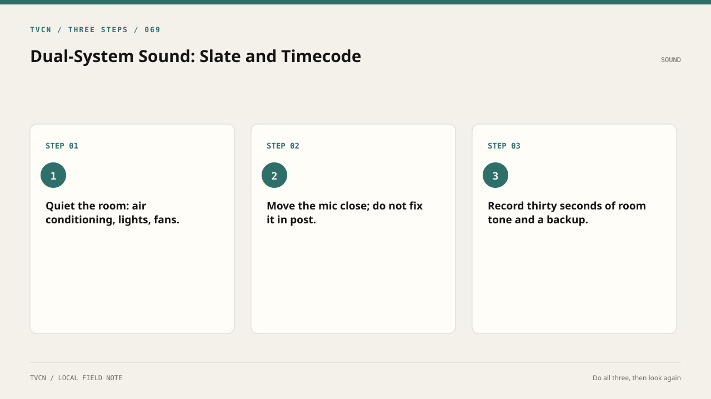

The camera mic is scratch; the external recorder captures clean dialogue. Clap or slate before rolling so both files share a sync point; do not align by camera audio alone.

<!-- DIAGRAM_START -->
<h2>Diagram</h2>
<figure>
  
  <figcaption>Watch “Clap three times at the head so camera” and “Jam timecode or announce the scene and take”; judge whether highlights, skin and sound survive together.</figcaption>
</figure>
<!-- DIAGRAM_END -->
<section><h2 id="section-1">Dual system records scratch and clean sound</h2>
Record 48 kHz/24-bit, keep raw WAV; no denoise or compression on set.
<h2 id="section-2">Limits</h2>
Dual system is not “two copies of sound.” If the lav is misplaced or gain is wrong, the clean track is also ruined; monitor on set.
</section><section><h2 id="section-3">On set</h2>
Clap three times at the head, or sync the recorder to timecode. Announce the scene number at the end of every take so post never has to guess.
</section><section><h2 id="section-4">Do this</h2>
Dual-system sound needs a clap or timecode; without either, post is guessing. Leave a sync mark at the head and tail.
<ol><li>Clap three times at the head so camera and recorder both capture it.</li><li>Jam timecode or announce the scene and take at the end of each run.</li><li>Sync on the clap frame or timecode in post, then check each take for drift.</li></ol></section><section><h2 id="section-5">Avoid</h2>
Do not rely on waveform auto-align; without a clap or timecode, drift grows as you fix it.
</section><section><h2>Judge</h2>
Three signals are observable on set:
<ul><li>highlights are not clipped and shadows keep recoverable detail</li><li>skin stays consistent across camera angles</li><li>sound has an independent track, not just the on-camera mic</li></ul></section><section><h2>Failures</h2>
These three moves erase the detail you just built:
<ul><li>exposure is right but the light has no direction</li><li>sound relies on the camera mic and dies in a noisy room</li><li>crossing the line leaves the audience without a map</li></ul></section><section><h2>Extend</h2>
<strong>10-minute exercise:</strong> Shoot three 10-second takes by the same window, changing only “Clap three times at the head so camera”. Compare highlights, skin and background; keep the one that is editable.
</section>
<h2>Check</h2><ul><li>Every take starts with three claps visible and audible.</li><li>Timecode or slate notes are complete enough for post to match audio by scene.</li><li>After sync, playback stays in lip-sync from head to tail.</li></ul>

<!-- DEEP_DIVE_START -->
## Deep dive

<strong>About 6 minutes.</strong> The real cost of dual-system sound is not the recorder; it is sync. If sync is wrong, the sound does not count.

### Shoot three things before syncing

At every setup, shoot a clap, a slate, and the timecode on camera; without timecode, the clap must be sharp and close to the mic. Write scene, shot, and take on the slate, not just the date.

Always run the camera scratch mic, even if it sounds bad. It is the last rescue track for lip sync.

### Sync without timecode

Find the waveform spike, listen for the plosive, then check the lips; one or two frames of disagreement is fine. Sync the primary audio first, then attach the other angles. On long takes, check drift every ten minutes.

Spot-check three clips after syncing: one dialogue, one action, one ambience. If all three hold, start editing; if not, go back to the script supervisor’s log.

### Timecode is not magic

Timecode saves sync time, but a battery, frame rate, or cable can make it fail quietly. Slate again after every card or battery change.

Check drift every ten minutes on long takes. Sound half a frame early makes lips look odd; half a frame late makes the gear look broken.

### Sync order for multiple cameras

Sync the primary audio first, attach camera A, then B and C. Do not sync three cameras at once or you will not know where the error started.

Rename every track scene_shot_camera_take. The editor should open the timeline and use it without guessing what “Audio 3” is.

### Ten checks before dual-system sound rolls
<ul><li>At a new setup, clap first: sharp and close to the mic</li><li>Then slate so the words are readable</li><li>Then shoot the timecode on camera</li><li>Write scene, shot, and take on the slate</li><li>Always run the camera scratch mic</li><li>Leave headroom on the recorder</li><li>Sync primary audio first on multicam</li><li>Find the waveform spike first</li><li>Then the plosive, then the lips</li><li>Check drift every ten minutes on long takes</li></ul>
Bad sync turns the best performance into a dubbing exercise. Ten seconds on set, ten hours in post. After syncing, listen to three random transitions with five seconds on each side before you continue editing. Listen first, then cut; never sync and cut at the same time.

<!-- DEEP_DIVE_END -->

<!-- SOURCES_START -->
## Sources

- [S31] ARRI Cine Systems; see the original link and use note in SOURCES.md.
- [S32] Sony 专业影像支持; see the original link and use note in SOURCES.md.

Full links and use notes: [`SOURCES.md`](../../about/).
<!-- SOURCES_END -->
