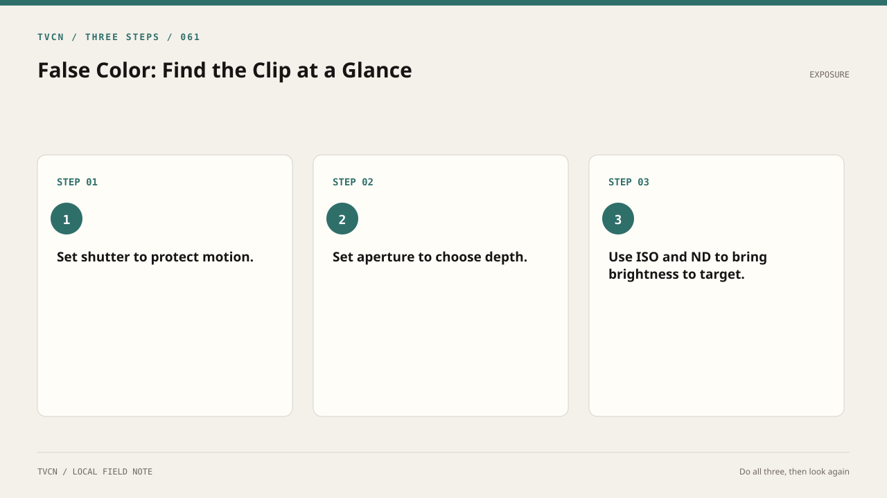

False color turns brightness into bands, so clipped skin or a dead sky is obvious at a glance.

<!-- DIAGRAM_START -->
<h2>Diagram</h2>
<figure>
  
  <figcaption>Do the three steps in order, then look again at the image or file.</figcaption>
</figure>
<!-- DIAGRAM_END -->
<h2>On set</h2>

Put the face in the skin patch and keep the sky out of red. Change the light first, not the ISO.

<h2>Do this</h2>

False color maps luminance into color blocks, so overexposed skin or a dead sky is obvious. Check skin first, then highlights.
<ol><li>Put the face in the skin-tone zone with no red warning.</li><li>Keep the sky out of red so highlight detail survives.</li><li>Change light or add ND first; do not raise ISO to compensate.</li></ol>
<h2>Avoid</h2>

Do not treat false color as a look; red is a warning, not a style.

<h2>Check</h2>
<ul><li>The face sits in the skin zone with no red patch.</li><li>Sky and windows are not red and highlights retain gradation.</li><li>The fix came from light or ND, not from pushing ISO.</li></ul>
