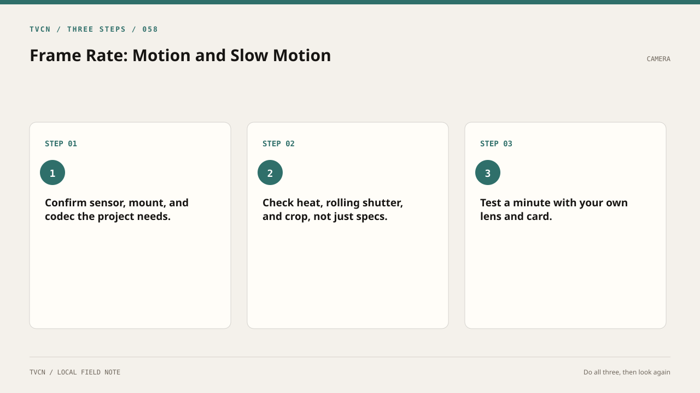

Project frame rate drives sound, captions and platform compatibility; slow motion is a capture rate. 24/25/30 is the narrative base, 60/120 for later slowdown. Do not mix base rates in one project.

<!-- DIAGRAM_START -->
<h2>Diagram</h2>
<figure>
  
  <figcaption>Watch “Shoot 25p for a 25p project; keep footage” and “For two-times slow motion, shoot 50p at 1/100”; judge whether highlights, skin and sound survive together.</figcaption>
</figure>
<!-- DIAGRAM_END -->
<section><h2 id="section-1">Set the project rate before slow motion</h2>
Choose capture rate by the slowdown: 2x needs 48/50/60; 4x needs 96/100/120.
<h2 id="section-2">Limits</h2>
High frame rate is not more cinematic. It makes action too smooth and weightless; narrative usually stays at 24/25, with slow motion only where needed.
</section><section><h2 id="section-3">On set</h2>
Shoot 25p for a 25p project. For a two-times slow motion, shoot 50p at 1/100 shutter and play back to check for flicker.
</section><section><h2 id="section-4">Do this</h2>
Frame rate decides how action feels in time. High-speed is not “slow”; it lets the audience see one instant. Decide the timeline and slow-motion factor before rolling.
<ol><li>Shoot 25p for a 25p project; keep footage and timeline matched.</li><li>For two-times slow motion, shoot 50p at 1/100 shutter.</li><li>Review for flicker and decide which second the slow-motion beat belongs to.</li></ol></section><section><h2 id="section-5">Avoid</h2>
Do not treat high-speed as a post slap-on; decide at the shoot, because stretching later stutters.
</section><section><h2>Judge</h2>
This page passes on three observable checks, not slogans:
<ul><li><strong>1.</strong> Timeline and footage frame rates match; 50p is not dropped onto a 25p timeline as normal speed.</li><li><strong>2.</strong> The slow-motion shot uses 50p at 1/100 and shows no flicker.</li><li><strong>3.</strong> Slow motion is used only where the instant matters, not as decoration.</li></ul></section><section><h2>Failures</h2>
Any one of these means stop and fix it before post:
<ul><li><strong>1.</strong> Check 1 is only staged (“Timeline and footage frame rates match; 50p is…”); another camera position or location exposes it.</li><li><strong>2.</strong> Check 2 is left to post or a verbal explanation (“The slow-motion shot uses 50p at 1/100 and sho…”); nothing on set can be rechecked.</li><li><strong>3.</strong> Do not treat high-speed as a post slap-on; decide at the shoot, because stretching later stutters.</li></ul></section><section><h2>Extend</h2>
<strong>10-minute exercise:</strong> Shoot three 10-second takes by the same window, changing only “Shoot 25p for a 25p project; keep footage”. Compare highlights, skin and background; keep the one that is editable.
</section>
<h2>Check</h2><ul><li>Timeline and footage frame rates match; 50p is not dropped onto a 25p timeline as normal speed.</li><li>The slow-motion shot uses 50p at 1/100 and shows no flicker.</li><li>Slow motion is used only where the instant matters, not as decoration.</li></ul>

<!-- DEEP_DIVE_START -->
## Deep dive

<strong>About 5 minutes.</strong> Frame rate changes the feel of time. 24 looks like cinema, 50 like television, 120 exists to pull action apart.

### Set the project rate first

Narrative uses 24 or 25; news and events use 25 or 30. Keep one rate for the whole piece, not one rate per shot.

Shutter is twice the frame rate: 1/48 or 1/50 at 24. Higher shutter makes motion look brittle.

### Do the slow-motion math

120 fps on a 24 fps timeline is five times slow. Decide the multiplier before you shoot, or you will discover it is either not enough or unwatchable.

Slow motion needs more light and a higher shutter; meter indoors before committing. Do not use slow motion to rescue action that was never designed.

### The mixed-rate trap

Mix 24 and 60 in one scene and playback stutters. Use one rate for the whole block and conform in the edit; do not cut 24 into 60.

Do not record sync sound for slow motion; dub the dialogue later. On-set audio is a reference, not a timeline track.

### When slow motion earns its place

Slow motion is for one turn: a jump, an impact, a look back. Slow the whole film and nothing is emphasized.

Before high-speed, ask what the audience needs to see. If the answer is nothing, do not slow it.

### Mark the frame rate on set

Write the frame rate on the slate and say it on the audio. Post should not guess whether the file is 24 or 120.

Put different rates in different folders and add fps to the filename. It saves one mistake at relink.

### Ten frame-rate checks before rolling
<ul><li>One frame rate for the whole piece</li><li>Shutter is twice the frame rate</li><li>Calculate the slow-motion multiplier first</li><li>Confirm enough light before high-speed</li><li>Record separate reference audio for slow motion</li><li>Mixed rates only within one block</li><li>Timeline rate matches the footage</li><li>Check whether motion blur looks natural</li><li>Write the frame rate on the slate</li><li>Play the whole piece before export</li></ul>
Higher frame rate is not better. The audience wants the right sense of time, not the biggest number.

### When you have five minutes
<ul><li>Set one rate for the piece</li><li>Shutter at twice the rate</li><li>Calculate the slow-motion factor</li><li>Confirm light before high-speed</li><li>Separate folders by rate</li><li>Write the rate on the slate</li></ul>
Frame rate is discipline before style; break the discipline and style becomes an accident. Check the project rate before the first slate; do not let the first take be wrong.

<!-- DEEP_DIVE_END -->

<!-- SOURCES_START -->
## References and further reading

- [S23] [SMPTE Standards](https://www.smpte.org/standards) — Accessed 2026-11-26. Used to check the terminology and public context in the opening paragraph (“Frame rate sets how motion feels; high speed does not slow t”) against Entry point for timecode, color, cinema and signal-chain standards; not a substitute for an on-set test.
- [S52] [ARRI: ALEXA 35](https://www.arri.com/en/camera-systems/cameras/legacy-camera-systems/alexa-35) — Accessed 2026-11-26. Used to check the terminology and public context in the opening paragraph (“Frame rate sets how motion feels; high speed does not slow t”) against Camera specifications, Log-C and colour workflow; not a substitute for an on-set test.
- [S53] [Sony: FX6](https://pro.sony/ue_US/products/handheld-camcorders/ilme-fx6v) — Accessed 2026-11-26. Used to check the terminology and public context in the opening paragraph (“Frame rate sets how motion feels; high speed does not slow t”) against Body specifications, recording formats and interfaces; not a substitute for an on-set test.
<!-- SOURCES_END -->

