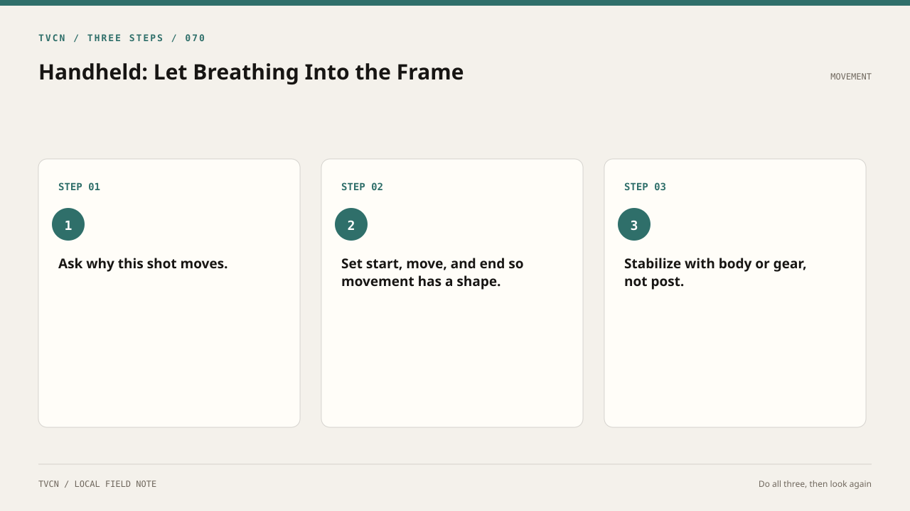

Handheld is not random shake; it turns the operator&#x27;s breath into rhythm. Stabilize the feet first, then allow movement.

<!-- DIAGRAM_START -->
<h2>Diagram</h2>
<figure>
  
  <figcaption>Watch “Stand feet shoulder-width apart and keep elbows against” and “Walk three steps in ten seconds and let”; judge whether highlights, skin and sound survive together.</figcaption>
</figure>
<!-- DIAGRAM_END -->
<section><h2 id="section-1">On set</h2>
Stand with feet shoulder-width, elbows against the ribs, and breathe between takes. Walk three steps in ten seconds and play it back: it should feel like breathing, not an earthquake.
</section><section><h2 id="section-2">Do this</h2>
Handheld is not random shake; it turns the operator's breath into rhythm. Stabilize the feet first, then allow movement.
<ol><li>Stand feet shoulder-width apart and keep elbows against the ribs; breathe between takes.</li><li>Walk three steps in ten seconds and let the body carry the camera, not the arms.</li><li>Review: it should feel like breathing, not an earthquake.</li></ol></section><section><h2 id="section-3">Avoid</h2>
Do not shake for style; movement without reason steals the performance.
</section><section><h2 id="section-4">When not to handhold</h2>
Handheld works for walking with a subject, tight spaces and reactive coverage. It does not work for long lenses, low light, repeatable track moves, or product close-ups where the viewer must read small text.

Three hard limits: focal length over 85mm, shutter slower than 1/50, or a shot that must hold readable text. If any applies, use a tripod, slider or gimbal. “Breathing” is not an excuse for shake.
</section><section><h2 id="section-5">Stance and settings</h2>
Use 24–50mm, 1/50 at 25p; do not go below 1/50 if you want natural motion blur. Set stabilisation to standard; for a pan, switch to vertical-only so it does not fight your horizontal move.
<ol><li>Feet shoulder-width, left foot slightly forward, knees soft. Wrap the strap around your wrist; right hand on the grip, left hand under the lens.</li><li>Stand still for 10 seconds and find the steadiest part of your breath. Roll at half-exhale, not at the top of an inhale.</li><li>Walk three steps and pause. Land heel first; let the body carry the camera. Turn the foot first, then the waist; do not swing the arms.</li></ol></section><section><h2 id="section-6">Moves that ruin the take</h2><ol><li>Arm swing: the frame sways and the subject looks seasick. Move the weight instead.</li><li>Walking too fast: steps outrun the breath and the frame bobs. Stretch three steps over 10 seconds.</li><li>Holding the breath: hands shake and the take ends with a gasp. Breathe normally, just smaller.</li><li>Never stopping: no pause means no edit point. Leave one steady beat every three steps.</li></ol>
If the shot follows a running actor, shoot a locked-off reference first. Do not use handheld to rescue blocking.
</section><section><h2 id="section-7">Handheld acceptance log</h2><ul><li>Shoot 10-second three-step takes at 24mm and 50mm; horizon drift under 2% of frame height.</li><li>Keep the head near the upper third; vertical drift under 2% of frame height.</li><li>Breath cycle every 3–4 seconds; no unexplained stop or acceleration.</li><li>Log body, lens, focal length, frame rate, shutter and stabilisation mode; another operator can repeat the rhythm.</li></ul></section><section><h2>Judge</h2>
Three signals are observable on set:
<ul><li>highlights are not clipped and shadows keep recoverable detail</li><li>skin stays consistent across camera angles</li><li>sound has an independent track, not just the on-camera mic</li></ul></section><section><h2>Failures</h2>
These three moves erase the detail you just built:
<ul><li>exposure is right but the light has no direction</li><li>sound relies on the camera mic and dies in a noisy room</li><li>crossing the line leaves the audience without a map</li></ul></section><section><h2>Extend</h2>
<strong>10-minute exercise:</strong> Shoot three 10-second takes by the same window, changing only “Stand feet shoulder-width apart and keep elbows against”. Compare highlights, skin and background; keep the one that is editable.
</section>
<h2>Check</h2><ul><li>Three steps in ten seconds stays even with no sudden vertical jump.</li><li>The breath comes from the body, not from arm shaking.</li><li>The horizon and the actor's head do not drift continuously.</li></ul>
