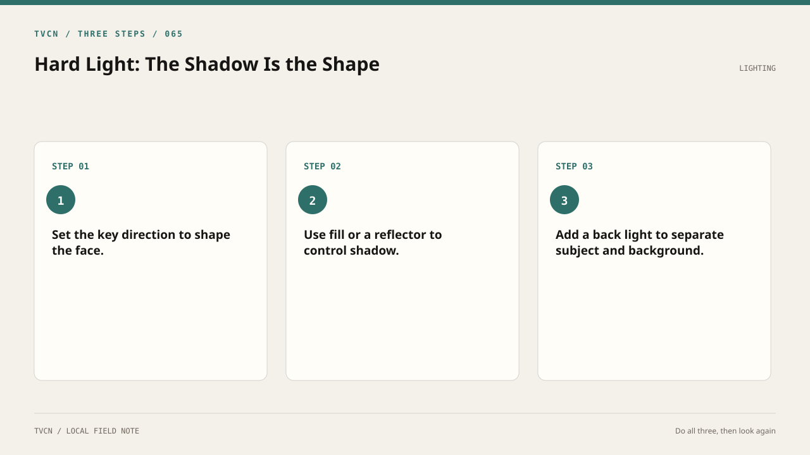

Hard light is not ugly; shadows shape the space. The problem is usually that the shadow lands in the wrong place.

<!-- DIAGRAM_START -->
<h2>Diagram</h2>
<figure>
  
  <figcaption>Do the three steps in order, then look again at the image or file.</figcaption>
</figure>
<!-- DIAGRAM_END -->
<h2>On set</h2>

Use the hard source as a side light and watch where the shadow lands. If it cuts across an eye or the mouth, move the lamp or the actor by ten centimeters.

<h2>Do this</h2>

Hard light is not “ugly”; it divides space with shadow. The usual problem is a shadow in the wrong place. Use it as side light and watch the edge.
<ol><li>Place the hard source to the side so the shadow falls on the wall or background.</li><li>Watch whether the shadow cuts across an eye or the mouth.</li><li>If it hits a feature, move the lamp or actor ten centimeters and shoot again.</li></ol>
<h2>Avoid</h2>

Do not fire hard light straight into the face; the shadow becomes a stain on the skin.

<h2>Check</h2>
<ul><li>The shadow falls on the background or wall and becomes part of the composition.</li><li>Eyes and mouth are not cut by shadow and features remain readable.</li><li>The fix moved the lamp or actor ten centimeters instead of swapping in a softbox.</li></ul>
