<!-- DIAGRAM_START -->
<h2>Diagram</h2>
<figure>
  
  <figcaption>Diagram: wall refresh, camera tracking, and engine time must share one clock. Projecting an image on a wall is not virtual production.</figcaption>
</figure>
<!-- DIAGRAM_END -->
<h2>First decision: wall or green screen</h2>
A wall suits scenes the actor can see and the light can hit: car windows, interior windows, distant ridges, interactive screens. It gives real eyelines and ambient light. Green screen suits heavy set changes, added characters, or close-ups where wall resolution is not enough; post is freer, but the set has no reference.

If the film has many close-up faces, transparent materials, or fine hair, do not use a wall just to save post. Wall resolution and moiré amplify those problems. Ask: what does the actor need to see, and is it worth building a wall for?
<h2>Wall and tracking: turn seeing into coordinates</h2>
Tracking needs camera position, focal length, and lens distortion. Camera only makes the background slide when you push in; lens only makes it drift when the camera moves. Markers cannot sit where the actor blocks them, and too many markers turn the frame into dots.

Walk a test chart through the full path before rolling: near, mid, far, tilt down, tilt up. Check the relative position of background and actor. If one position fails, the actor will break the illusion there, and post cannot recover it.
<h2>Sync and latency: the actor sees the past</h2>
The wall image takes time from engine to light, and tracking takes time to reach the engine. The actor sees a world tens of milliseconds old. With high latency, eyelines lag and blocking chases the background. Measure it: have the actor watch a moving object on the wall, shoot a take, and check lip sync and eyeline.

Wall refresh and camera shutter must match. Too fast a shutter catches scan lines; too slow smears. Start at 1/50 or 1/60, then match local mains frequency. LED refresh differs by region; do not copy a setting from another country.
<h2>Color: the wall is a light, not a monitor</h2>
Wall color temperature, brightness, and spectrum all hit the actor. Set the wall to the same white as practical light before styling the background. A blue wall makes a blue face; a bright wall becomes the key light. Meter the face, not just the monitor.

Lock the color pipeline before rolling: camera Log or RAW, engine output, wall calibration LUT, post ACES/Rec.709. Each stage needs a transform; do not put one LUT on everything. Shoot a grey card and a skin reference so post shares an anchor.
<h2>Failure case: bright wall, dark face, pasted background</h2>
A car ad set the wall bright for the background but did not fill the actor. On set the background looked rich; in post the face was three stops darker, and lifting it destroyed noise and skin. Tracking followed only the camera, so the background scaled on the push-in and the window edge looked pasted.

The fix was two stops down on the wall, a soft fill on the actor, and a re-shoot of the push-in. The extra cost was not a light; it was rebuilding the wall and rebooking the actor. Wall brightness serves the face first, the background second.
<h2>Cost and acceptance</h2>
Low: small-pitch wall, locked camera, 2D background, ¥15,000–40,000/day. Mid: tracking, real-time engine, sync, color management, ¥40,000–100,000/day. High: multicam, complex interaction, on-set comp team, ¥100,000–300,000/day. Excludes content, cast, and venue.
<h2>Check</h2><ul><li>The background the actor must see is worth a wall.</li><li>Tracking records camera, focal length, and distortion.</li><li>Latency is tested with a moving object and lip sync.</li><li>Wall refresh matches shutter with no scan lines.</li><li>Wall color and brightness serve the face first.</li><li>Each color stage has a transform, with grey-card and skin references.</li></ul>
<!-- SOURCES_START -->
<h2>Sources</h2>

Experience: TVCN field notes and project reviews; tested: the review setup and reproducible exercises noted on the page; references: public links below.

<ul><li>[S23] SMPTE Standards</li><li>[S31] ARRI Technical Documentation</li><li>[S32] Sony Pro Support</li><li>[S33] Canon Support</li></ul>

<a href="../../SOURCES.md">Full links and notes in SOURCES.md</a>

<!-- SOURCES_END -->
