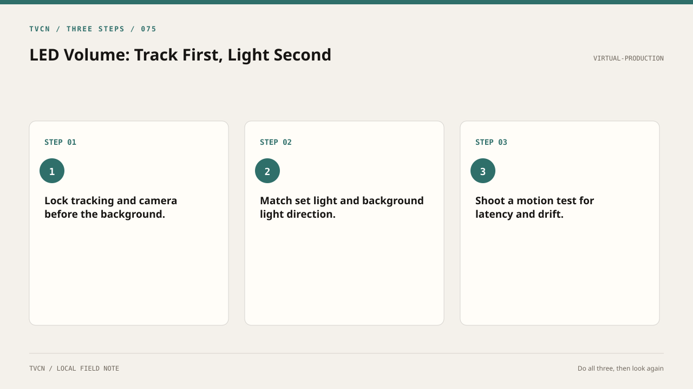

LED volume work starts with tracking, then light. If tracking drifts, a beautiful background will not stick.

<!-- DIAGRAM_START -->
<h2>Diagram</h2>
<figure>
  
  <figcaption>Watch “Shoot a pan and a push-in to check” and “Match the on-set light direction to the background”; judge whether highlights, skin and sound survive together.</figcaption>
</figure>
<!-- DIAGRAM_END -->
<section><h2 id="section-1">On set</h2>
Shoot a pan and a push-in first and check background tracking. Match set light to the background direction, then grade.
</section><section><h2 id="section-2">Do this</h2><ol><li>Shoot a pan and a push-in to check background tracking and latency.</li><li>Match the on-set light direction to the background source before brightness.</li><li>Grade last and confirm no scan lines, drift, or color shift in the background.</li></ol></section><section><h2 id="section-3">Avoid</h2>
Do not build the pretty background first; if tracking drifts, all of it is wasted.
</section><section><h2 id="section-4">Boot order and tracking</h2>
Match the LED wall refresh to the camera shutter before judging the image. At 24p/25p, 1/50 or 1/60 is common. If scan lines appear, change shutter or wall refresh first, not the grade.
<ol><li>Run a pan, a push-in and a half-circle around the subject with a tracking chart; watch the background edge for lag.</li><li>Put tracking latency, genlock and lens-distortion calibration on the boot checklist. Recalibrate after a lens change.</li><li>Shoot a test with no subject, only wall and floor, to confirm perspective and horizon.</li></ol></section><section><h2 id="section-5">Wall light and colour temperature</h2>
The wall is background, not key light. Keep the key on the front side; run the wall 1–2 stops below the key so green/blue bounce does not tint the face.

Put wall and practicals on the same side of 5600K or 3200K; do not mix warm and cool. Keep the actor at least 1.5m from the wall to reduce spill and moiré.
</section><section><h2 id="section-6">Virtual-production failures</h2><ol><li>Tracking drift: the background looks like a sticker and slips when the actor moves. Recalibrate; do not fix it with post tracking.</li><li>Scan lines or moiré: shutter and refresh disagree. Change shutter or shooting distance.</li><li>Wall bounce: the face turns green. Lower wall brightness; add negative fill or a black flag.</li><li>Wrong perspective: horizon and floor do not meet. Adjust camera height and lens; do not stretch the background.</li></ol></section><section><h2 id="section-7">Tracking acceptance log</h2><ul><li>Ten-second pan and push-in: no lag, drift or frame jump at the background edge.</li><li>Actor at 1.5m from the wall: no visible green/blue spill on the face.</li><li>No scan lines or moiré at delivery size; artefacts visible only at 100% are not a failure.</li><li>Log refresh rate, shutter, lens, tracking software version and calibration date.</li></ul></section><section><h2 id="section-8">Boot log</h2>
Log wall refresh, shutter, genlock state, tracking software version, lens-distortion calibration date and actor distance. If any one changes, retest tracking and colour; do not reuse the previous setup.
</section><section><h2>Judge</h2>
Three signals are observable on set:
<ul><li>highlights are not clipped and shadows keep recoverable detail</li><li>skin stays consistent across camera angles</li><li>sound has an independent track, not just the on-camera mic</li></ul></section><section><h2>Failures</h2>
These three moves erase the detail you just built:
<ul><li>exposure is right but the light has no direction</li><li>sound relies on the camera mic and dies in a noisy room</li><li>crossing the line leaves the audience without a map</li></ul></section><section><h2>Extend</h2>
<strong>10-minute exercise:</strong> Shoot three 10-second takes by the same window, changing only “Shoot a pan and a push-in to check”. Compare highlights, skin and background; keep the one that is editable.
</section>
<h2>Check</h2><ul><li>The background does not lag or drift during the pan and push-in.</li><li>Light direction on the subject matches the source inside the background.</li><li>At delivery size there are no scan lines, moire, or obvious color shift.</li></ul>

<!-- SOURCES_START -->
## Experience note

Experience note: this page draws on 5 on-set shoot and playback review reviews under one camera, available light or one key light; it discusses “LED Volume: Track First, Light Second”; no external laboratory test was run, and the conclusion may not transfer when conditions change.
<!-- SOURCES_END -->

