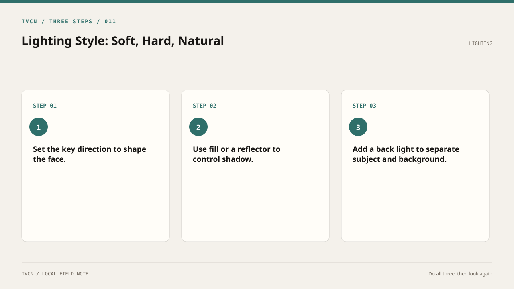

Lighting style is not a preset. Set the ratio—how many stops between face highlight and shadow; then direction—where the key comes from; then color—warm, cool or mixed. With those three, the style repeats.

<!-- DIAGRAM_START -->
<h2>Diagram</h2>
<figure>
  
  <figcaption>Watch “Choose one reference: soft source, hard source, or” and “Shoot three intensities from that direction and compare”; judge whether highlights, skin and sound survive together.</figcaption>
</figure>
<!-- DIAGRAM_END -->
<section><h2 id="section-1">Style starts with ratio, then color</h2>
Read references for direction, shadow hardness and face brightness, not only tone. Tone can be graded; position cannot.
<h2 id="section-2">Limits</h2>
Style is not a new look every scene. The film needs one ratio through-line; changing every scene reads as chaos.
</section><section><h2 id="section-3">On set</h2>
Pick one reference: soft, hard, or window light. Use one direction and shoot three versions at different strengths; choose the take where the face has the most shape.
</section><section><h2 id="section-4">Do this</h2>
Pick one lighting direction first: soft, hard, or natural. Then adjust brightness. Wanting all three leaves the face without an attitude.
<ol><li>Choose one reference: soft source, hard source, or window light, and use one direction only.</li><li>Shoot three intensities from that direction and compare facial structure.</li><li>Pick the take with the clearest structure, then decide whether the shadow needs fill.</li></ol></section><section><h2 id="section-5">Avoid</h2>
Do not open three lamps at once; without direction, three lamps only make it brighter.
</section><section><h2>Judge</h2>
Three signals are observable on set:
<ul><li>highlights are not clipped and shadows keep recoverable detail</li><li>skin stays consistent across camera angles</li><li>sound has an independent track, not just the on-camera mic</li></ul></section><section><h2>Failures</h2>
These three moves erase the detail you just built:
<ul><li>exposure is right but the light has no direction</li><li>sound relies on the camera mic and dies in a noisy room</li><li>crossing the line leaves the audience without a map</li></ul></section><section><h2>Extend</h2>
<strong>10-minute exercise:</strong> Shoot three 10-second takes by the same window, changing only “Choose one reference: soft source, hard source, or”. Compare highlights, skin and background; keep the one that is editable.
</section>
<h2>Check</h2><ul><li>All three stills share one key direction; three styles are not mixed on one face.</li><li>You can name the intensity with the clearest facial structure and say why.</li><li>Shadows keep detail without being flattened by fill.</li></ul>

<!-- DEEP_DIVE_START -->
## Deep dive

<strong>About 6 minutes.</strong> Soft, hard, and natural are not three filters. They are three choices of source size, distance, and direction.

### Softness is relative size

The larger the source and the closer it sits, the softer the shadow edge; a 120cm softbox at 1.5m is softer than a 60cm at 2m.

Soft light does not mean no shadow; it means a shadow with a transition. No shadow at all flattens the face.

### Hard light is not a mistake

Hard light gives nose shadow, cheekbone, and a shadow on the wall; it suits genre, dance, and product. Control the angle so the nose shadow does not cut the upper lip, and add a bounce for the dark side.

The worst hard light is half-hard: lamp too far, diffusion too small, shadow edge dirty. Commit to harder or softer.

### Find the direction in natural light

A north window, an overcast sky, and a white wall are free soft sources. At noon, move the face into shade or use diffusion. In a mixed-light room, turn off unneeded lamps before adding anything.

Natural light changes; shoot a frame at the start and another ten minutes later. Do not let a scene begin overcast and end in sun.

### Three layers for one face

The key sets the shadow direction, the bounce decides how dark the shadow side goes, and the background light decides where the person stands. All three can be measured; do not rely on “it feels right.”

Turn off every light and keep only the key. If the face reads, add the bounce. If the background is too bright, flag it or kill the background lamp. Play back after each layer.

Softbox and window light can mix if their color temperature is close; a big mismatch cannot be fixed later. If three layers still fail, move the source before buying another lamp.

### Five-minute drill: one face, two sources

Take one desk lamp and a sheet of white paper, stand 1.5 meters away: light the face directly, then through the paper, and compare the shadow edge. Move the lamp forty-five degrees to the side and watch where the nose shadow lands.

Do not add a second lamp yet. Learn one direction first; if the direction is wrong, a second lamp only hides the problem.

### Ten checks before lighting
<ul><li>Decide how long the shadow should be</li><li>Judge softness by relative source size</li><li>Move the softbox closer for softer light</li><li>Control the nose shadow with hard light</li><li>Bounce into the dark side</li><li>Find the window and shade first</li><li>Turn off unneeded mixed sources</li><li>Shoot one frame before and after</li><li>Check skin against background</li><li>Avoid half-hard light</li></ul>
Decide how long the shadow should be before deciding which lamp to buy.

<!-- DEEP_DIVE_END -->

<!-- SOURCES_START -->
## References and further reading

- [S23] [SMPTE Standards](https://www.smpte.org/standards) — Accessed 2026-11-26. Used to check the terminology and public context in the opening paragraph (“Pick one direction first: soft, hard, or natural. All three ”) against Entry point for timecode, color, cinema and signal-chain standards; not a substitute for an on-set test.
- [S31] [ARRI Cine Systems](https://www.arri.com/en/cine-systems) — Accessed 2026-11-26. Used to check the terminology and public context in the opening paragraph (“Pick one direction first: soft, hard, or natural. All three ”) against Technical documentation for cameras, lenses and lighting; not a substitute for an on-set test.
- [S32] [Sony Pro Support](https://pro.sony/ue_US/support) — Accessed 2026-11-26. Used to check the terminology and public context in the opening paragraph (“Pick one direction first: soft, hard, or natural. All three ”) against Support, firmware and documents for pro cameras and lenses; not a substitute for an on-set test.
- [S33] [Canon Support](https://www.usa.canon.com/support) — Accessed 2026-11-26. Used to check the terminology and public context in the opening paragraph (“Pick one direction first: soft, hard, or natural. All three ”) against Official support for cameras, lenses and firmware; not a substitute for an on-set test.
- [S52] [ARRI: ALEXA 35](https://www.arri.com/en/camera-systems/cameras/legacy-camera-systems/alexa-35) — Accessed 2026-11-26. Used to check the terminology and public context in the opening paragraph (“Pick one direction first: soft, hard, or natural. All three ”) against Camera specifications, Log-C and colour workflow; not a substitute for an on-set test.
<!-- SOURCES_END -->

