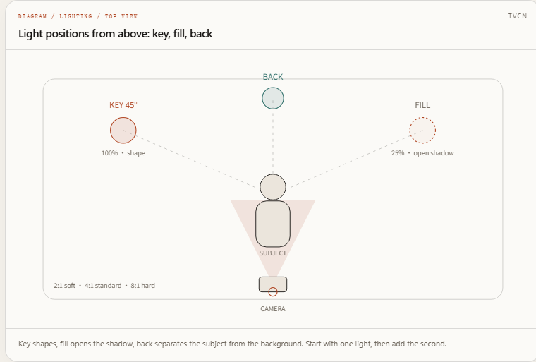

<!-- DIAGRAM_START -->
## Diagram

<figure>
  
  <figcaption>Key shapes, fill opens the shadow, back separates the subject from the background. Start with one light, then add the second.</figcaption>
</figure>
<!-- DIAGRAM_END -->

One key and one reflector can shoot most portrait scenes. Control the contrast first, then collect positions.

## The key shapes the face

Place the key about 45 degrees to one side of the face and slightly above eye level. Hard light reveals structure; soft light smooths. Choose the quality first, then the intensity.

The key is not “as bright as possible.” It has to relate to the background and ambient light. One stop brighter than the background is often enough to separate a face.

## Three useful ratios

1:1 is flat, clear, and good for comedy or teaching. 2:1 has shape and is the most useful default. 4:1 deepens shadows for mystery, night scenes, and secrets.

Ratio is the brightness difference between key and fill, not the number of lamps. Without a fill light, use a reflector or negative fill (a black flag) to bring the shadow side down.

## Window light plus a reflector

Place the subject near a window with light coming from one side. Put a white board or foam core on the other side to lift the shadow. Shoot a take, then decide whether to add a black flag.

Do not buy lights first. Window light already has color and direction; you only need to control its size and contrast.

## Three checks

- You can explain the mood of 1:1, 2:1, and 4:1.
- Key and fill have a deliberate brightness difference.
- Without a fill light, you can use a reflector or black flag.
<!-- SOURCES_START -->
<h2>Sources</h2>

Experience: TVCN field notes and project reviews; tested: the review setup and reproducible exercises noted on the page; references: public links below.

<ul><li>[S23] SMPTE Standards</li><li>[S31] ARRI Technical Documentation</li><li>[S32] Sony Pro Support</li><li>[S33] Canon Support</li></ul>

<a href="../../about/">Full links and notes in SOURCES.md</a>

<!-- SOURCES_END -->
