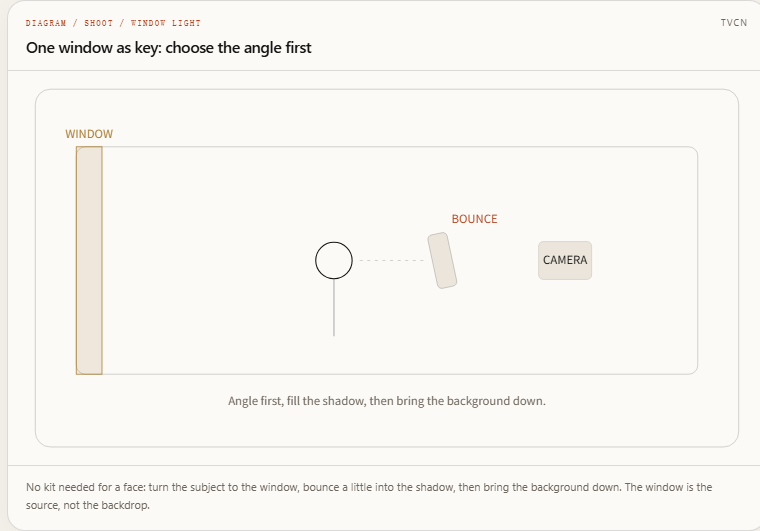

<!-- DIAGRAM_START -->
## Diagram

<figure>
  
  <figcaption>No kit needed for a face: turn the subject to the window, bounce a little into the shadow, then bring the background down. The window is the source, not the backdrop.</figcaption>
</figure>
<!-- DIAGRAM_END -->

## Turn the face, not the window

Ask the subject to turn slowly toward the window until the nose shadow falls on one cheek. Facing the window flat is boring; facing away is dark. Thirty to forty-five degrees is the reliable zone.

Direct sun is too hard; add a sheer curtain or a white cloth. An overcast window is often easier: soft face, still some background separation.

## Keep the bounce low

Bounce from chest height and the shadow softens; hold it above the head and the face gets two top lights. A white wall, paper, or foam board works; you do not need a professional reflector.

Fill only the shadow side, and do not bring it up to the bright side. One stop of difference keeps the face dimensional.

## Take the background one stop down

Close the curtain behind the subject or kill the overhead light in the background. A bright face against a darker background creates depth; equal brightness makes the person look pasted on.

If the background cannot change, choose a darker angle or move the subject half a meter forward. With available light, moving the person is easier than moving the light.

## Three checks

- The nose shadow falls on one side only.
- The shadow side has detail without matching the bright side.
- The background is darker than the face, so the subject separates.

<!-- V11_DEEPEN -->

<section><h2>Boundary</h2>
This page only covers “How to Use One Window as Your Key Light”; it does not replace Wireless Lav: Hide It, Back It Up, Cross the Line and the Room Disappears, Color: Match First, Style Second. When the problem belongs to one of those pages, use that page instead of adding more parameters here.
</section>
<!-- DEEP_DIVE_START -->
## Deep dive

<strong>About 7 minutes.</strong> This section does not repeat the method above. It adds three things: two conditions, a counterexample and a reusable model, so you can decide when to change the method.

### Condition A: one window, small room

In a one-window room, first decide which side the window is on. Forty-five degrees side-front is the safest, side-back is more dramatic, side-on gives volume. Do not face the person into the window; the face flattens and the eye socket loses shadow. Let the window hit the nose bridge and one cheek, then lift the other side half a stop with a reflector.

Do not put the reflector directly opposite the face; it creates a second catchlight. Put it on the shadow side, angled up. Closer is softer, farther is harder; try three positions and compare ten seconds.

### Condition B: mixed light or overcast

In mixed light, decide which source is key. Cool window and warm room lamp: pick one as key and the other as fill; do not let both be key. If the window is key, turn off or match the room lamp; if the lamp is key, curtain the window to reduce its strength.

Overcast window light is soft but directionless; flag one side with black to create direction. The flag is not to darken the frame; it is to give the face contrast. On an overcast day, contrast matters more than brightness.

### Counterexample: the window behind the subject

To show “the city outside”, the camera faces the window and the person sits with their back to it. The window is beautiful, the face is black; brightening in post clips the background and adds noise to the face. The audience watches the city, not the person.

The fix is not losing the window; change the relationship. Turn the person sideways to the window and shoot from the side, leaving the window at the edge. It is still the background, but the face has light; the city does not need the whole frame, a corner is enough.

### Reusable model

<strong>Direction → ratio → colour → background.</strong> Give the person an angle to the window, control face-to-background contrast, match colour, then decide how much window is in frame. Follow the order; do not start by closing the curtain.

Every camera move redoes direction; window light does not follow the camera. A new angle can turn side light into backlight; without redoing it, the scene breaks.

<!-- DEEP_DIVE_END -->

<!-- SOURCES_START -->
## References and further reading

- [S31] [ARRI: Cine Systems](https://www.arri.com/en/cine-systems) — Accessed 2026-11-26. Used to check the terminology/method/rule in the “Turn the face, not the window” section against ARRI camera, lens and lighting documentation, not a general shooting tutorial; it does not verify numbers, model choices or on-set conclusions derived from this page, and is not a substitute for a test.
- [S23] [SMPTE: Standards](https://www.smpte.org/standards) — Accessed 2026-11-26. Used to check the terminology/method/rule in the “Keep the bounce low” section against SMPTE standards portal, not specific camera specs; it does not verify numbers, model choices or on-set conclusions derived from this page, and is not a substitute for a test.
<!-- SOURCES_END -->

