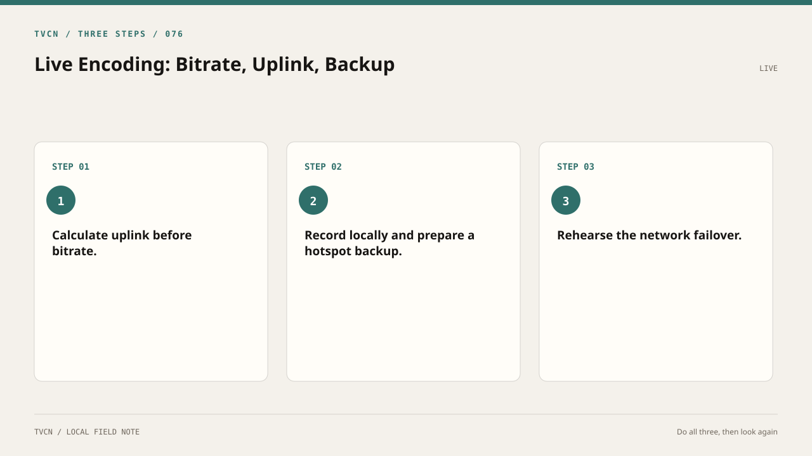

Calculate uplink before bitrate, and always keep a local recording as backup.

<!-- DIAGRAM_START -->
<h2>Diagram</h2>
<figure>
  
  <figcaption>Do the three steps in order, then look again at the image or file.</figcaption>
</figure>
<!-- DIAGRAM_END -->
<h2>On set</h2>

Measure upload speed first: you need 1.5 times the target bitrate for headroom. Set a primary stream and a hotspot backup, and record a local high-bitrate copy.

<h2>Do this</h2>

Live encoding starts with uplink bandwidth, then bitrate. Always keep a local recording as backup.
<ol><li>Measure upload speed; 1.5 times the target bitrate is the safe margin.</li><li>Set a primary stream, a hotspot backup, and a high-bitrate local recording.</li><li>Rehearse a disconnection and record the dropout time and recovery steps.</li></ol>
<h2>Avoid</h2>

Do not run one path or treat the stream as one-shot; a dropout kills more than soft image quality.

<h2>Check</h2>
<ul><li>Uplink is at least 1.5 times the target bitrate and the margin is recorded.</li><li>When the primary drops, the hotspot backup and local recording still run.</li><li>The rehearsal log shows the dropout time, cause, and recovery duration.</li></ul>
