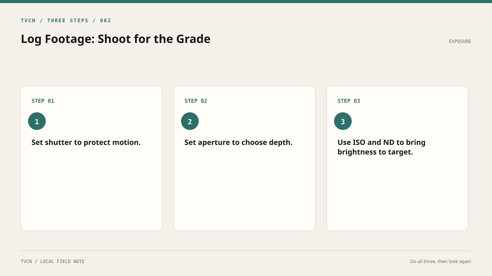

Log is not "flat looks pro"; it preserves highlights and shadows for post, if exposure and color are handled.

<!-- DIAGRAM_START -->
<h2>Diagram</h2>
<figure>
  
  <figcaption>Do the three steps in order, then look again at the image or file.</figcaption>
</figure>
<!-- DIAGRAM_END -->
<h2>On set</h2>

Expose the face slightly above middle grey and use the waveform to keep highlights off the ceiling. Shoot a color chart before the take so post has a reference.

<h2>Do this</h2>

Log is not a “flat look”; it reserves highlight and shadow range for post, provided exposure and color management are right. Shoot for the grade.
<ol><li>Expose the face slightly above middle gray and confirm on the waveform.</li><li>Keep highlights below the ceiling; do not blow the sky for a brighter face.</li><li>Shoot a color chart before rolling to give post a transform reference.</li></ol>
<h2>Avoid</h2>

Do not treat a flat image as a style; without correct exposure and color management, Log is harder to rescue.

<h2>Check</h2>
<ul><li>Skin sits slightly above middle gray, shadows are not crushed, and highlights are unclipped.</li><li>A color chart was shot for every setup and post can apply one transform.</li><li>You can state the exposure intent of the Log take instead of “we'll fix it later.”</li></ul>
