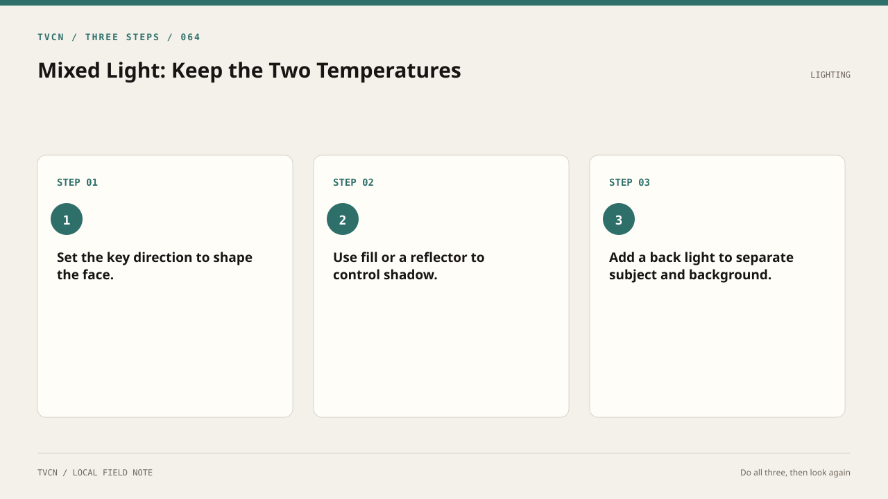

Do not white-balance mixed light into one color; keep the cool window and warm bulb for depth.

<!-- DIAGRAM_START -->
<h2>Diagram</h2>
<figure>
  
  <figcaption>Do the three steps in order, then look again at the image or file.</figcaption>
</figure>
<!-- DIAGRAM_END -->
<h2>On set</h2>

With 5600K daylight outside and 3200K bulbs inside, do not force one white. Keep the window cool, the bulb warm, and the face in between.

<h2>Do this</h2>

Do not white-balance mixed light into one flat white; keep the cool window and warm bulb so the room has depth. Decide which source leads, then place the face between them.
<ol><li>With 5600K daylight outside and 3200K bulbs inside, do not force one white balance.</li><li>Let the window stay cool and the bulb stay warm.</li><li>Balance the face in between so skin does not follow the background.</li></ol>
<h2>Avoid</h2>

Do not white-balance every source to white; fighting temperatures flatten the room.

<h2>Check</h2>
<ul><li>The frame shows a cool window and a warm bulb as an intentional contrast.</li><li>Skin stays neutral without a green or yellow cast on one side.</li><li>One white balance was not used to erase both sources into one color.</li></ul>
