<!-- DIAGRAM_START -->
<h2>Diagram</h2>
<figure>
  
  <figcaption>Diagram: every signal needs a source, a record, and a monitor. A program feed without ISO recording is not multicam.</figcaption>
</figure>
<!-- DIAGRAM_END -->
<h2>First decision: when multicam is worth it</h2>
Use multicam only when something happens once and cannot be repeated: a ceremony, a match, a performance; when a continuous take matters; or when someone must switch live for an audience. An interview that merely wants another angle is cheaper and safer shot twice with one camera.

Write a camera-role sheet: A holds the wide and the main action, B holds reactions and close-ups, C holds inserts, hands, or roams. Each camera answers one question so the director knows when to cut. Three medium shots are one camera.
<h2>Signal chain: draw the interfaces before the frames</h2>
Draw the chain on one page: where each camera leaves, which switcher it enters, where it records, and which monitor gets return. Consumer HDMI connectors have no lock and fail when bumped; use SDI where possible, and add a locking sleeve plus a spare HDMI cable where not. Test any run over 15 metres before dressing the set.

Keep program and ISO recording separate: program is what the audience sees; clean ISO is what post can rescue. Program only leaves no second choice; ISO only means no one sees the finished show. Two recorders, two cards—not one card counted twice.
<h2>Timecode and sync: put three cameras on one timeline</h2>
The most expensive multicam error is not composition; it is three tracks that do not align. Use one timecode generator when possible. If not, clap in front of every camera and align by audio waveform in post. That is a rescue, not a workflow.

Lock frame rate, shutter, and white balance before rolling. Mixed frame rates confuse switchers and recorders; mixed white balance makes skin jump on every cut. Shoot ten seconds of the same grey card on every camera so post has one manual anchor.
<h2>On set: rehearsal, return, and failure drills</h2>
Run one full rehearsal before recording: the director calls “camera three standby,” every operator answers, tally lights, and return appears. Without this, everyone hunts for their own frame when the show starts. Put return where the operator can see it without turning away from the lens.

Prepare three failure plans: which cable replaces a dead one, who takes over a dead camera, and what covers a lost audio feed. Put names on the plan, not “everyone watch out.” Live has no retake, only cuts.
<h2>Failure case: three cameras became three separate films</h2>
A two-hour industry forum used three cameras with no timecode and audio only on A. The show looked fine on set; in post, B and C drifted twelve seconds, applause no longer matched, and every cut was off. The fix was to rebuild on A audio and discard most of B and C.

The real cost was not one timecode cable; it was three people aligning waveforms for two days. Put “sync test” in the multicam budget, or the saved cable money returns double in post.
<h2>Cost and acceptance</h2>
Low: one switcher, two cameras, camera audio, ¥3,000–8,000/day for an internal stream. Mid: three cameras, SDI, timecode, separate audio, ISO record, ¥8,000–20,000/day. High: four-plus cameras, director team, comms, return, dual recorders, ¥20,000–60,000/day. Excludes venue, dedicated network, and travel.
<h2>Check</h2><ul><li>Every camera has one role, and at least one holds the wide.</li><li>All cameras share frame rate, shutter, and white balance.</li><li>Timecode or clap sync is proven in rehearsal.</li><li>Program and ISO record separately, with two cards or recorders.</li><li>Tally, return, and comms are rehearsed at least once.</li><li>Failure plan names people and replacement cables.</li></ul>
<!-- SOURCES_START -->
<h2>Sources</h2>

Experience: TVCN field notes and project reviews; tested: the review setup and reproducible exercises noted on the page; references: public links below.

<ul><li>[S23] SMPTE Standards</li><li>[S31] ARRI Technical Documentation</li><li>[S32] Sony Pro Support</li><li>[S33] Canon Support</li></ul>

<a href="../../SOURCES.md">Full links and notes in SOURCES.md</a>

<!-- SOURCES_END -->
