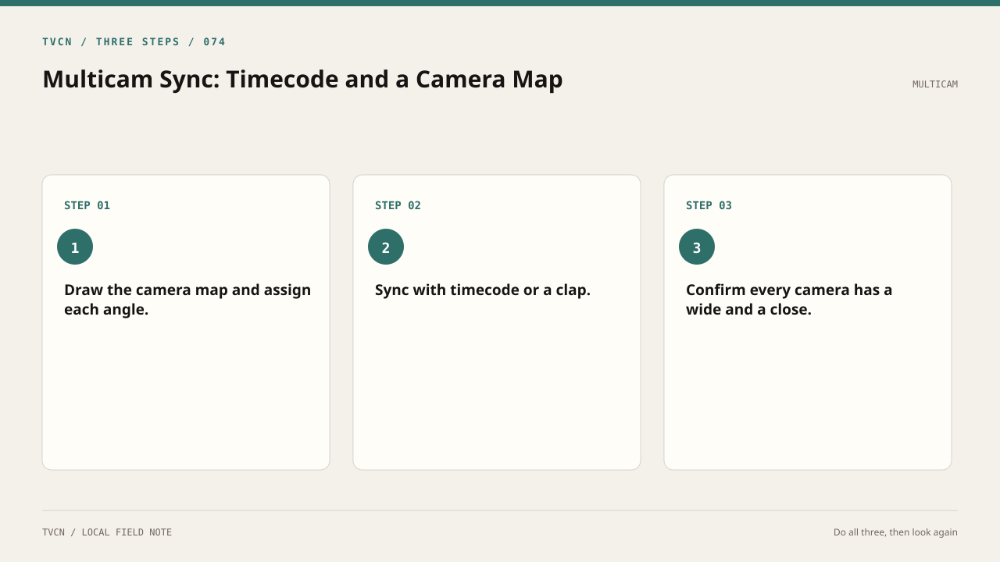

Draw the camera map, then sync timecode. The edit must know which camera stood where.

<!-- DIAGRAM_START -->
<h2>Diagram</h2>
<figure>
  
  <figcaption>Do the three steps in order, then look again at the image or file.</figcaption>
</figure>
<!-- DIAGRAM_END -->
<h2>On set</h2>

Draw a top-down camera map and mark what A, B, and C cover. Sync by timecode or a clap; the editor uses the map to find the take.

<h2>Do this</h2>

Multicam starts with a camera map, then timecode. The edit must know where each camera stood. Two cameras on the same size is repetition, not coverage.
<ol><li>Draw a top-down map and label what size A, B, and C shoot.</li><li>Sync by timecode or clap and confirm all three angles align.</li><li>Check that each camera contributes different information, not the same size.</li></ol>
<h2>Avoid</h2>

Do not put two cameras on the same size; multicam is not duplicate cam.

<h2>Check</h2>
<ul><li>The map shows what A, B, and C each cover with no duplicate size.</li><li>All three angles align frame-accurately on the timeline.</li><li>Each angle offers different information, so cuts have a reason.</li></ul>
