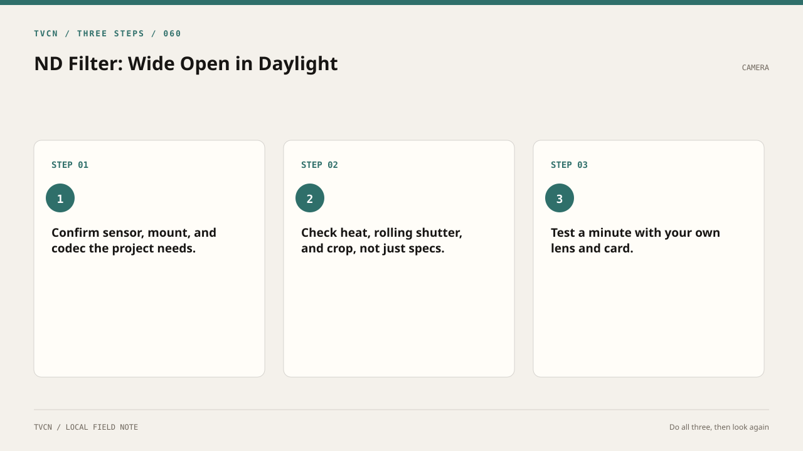

ND restores a cinematic shutter without overexposure. Calculate the gap from target aperture, 1/50 shutter and current ISO, then choose the filter; do not guess by “it looks dark.”

<!-- DIAGRAM_START -->
<h2>Diagram</h2>
<figure>
  
  <figcaption>Watch “At noon, f/2.8, ISO 100, start with a” and “If shutter is still above 1/50, add 3”; judge whether highlights, skin and sound survive together.</figcaption>
</figure>
<!-- DIAGRAM_END -->
<section><h2 id="section-1">Calculate ND stops, then check IR</h2>
Strong ND can cause IR cast, turning black fabric purple. Use IR-suppressed ND or shoot a color chart comparison.
<h2 id="section-2">Limits</h2>
ND is not a substitute for stopping down. It matters when you need F1.4; at F8, stop the lens first and then consider ND.
</section><section><h2 id="section-3">On set</h2>
At noon, f/2.8, ISO 100, start with a 6-stop ND. If the shutter is still above 1/50, add 3 stops. On a variable ND, twist to the lightest setting first to avoid the cross pattern.
</section><section><h2 id="section-4">Do this</h2>
ND is not about darkening the image; it lets you hold a wide aperture and shallow depth in daylight. Set shutter and aperture first, then calculate the stops.
<ol><li>At noon, f/2.8, ISO 100, start with a 6-stop ND.</li><li>If shutter is still above 1/50, add 3 stops until it returns to target.</li><li>With a variable ND, start at the lightest setting and increase gradually to avoid cross patterns.</li></ol></section><section><h2 id="section-5">Avoid</h2>
Do not add ND and leave aperture or shutter uncorrected; do not crank a variable ND to its darkest setting.
</section><section><h2>Judge</h2>
Three signals are observable on set:
<ul><li>highlights are not clipped and shadows keep recoverable detail</li><li>skin stays consistent across camera angles</li><li>sound has an independent track, not just the on-camera mic</li></ul></section><section><h2>Failures</h2>
These three moves erase the detail you just built:
<ul><li>exposure is right but the light has no direction</li><li>sound relies on the camera mic and dies in a noisy room</li><li>crossing the line leaves the audience without a map</li></ul></section><section><h2>Extend</h2>
<strong>10-minute exercise:</strong> Shoot three 10-second takes by the same window, changing only “At noon, f/2.8, ISO 100, start with a”. Compare highlights, skin and background; keep the one that is editable.
</section>
<h2>Check</h2><ul><li>At wide aperture in daylight, shutter stays near 1/50 and depth of field is not sacrificed.</li><li>The variable ND shows no cross pattern or color shift.</li><li>Highlights are protected without underexposing the whole frame.</li></ul>

<!-- DEEP_DIVE_START -->
## Deep dive

<strong>About 5 minutes.</strong> ND is daylight aperture insurance. Without it you either overexpose or stop down until the depth of field disappears.

### Shutter first, aperture second

Outside in daylight, set a 180-degree shutter; if you want a wide aperture, you need ND. Calculate total light first, then choose the strength; do not buy a filter and look for an exposure afterward.

Do not use a high shutter to control exposure; motion turns brittle. ND returns the shutter to its natural place; it is not decoration.

### How the stops add up

One stop halves the light; two stops cut three quarters. On a variable ND, screw to maximum density first, then back to the target, to avoid the cross shadow.

Minimum density differs by lens, and wides vignette sooner. Test every lens before the shoot, not on location.

### Color cast and infrared

Cheap ND goes green or magenta, and white balance cannot fully save it. Shoot a gray card and correct later; if it is severe, change the filter.

Black synthetics turn purple in strong sun from infrared pollution. Add an IR cut or change the filter; do not force the blacks in post.

### ND and polarizers are different

ND cuts all light; a polarizer cuts reflections. Water and glass need a polarizer; a wide aperture needs ND.

Stack ND first, then the polarizer; reverse the order and you get vignetting.

### Recheck after a lens change

The same ND passes different light on different lenses, especially fast ones. Meter again after a lens change.

A zoom can differ from wide to long end; test one frame at each before the take.

### Ten checks before adding ND
<ul><li>Set shutter before aperture</li><li>Calculate total light</li><li>Remember one stop halves the light</li><li>Screw variable ND to maximum first</li><li>Test wides for vignetting</li><li>Shoot a gray card</li><li>Check for green or magenta</li><li>Check black synthetics for infrared</li><li>Clean both sides of the filter</li><li>Meter again after a lens change</li></ul>
Use ND well and the audience sees shallow depth; use it badly and they see a color cast and vignette.

### When you have five minutes
<ul><li>Shutter first, aperture second</li><li>Calculate total light</li><li>Screw variable ND to maximum</li><li>Test wides for vignetting</li><li>Shoot a gray card</li><li>Clean both sides of the filter</li></ul>
ND returns the image to natural exposure; it is not a decoration that makes the frame darker. Price is not the test; first confirm no color cast and no vignette. Look again before and after a lens change.

<!-- DEEP_DIVE_END -->

<!-- SOURCES_START -->
## References and further reading

- [S23] [SMPTE Standards](https://www.smpte.org/standards) — Accessed 2026-11-26. Used to check the terminology and public context in the opening paragraph (“An ND filter does not darken a picture; it lets you stay wid”) against Entry point for timecode, color, cinema and signal-chain standards; not a substitute for an on-set test.
- [S52] [ARRI: ALEXA 35](https://www.arri.com/en/camera-systems/cameras/legacy-camera-systems/alexa-35) — Accessed 2026-11-26. Used to check the terminology and public context in the opening paragraph (“An ND filter does not darken a picture; it lets you stay wid”) against Camera specifications, Log-C and colour workflow; not a substitute for an on-set test.
- [S53] [Sony: FX6](https://pro.sony/ue_US/products/handheld-camcorders/ilme-fx6v) — Accessed 2026-11-26. Used to check the terminology and public context in the opening paragraph (“An ND filter does not darken a picture; it lets you stay wid”) against Body specifications, recording formats and interfaces; not a substitute for an on-set test.
<!-- SOURCES_END -->

