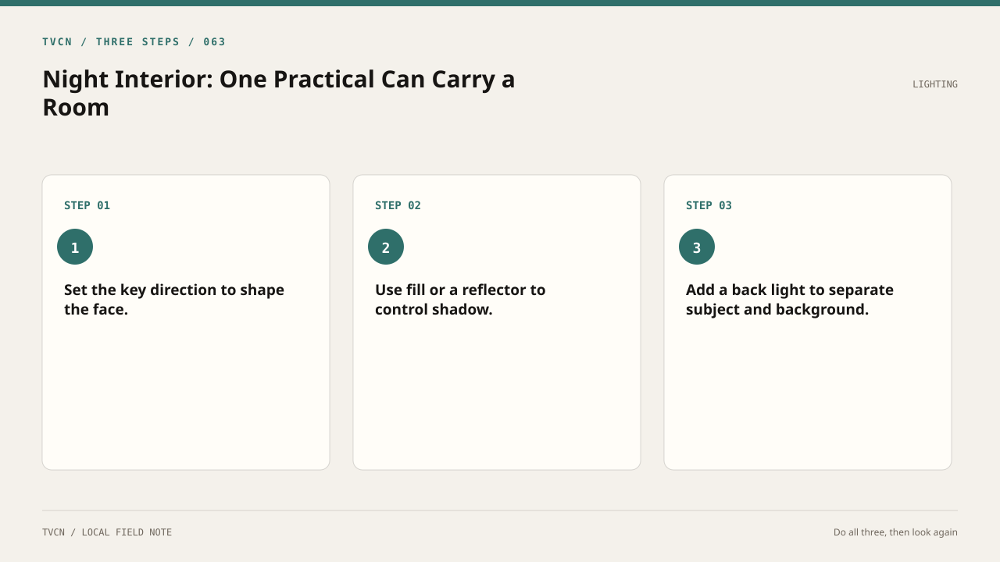

Find a practical light the room can believe, then add one small face light. Do not flatten the whole room.

<!-- DIAGRAM_START -->
<h2>Diagram</h2>
<figure>
  
  <figcaption>Do the three steps in order, then look again at the image or file.</figcaption>
</figure>
<!-- DIAGRAM_END -->
<h2>On set</h2>

Let one practical lamp or wall light sit in frame as the motive. Add a small light at 45 degrees for the face and leave the background dark; do not turn on the ceiling.

<h2>Do this</h2>

A night interior needs a practical light the audience believes, then one small lamp on the face. Do not flatten the room.
<ol><li>Let a practical lamp or wall sconce motivate the scene and actually stay on.</li><li>Add a small light at 45 degrees to the face for an eye light and nose shape.</li><li>Keep the background dark and leave the ceiling light off so bright and dark zones separate.</li></ol>
<h2>Avoid</h2>

Do not turn on the ceiling light and flatten the room; night is not daylight dimmed down.

<h2>Check</h2>
<ul><li>The practical is visibly on and motivates why the face is lit.</li><li>The face has a nose shadow and an eye light, not a flat frontal wash.</li><li>The background sits at least a stop darker than the face and keeps shadow detail.</li></ul>

<!-- DEEP_DIVE_START -->
## Deep dive

<strong>About 6 minutes.</strong> A night interior is not all lights on. It is one motivated source, then a face that survives.

### Find one practical first

A table lamp, a fridge, a sign outside, a hallway light: all are sources the audience can see. Choose it first, then add light; the audience needs a reason why this place is lit.

Without a practical, use cold window light and one warm table lamp. Cold for space, warm for the person.

### Even one lamp needs three layers

Key the face, bounce the shadows, flag the background. Three layers are not three lights; they are three controls: lift the face, keep shadow detail, push the background back.

One stop over the background is enough; do not turn night into day. Leave a little window frame or wall reflection so the space is not a black hole.

### Black level and noise

Do not underexpose log; lifting shadows creates noise. Protect the face first, then let blacks fall. A style with an unusable face is just an excuse.

Pure black can lack detail, but do not crush it into a single hole. Keep an edge light so the audience knows the room still has walls.

### Treating the window

The window should sit two or three stops over the room to read as night. The frame can clip, but the face cannot go black.

Blinds, sheers, and tree shadows break up the outside. A pure white window looks like a studio, not night.

### Keep the skin alive

Night skin tends toward cyan. Warm the key a little or isolate skin in post.

Do not push every shadow blue. The audience believes night because the face still looks human.

### Ten night-interior checks
<ul><li>Find the practical in frame first</li><li>Face one stop over background</li><li>Use soft key light</li><li>Bounce into the shadows</li><li>Flag the background down</li><li>Do not lift the whole room into day</li><li>Do not underexpose log</li><li>Shoot three seconds of gray card or white paper</li><li>Check window and lamp color</li><li>Play back and inspect shadow noise</li></ul>
Night is not hard because it is dark; it is hard to make the audience believe someone is there in the dark.

### When you have five minutes
<ul><li>Find one practical in frame</li><li>Window three stops over the room</li><li>Face one stop over background</li><li>Flag the background down</li><li>Do not underexpose log</li><li>Play back for shadow noise</li></ul>
Night needs a reason before a mood: the reason is one lamp, the mood is a visible face.

<!-- DEEP_DIVE_END -->
