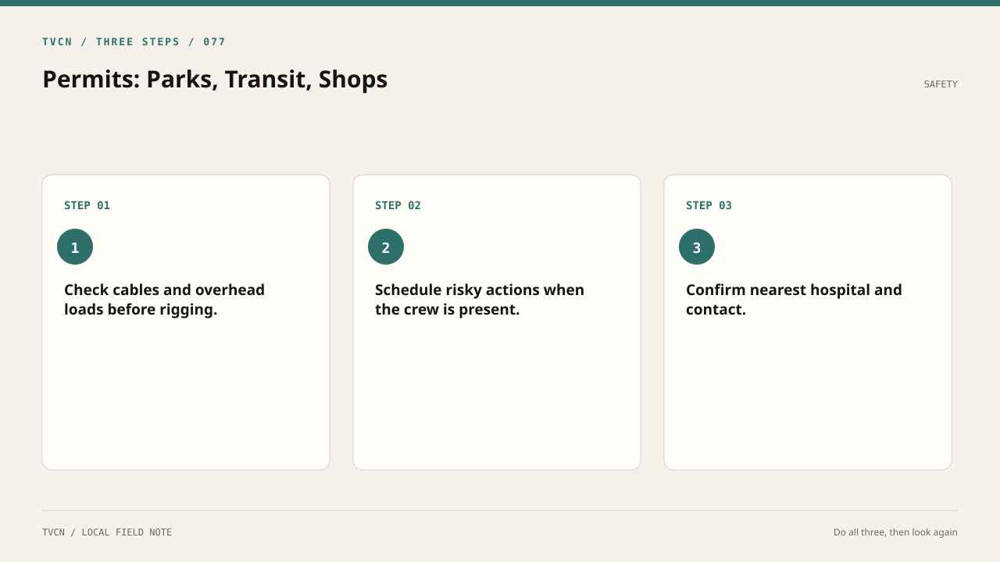

Permits have three layers: private property needs the owner; public space may need city or police permission; special areas—airport, subway, park, historic building—have their own authority. Call first; do not gamble on the day.

<!-- DIAGRAM_START -->
<h2>Diagram</h2>
<figure>
  
  <figcaption>Watch “Ask: can we set a light, can we” and “Put the answers and permit contact in the”; judge whether highlights, skin and sound survive together.</figcaption>
</figure>
<!-- DIAGRAM_END -->
<section><h2 id="section-1">Ask whose ground, road and air first</h2>
Put permit number, contact, valid window and restrictions on the call sheet so everyone knows what not to touch.
<h2 id="section-2">Limits</h2>
A small crew is not a waiver. Fewer people and a small camera may lower the approval level, but do not remove it; enforcement varies by city.
</section><section><h2 id="section-3">On set</h2>
Ask three questions: can you rig lights, can you block the sidewalk, can you show the storefront? Put the permit contact on the call sheet.
</section><section><h2 id="section-4">Do this</h2>
A permit is not a piece of paper; it decides whether you can light, block a walkway, or show a storefront. Ask three questions before choosing the shot.
<ol><li>Ask: can we set a light, can we block the pavement, can we show the storefront?</li><li>Put the answers and permit contact in the call sheet and mark restricted areas.</li><li>If one answer is unclear, change the shot or the plan; do not wing it on the day.</li></ol></section><section><h2 id="section-5">Avoid</h2>
Do not treat “we'll shoot quickly and leave” as permission; security can stop both the camera and the footage.
</section><section><h2>Judge</h2>
Three signals are observable on set:
<ul><li>highlights are not clipped and shadows keep recoverable detail</li><li>skin stays consistent across camera angles</li><li>sound has an independent track, not just the on-camera mic</li></ul></section><section><h2>Failures</h2>
These three moves erase the detail you just built:
<ul><li>exposure is right but the light has no direction</li><li>sound relies on the camera mic and dies in a noisy room</li><li>crossing the line leaves the audience without a map</li></ul></section><section><h2>Extend</h2>
<strong>10-minute exercise:</strong> Shoot three 10-second takes by the same window, changing only “Ask: can we set a light, can we”. Compare highlights, skin and background; keep the one that is editable.
</section>
<h2>Check</h2><ul><li>Lighting, pavement, and storefront questions all have clear answers.</li><li>The call sheet lists the permit contact, valid hours, and restricted areas.</li><li>If one item was denied, the shot or plan changed instead of being forced on location.</li></ul>
