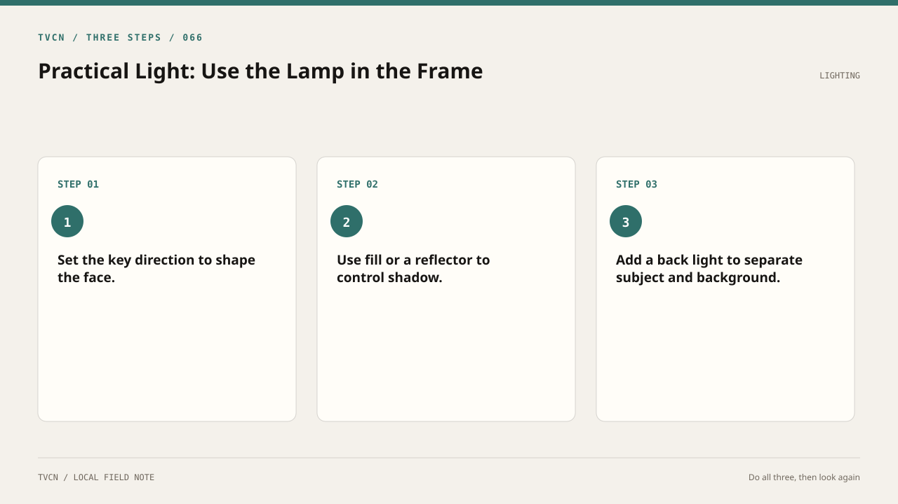

A lamp in frame must actually turn on, off, or flicker, but it motivates light rather than lighting the face.

<!-- DIAGRAM_START -->
<h2>Diagram</h2>
<figure>
  
  <figcaption>Do the three steps in order, then look again at the image or file.</figcaption>
</figure>
<!-- DIAGRAM_END -->
<h2>On set</h2>

Let the lamp in frame actually glow, but dim it to 20 or 30 percent. Light the face with a separate small source; do not treat the practical as the key.

<h2>Do this</h2>

A practical must really be on, off, or flicker, but it is motivation, not a key light. The face needs a separate small source.
<ol><li>Keep the practical visibly on but dim it to 20 or 30 percent.</li><li>Light the face with a separate small lamp; the practical motivates the background.</li><li>Check that the bulb does not clip and does not light the whole room.</li></ol>
<h2>Avoid</h2>

Do not make the visible bulb the only key; it cannot light the face and will clip.

<h2>Check</h2>
<ul><li>The practical is visibly on without clipping into a white block.</li><li>A separate lamp shapes the face while the practical motivates the background.</li><li>Turn the practical off and the face is still supported by its key.</li></ul>
