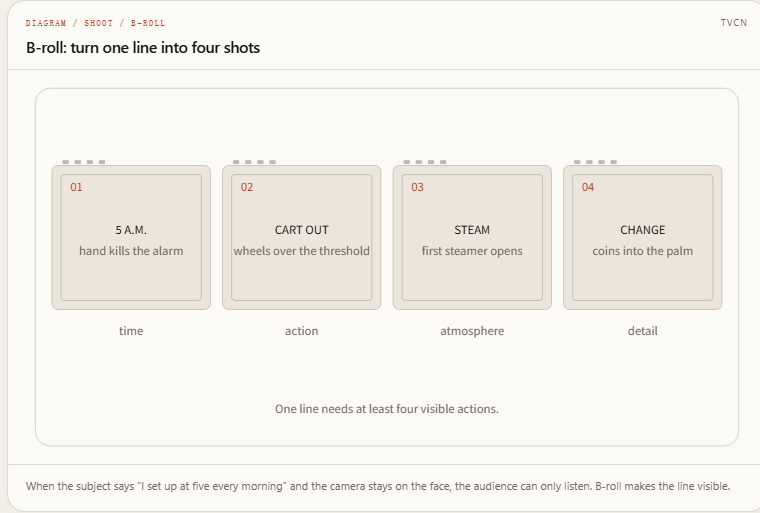

<!-- DIAGRAM_START -->
## Diagram

<figure>
  
  <figcaption>When the subject says “I set up at five every morning” and the camera stays on the face, the audience can only listen. B-roll makes the line visible.</figcaption>
</figure>
<!-- DIAGRAM_END -->

## List the nouns before you leave

Circle the concrete nouns in the interview: the scale, the old bicycle, the cash tin, the alley before dawn. For each noun, shoot three things: the whole, the detail, the action. If you wait until you are on location to “find the feeling,” you usually find nothing.

The more specific the noun, the easier the edit. You cannot shoot “life.” You can shoot a man flattening bills one at a time.

## Hands, feet, back

Hands working, feet walking, a back leaving. Faces carry feeling; hands and feet carry life. Hold ten seconds before and after each action so the edit has room to cut.

Do not come back with only mediums. A wide says where he is, a close-up says how he does it, and you still need one shot that shows the action from start to finish. With all three, a sentence can breathe.

## Room tone is picture too

Do not mute the location. The scale hitting the counter, the roller shutter, a radio in the distance: those sounds hold the picture up. At every new place, record thirty seconds of clean room tone. It patches more holes than you expect.

Play it back in the car before you leave. If something is missing, go back while you are still on the street. Finding out at the edit that you never shot a hand is too late.

## Checks

- Every concrete noun has a wide, a detail, and an action.
- Every action has ten seconds of handle on both sides.
- Every location has thirty seconds of room tone.

<!-- DEEP_DIVE_START -->
## Deep dive

<strong>About 5 minutes.</strong> B-roll is not filler. It gives the main story something to cut to and details that make it credible.

### Shoot hands, feet, and backs first

Before a character enters, shoot the hand pushing the door, the foot crossing the threshold, the back pausing. These let the edit cut anywhere in the main action.

Do not shoot only faces. A face is emotion; hands and feet are action. Action footage cuts more easily.

Get two takes per action: one complete, one detail only. The detail take gives the edit room.

### Every b-roll shot answers something

Ask of every b-roll shot: what does it answer? Environment, action, time, relationship. If nothing, it is a pretty outtake.

Shoot at least three groups per location: establishing space, human detail, environmental change. Two takes each so they can be joined.

B-roll needs a beginning and an end; a middle fragment alone gives the editor no in-point or out-point.

### Do not let b-roll steal the scene

Keep b-roll shorter than the main shot unless it carries a turn; past three seconds, the audience assumes it is the point.

If the color, movement, or sound in the b-roll is stronger than the main story, cut it; it will pull attention away.

More is not better. Two or three usable details per scene beat twenty beautiful shots.

### Pickup list: three lines

For every main location, list three lines: space, action, environmental change. Strike them out when shot; do not rely on memory.

Do not shoot ten b-roll shots at once. Get three usable ones, confirm an in-point and an out-point, then add a second take.

With five minutes left, shoot hands and feet before faces; a face can act again, hands and feet cannot.

### Ten b-roll checks
<ul><li>Shoot hands, feet, backs first</li><li>Every action has a full and a detail take</li><li>Every b-roll shot answers a question</li><li>One group each for space, detail, change</li><li>At least two takes per group</li><li>B-roll has an in and an out</li><li>Keep each shot under three seconds</li><li>Color and movement do not overpower the story</li><li>Sound does not bury dialogue</li><li>Pick up missing details before wrap</li></ul>
B-roll is not extra; it is the edit’s way out.

<!-- DEEP_DIVE_END -->
