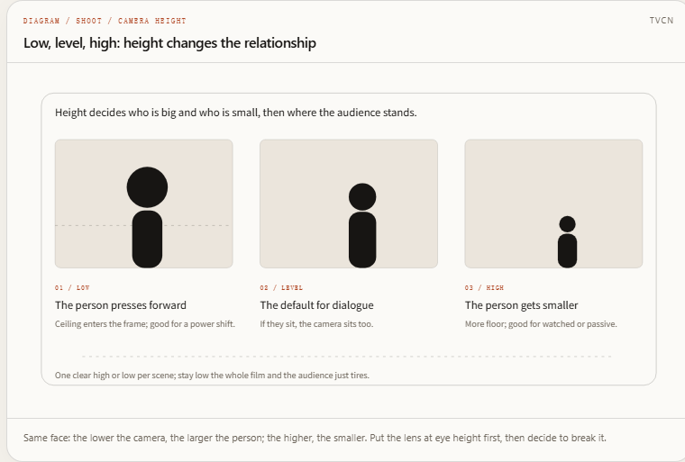

<!-- DIAGRAM_START -->
## Diagram

<figure>
  
  <figcaption>Same face: the lower the camera, the larger the person; the higher, the smaller. Put the lens at eye height first, then decide to break it.</figcaption>
</figure>
<!-- DIAGRAM_END -->

The same face, one inch lower, reads as a different person. Height sets the relationship before it sets the shot size. A new lens cannot fix standing in the wrong place.

## High presses down, low lifts up

Camera above the subject's eyes: the person gets smaller, floor fills the frame, and the audience reads them as passive or watched. Camera below: the person gets bigger, ceiling enters the frame, and they seem to press forward.

This is not “the cooler the better.” Use one clear high or low angle in a scene, and the change means something. Stay low the whole time and the audience just gets tired.

## Start at eye level, then decide to move

Dialogue defaults to level. If the subject sits, put the camera at their eye height. Do not stand and shoot down at them unless you want the scene to feel like an interrogation.

The most common phone mistake is standing with the phone at your chest, pointing down. Squat until the lens is at the other person's eyes. Their face changes at once. A small tripod and a stack of books is cheaper than a new lens.

## Height follows action

When power shifts, lower the camera: he stands, the lens goes low; she sits, the lens comes back to level. If height follows the body, the audience feels the relationship change without naming it.

Do not stay low for the whole film to look “cinematic.” Height is a sentence, not an accent. One per scene.

## Checks

- Is the default height level, or is the high/low angle a deliberate choice?
- For a seated interview, is the lens also seated at eye height?
- Does the height change land on a stand, sit, step in, or step back?
