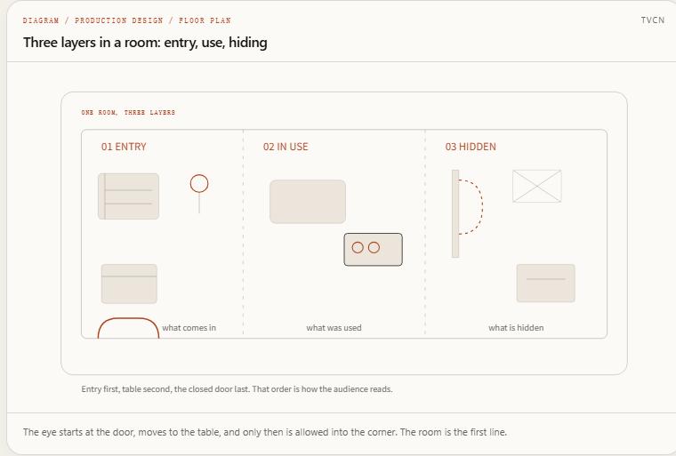

<!-- DIAGRAM_START -->
## Diagram

<figure>
  
  <figcaption>The eye starts at the door, moves to the table, and only then is allowed into the corner. The room is the first line.</figcaption>
</figure>
<!-- DIAGRAM_END -->

Before anyone speaks, the room is already talking. Set dressing is the first line.

## Decide who has lived here

Before asking how to make a room look good, write three lines: who lives here, what they just did, and what they do not want anyone to see. If you cannot write those lines, the room is only a backdrop.

Take a shared flat: two pairs of shoes at the door, one lined up, one kicked over; a bowl left in the sink for three days; a tie hanging on the bedroom handle, never given away. The audience reads two people living at different speeds without a word of explanation.

## Props need a use and a before/after

Props are not decoration. They should be picked up, put down, knocked over, hidden. Before the shoot, give every key prop a state: full, empty, clean, used. The audience reads the change of state, not the object.

Three things at the entry: keys, mail, shoes. Three on the table: a cup, pills, bills. One thing in the corner: what he does not want seen. Three groups are enough. More and the room becomes a prop warehouse.

Then make one thing wrong. A chair facing the door. An expired train ticket on the fridge. A bunch of flowers still wrapped in the bin. The audience asks why, and the scene starts.

## The light belongs to the room too

If the room has only a ceiling light, people look like they are in an office. If there is one table lamp, they sit toward it. The position of light decides whether the character wants to be seen.

Find the sources already in the room: window, table lamp, fridge door, hallway light. Give each one a reason: it is not dark yet, he is waiting, she forgot to turn it off. Add a reflector or a sheet of white paper to open the shadow; do not light the whole room.

Before shooting, walk from the door to the window with a phone. What the eye sees first and second is often not what looked good on the floor plan.

## Checks

- You can name who lived here, what just happened, and what is hidden.
- Key props carry wear or a change of state.
- The light comes from the room, and one thing is wrong enough to make the audience ask why.
