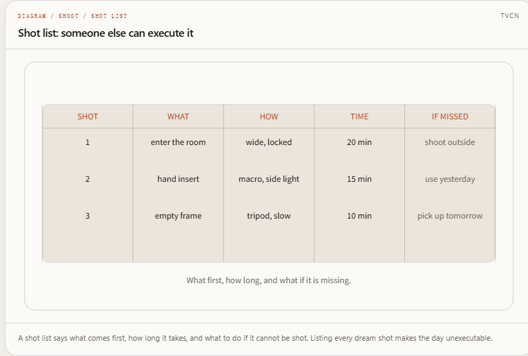

<!-- DIAGRAM_START -->
## Diagram

<figure>
  
  <figcaption>A shot list says what comes first, how long it takes, and what to do if it cannot be shot. Listing every dream shot makes the day unexecutable.</figcaption>
</figure>
<!-- DIAGRAM_END -->

The first shot list usually follows the script: scene one, scene two. Then you get to set and the lights have to move, the wardrobe has to change, and the sun is already gone.

## Order by camera and light

Order by camera and light instead. Keep shots facing the same way and using the same kit together. Put wardrobe continuity and the location’s time window in the header.

I write three lines at the top: three shots we must get today, three we can push, three we can lose. With those lines on the page, the day can fall apart and we still know where the floor is.

## Give every row a fallback

Add a fallback column to every row: reverse, close-up, insert, sound. When the master shot gets stuck, the whole crew should not stand around. If the dolly cannot get in, go handheld and follow the action. If the wide is impossible, take the doorway insert and a bed of room tone.

The ten extra seconds you grab on the day are what save you in the edit. A shot list is not there to fill the schedule. It is there to get the few pieces that cut into a film.

## Check the list before wrap

After a scene, stand at the monitor and strike the rows. Do not work from memory; memory loses things between card changes, battery swaps, and wardrobe. Strike the rows before you move on, and you avoid a pickup day.

Leave one blank page at the end for what you find on set. The unplanned shots are often the ones that survive the final cut.

## Checks

- The list is grouped by camera and light, not script pages.
- Every essential shot has a fallback.
- At wrap, you can point to the rows you did not get.
