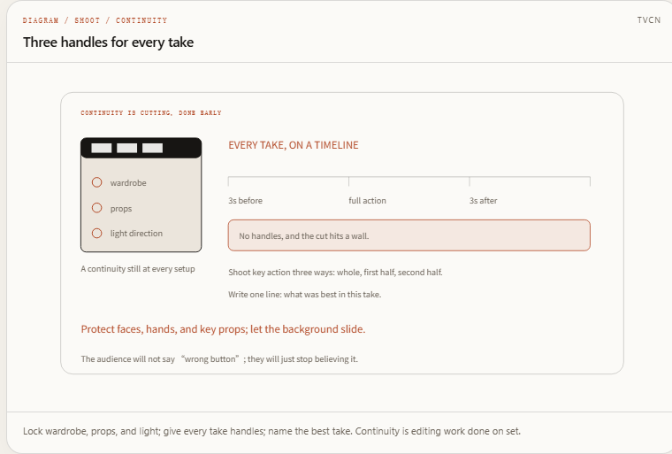

<!-- DIAGRAM_START -->
## Diagram

<figure>
  
  <figcaption>Lock wardrobe, props, and light; give every take handles; name the best take. Continuity is editing work done on set.</figcaption>
</figure>
<!-- DIAGRAM_END -->

Continuity is not the person behind the monitor calling out timecode. It is one job: make every take cut with the next.

## Track the three things that will drift

Wardrobe, props, and physical state drift quietly between takes. The second button comes undone, the cup moves from the right hand to the left, the actor cried in the last scene and still has swollen eyes. The audience may not name it, but it reads as fake.

At every new setup, take a continuity still on your phone. The frame should hold the full figure, the key prop, and the background. Use notes only for what the photo cannot show: the coat is wet, the cup is half full, his left hand is injured.

Do not write “wardrobe same as before.” The person doing continuity may not know which “before.” Write “blue coat, second button open, wet cuff.” That is when the note starts working.

## Give every take a handle

Roll three seconds before the action and hold three seconds after. The edit needs material to grab: room to cut in early or stay late. A shot with no handles cuts like hitting a wall.

For any important action, shoot it at least three ways: the full action, the first half, the second half. Use the wide for the whole and the close for the pieces. Do not count on one take, and do not let the actor get faster and faster inside the same action.

After each take, write one line about what was best. Not a score: an entrance for the editor. “She paused before setting the cup down.” “He looked at her before opening the door.” That line beats ten OKs.

## Write it on set, not from memory

Keep a three-column sheet: setup, take, note. Notes stay concrete; “felt good” is not a note. Hand the sheet and the photos to the editor before wrap, not the next morning.

Continuity is not the police. Do not chase every background mismatch. Protect what the audience will see: faces, hands, key props, direction of light. An extra chair in the background may pass; the key in the hero’s other hand will not.

## Checks

- Every setup has a continuity still with the key prop and wardrobe visible.
- Every take has handles, and important actions have a wide and a close.
- The sheet names the best take and why it is best.

<!-- SOURCES_START -->
## References and further reading

- [S31] [ARRI: Cine Systems](https://www.arri.com/en/cine-systems) — Accessed 2026-11-26. Used to check the terminology/method/rule in the “Track the three things that will drift” section against ARRI camera, lens and lighting documentation, not a general shooting tutorial; it does not verify numbers, model choices or on-set conclusions derived from this page, and is not a substitute for a test.
- [S52] [ARRI: ALEXA 35](https://www.arri.com/en/camera-systems/cameras/legacy-camera-systems/alexa-35) — Accessed 2026-11-26. Used to check the terminology/method/rule in the “Give every take a handle” section against ALEXA 35 official specs, not independent testing; it does not verify numbers, model choices or on-set conclusions derived from this page, and is not a substitute for a test.
- [S53] [Sony: FX6](https://pro.sony/ue_US/products/handheld-camcorders/ilme-fx6v) — Accessed 2026-11-26. Used to check the terminology/method/rule in the “Write it on set, not from memory” section against FX6 official specs, not independent testing; it does not verify numbers, model choices or on-set conclusions derived from this page, and is not a substitute for a test.
<!-- SOURCES_END -->

