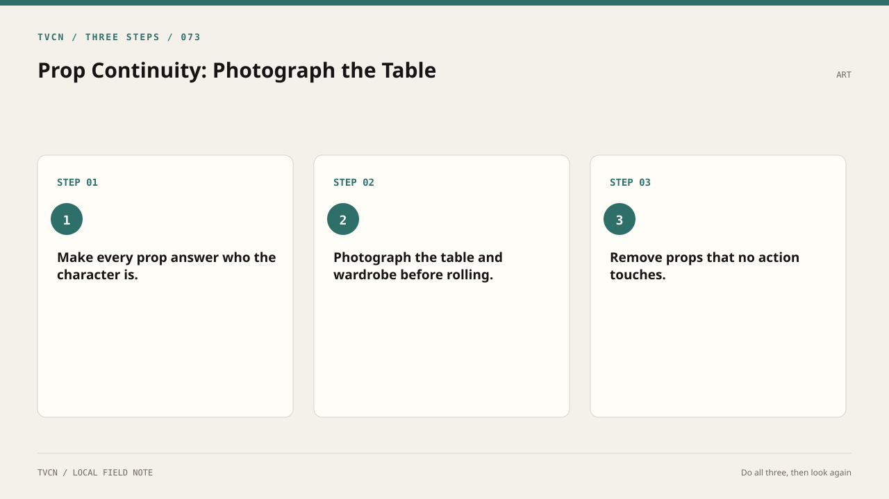

Continuity lives in photos: shoot the table, hands, and wardrobe before and after the take.

<!-- DIAGRAM_START -->
<h2>Diagram</h2>
<figure>
  
  <figcaption>Do the three steps in order, then look again at the image or file.</figcaption>
</figure>
<!-- DIAGRAM_END -->
<h2>On set</h2>

Photograph the tabletop, the hands, and the wardrobe before rolling. Repeat at the end of every scene, including which way the cup handle faces.

<h2>Do this</h2>

Prop continuity lives in photos: shoot the table, hands, and wardrobe before rolling and again at wrap.
<ol><li>Photograph the table, hands, and wardrobe before the take, noting the cup handle direction.</li><li>Shoot the same frames at the end of each scene and compare side by side.</li><li>If something moved, reset it or shoot an insert that hides the break.</li></ol>
<h2>Avoid</h2>

Do not trust memory for cups and wardrobe; photos are more reliable.

<h2>Check</h2>
<ul><li>Cup handle, collar, and table objects face the same way across cuts.</li><li>Every scene has before-and-after continuity photos.</li><li>A break is either reset or covered by an insert, not ignored.</li></ul>
