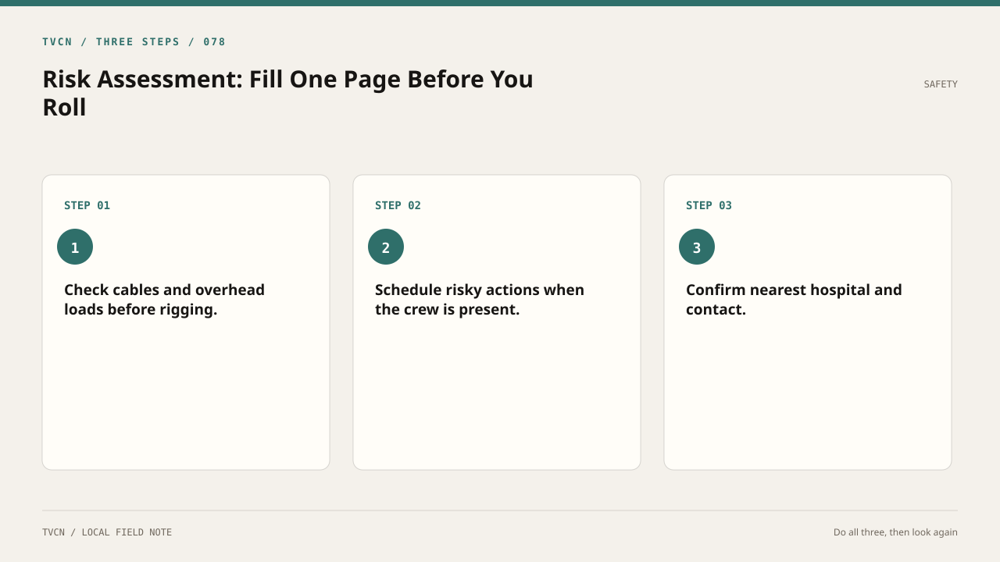

A risk sheet is not every possible bad thing; it is the three to five that would make today unshootable: weather, key person absent, gear failure, location refused, transport cut. For each, write trigger, backup and decision time.

<!-- DIAGRAM_START -->
<h2>Diagram</h2>
<figure>
  
  <figcaption>Watch “Fill four boxes: who can be hurt, what” and “Read it aloud before rolling and assign an”; judge whether highlights, skin and sound survive together.</figcaption>
</figure>
<!-- DIAGRAM_END -->
<section><h2 id="section-1">Name the item that would stop the shoot</h2>
Put the latest decision moment on the call sheet: if it is not solved by then, switch to Plan B without an on-set debate.
<h2 id="section-2">Limits</h2>
A risk sheet is not insurance. It cannot remove risk, only decide earlier; real safety still needs an on-set owner with stop-work authority.
</section><section><h2 id="section-3">On set</h2>
Fill one page with four boxes: who can get hurt, what can fall, who is responsible, and the nearest hospital. Read it to the crew before rolling.
</section><section><h2 id="section-4">Do this</h2>
A risk assessment is one page: who can get hurt, what can fall, who is responsible, and where the nearest hospital is. Read it to the crew.
<ol><li>Fill four boxes: who can be hurt, what can fall, who owns the risk, and the nearest hospital.</li><li>Read it aloud before rolling and assign an owner to each risk.</li><li>Update it when the set changes and confirm at wrap that nothing was missed.</li></ol></section><section><h2 id="section-5">Avoid</h2>
Do not fill the form and lock it in a drawer; if nobody heard it, it was not done.
</section><section><h2>Judge</h2>
This page passes on three observable checks, not slogans:
<ul><li><strong>1.</strong> All four boxes contain specifics, not “be careful.”</li><li><strong>2.</strong> Every risk has a named owner and crew can state their own item.</li><li><strong>3.</strong> The sheet was updated after set changes and checked again at wrap.</li></ul></section><section><h2>Failures</h2>
Any one of these means stop and fix it before post:
<ul><li><strong>1.</strong> Check 1 is only staged (“All four boxes contain specifics, not “be care…”); another camera position or location exposes it.</li><li><strong>2.</strong> Check 2 is left to post or a verbal explanation (“Every risk has a named owner and crew can stat…”); nothing on set can be rechecked.</li><li><strong>3.</strong> Do not fill the form and lock it in a drawer; if nobody heard it, it was not done.</li></ul></section><section><h2>Extend</h2>
<strong>10-minute exercise:</strong> Shoot three 10-second takes by the same window, changing only “Fill four boxes: who can be hurt, what”. Compare highlights, skin and background; keep the one that is editable.
</section>
<h2>Check</h2><ul><li>All four boxes contain specifics, not “be careful.”</li><li>Every risk has a named owner and crew can state their own item.</li><li>The sheet was updated after set changes and checked again at wrap.</li></ul>

<!-- SOURCES_START -->
## References and further reading

- [S18] [CMSI: Dangerous Documentaries](https://cmsimpact.org/wp-content/uploads/2015/12/dangerousdocs-feb2015.pdf) — Accessed 2026-11-26. Used to check the terminology/method/rule in the “Name the item that would stop the shoot” section against documentary risk and ethics handbook, not legal advice; it does not verify numbers, model choices or on-set conclusions derived from this page, and is not a substitute for a test.
- [S36] [NRTA: Official Site](https://www.nrta.gov.cn/) — Accessed 2026-11-26. Used to check the terminology/method/rule in the “Limits” section against NRTA official site, not permit agency service; it does not verify numbers, model choices or on-set conclusions derived from this page, and is not a substitute for a test.
<!-- SOURCES_END -->

