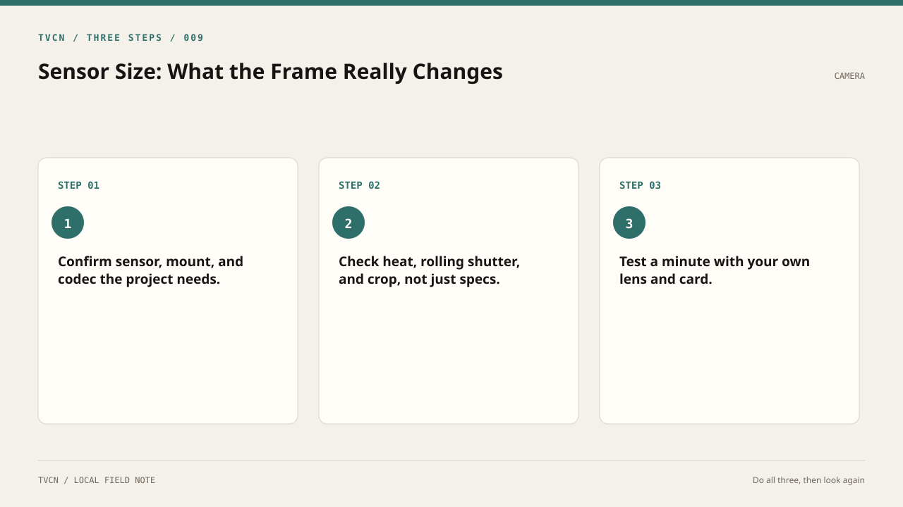

A larger sensor needs a longer lens for the same angle, gives shallower depth and usually better low light. It does not automatically buy better color, codec or latitude. Choose the format from working distance and depth, then look at the processor and recording specs.

<!-- DIAGRAM_START -->
<h2>Diagram</h2>
<figure>
  
  <figcaption>Watch “Mount the same lens on M4/3, S35, and” and “Compare background compression, depth of field, and shadow”; judge whether highlights, skin and sound survive together.</figcaption>
</figure>
<!-- DIAGRAM_END -->
<section><h2 id="section-1">It sets angle, depth and low light, not “image quality”</h2>
Crop modes change the real angle: the same lens becomes longer and depth changes with it. Calculate with the actual readout width, not the full-frame claim.
<h2 id="section-2">Limits</h2>
Do not sacrifice focus, cooling and lens cost for “full frame.” A small sensor with good light can be steadier than a large one with the wrong glass.
</section><section><h2 id="section-3">On set</h2>
Put the same lens on M4/3, S35, and full-frame bodies and shoot the same half-body frame. Keep the framing equal, compare background compression and shadow noise, then choose the body for the project.
</section><section><h2 id="section-4">Do this</h2>
Sensor size changes angle of view, depth of field, and low-light response, not “cinematic look” by itself. Compare the same lens and framing across formats before paying for the difference.
<ol><li>Mount the same lens on M4/3, S35, and full-frame bodies and keep the same half-body framing.</li><li>Compare background compression, depth of field, and shadow noise, not resolution alone.</li><li>Choose the body for the project, then check mount, recording format, and heat.</li></ol></section><section><h2 id="section-5">Avoid</h2>
Do not sell sensor size as a “cinematic” parameter; the look comes from light, lens, and blocking.
</section><section><h2>Judge</h2>
Three signals are observable on set:
<ul><li>highlights are not clipped and shadows keep recoverable detail</li><li>skin stays consistent across camera angles</li><li>sound has an independent track, not just the on-camera mic</li></ul></section><section><h2>Failures</h2>
These three moves erase the detail you just built:
<ul><li>exposure is right but the light has no direction</li><li>sound relies on the camera mic and dies in a noisy room</li><li>crossing the line leaves the audience without a map</li></ul></section><section><h2>Extend</h2>
<strong>10-minute exercise:</strong> Shoot three 10-second takes by the same window, changing only “Mount the same lens on M4/3, S35, and”. Compare highlights, skin and background; keep the one that is editable.
</section>
<h2>Check</h2><ul><li>The three half-body frames match closely enough to compare side by side.</li><li>You can name the difference in compression, depth of field, and shadow noise instead of saying “more cinematic.”</li><li>The chosen body covers eighty percent of the project without adapter workarounds.</li></ul>

<!-- DEEP_DIVE_START -->
## Deep dive

<strong>About 5 minutes.</strong> Sensor size is not a rank. It changes field of view, depth of field, and weight before it changes the look.

### One lens, a different view per format

A 50mm lens is 50mm on full frame, roughly 70mm on S35, and 100mm on M4/3. Calculate the equivalent before asking whether a lens is wide enough.

Do not assume a full-frame wide works on a small sensor; an 18mm on M4/3 is a 36mm, and the room suddenly gets tight.

### Compare depth at the same framing

At the same framing and aperture, full frame has less depth of field; a smaller sensor needs one or two stops wider to approach the same separation. That also changes exposure, so shutter and ND need a new calculation.

If two people must both stay in focus, a smaller sensor is easier. If the face must lift off the background, full frame helps, but focus errors show sooner.

### Weight and runtime are part of the format

Full-frame bodies, lenses, batteries, and ND filters weigh more; a full day handheld will find your shoulder first. Smaller sensors suit travel, events, documentary, and tight rooms; full frame suits low light, shallow depth, and wide angles.

Ask how long you shoot, how far you walk, and who carries the bag before choosing a format. A spec sheet will not carry the camera for you.

### Borrow one for a real day

Do not judge from a spec sheet. Borrow or rent the target format and shoot a real day: walking, handheld, lens changes, low light, ingest, edit. Log when your shoulder starts to ache, how many batteries you change, whether the wide is wide enough, and whether shadow noise is acceptable.

Shoot the same day on a smaller format and cut the two together. Many “must be full frame” needs are only a cleaner shadow; many “lightweight” needs turn out to be lens-kit weight.

Test with the same lens on both bodies, or you are comparing lenses, not formats.

### Ten checks before choosing a format
<ul><li>Calculate equivalent focal length</li><li>Compare depth at the same framing</li><li>Check noise in low light</li><li>Include lens, battery, and ND weight</li><li>Confirm continuous record time</li><li>Test wide-angle edges</li><li>Recalculate ND and shutter</li><li>Check cards and backup</li><li>Shoot one test in three kinds of light</li><li>Ask whether the format is enough last</li></ul>
Format is a constraint, not a rank. Fit the camera to the day first, then to your taste.

<!-- DEEP_DIVE_END -->

<!-- SOURCES_START -->
## References and further reading

- [S23] [SMPTE Standards](https://www.smpte.org/standards) — Accessed 2026-11-26. Used to check the terminology and public context in the opening paragraph (“Sensor size changes angle, depth, and low light, not 'cinema”) against Entry point for timecode, color, cinema and signal-chain standards; not a substitute for an on-set test.
- [S52] [ARRI: ALEXA 35](https://www.arri.com/en/camera-systems/cameras/legacy-camera-systems/alexa-35) — Accessed 2026-11-26. Used to check the terminology and public context in the opening paragraph (“Sensor size changes angle, depth, and low light, not 'cinema”) against Camera specifications, Log-C and colour workflow; not a substitute for an on-set test.
- [S53] [Sony: FX6](https://pro.sony/ue_US/products/handheld-camcorders/ilme-fx6v) — Accessed 2026-11-26. Used to check the terminology and public context in the opening paragraph (“Sensor size changes angle, depth, and low light, not 'cinema”) against Body specifications, recording formats and interfaces; not a substitute for an on-set test.
<!-- SOURCES_END -->

