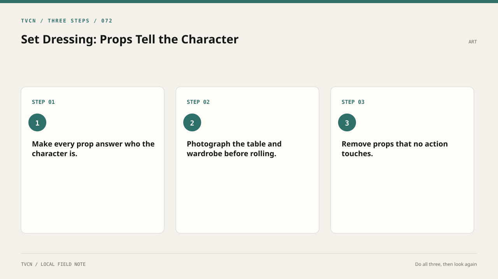

Set dressing is not shopping for pretty objects; each prop answers why this person kept it.

<!-- DIAGRAM_START -->
<h2>Diagram</h2>
<figure>
  
  <figcaption>Do the three steps in order, then look again at the image or file.</figcaption>
</figure>
<!-- DIAGRAM_END -->
<h2>On set</h2>

Write one origin line for every prop: who bought it, how long it has been used, why it was kept. Shoot a wide before the take and check it after wrap.

<h2>Do this</h2>

Set dressing is not a pile of nice objects; every prop answers why this person kept it.
<ol><li>Write one origin line per prop: who bought it, how long they kept it, why it stayed.</li><li>Shoot a wide plus details of the table, hands, and wardrobe before rolling.</li><li>Remove props that neither move the action nor explain the character.</li></ol>
<h2>Avoid</h2>

Do not turn the set into a junk shop; too much information means none.

<h2>Check</h2>
<ul><li>Every prop left in frame has an origin line you can say aloud.</li><li>Wide and detail photos match and props do not drift between setups.</li><li>At least one non-action decoration was removed so the frame reads more clearly.</li></ul>
