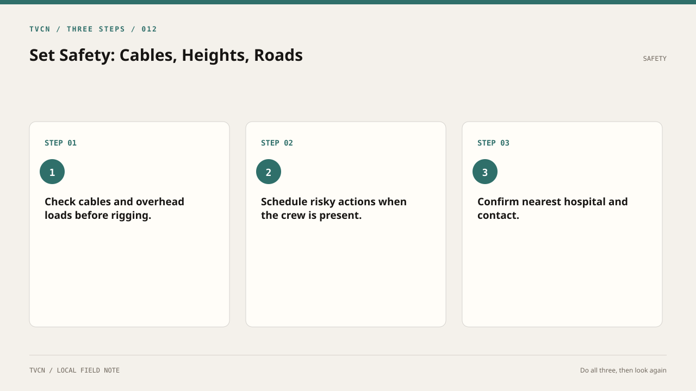

Walk the set before rolling: cable paths that trip, stands without sandbags, heights without tie-offs, roads without closure and hi-vis. Give every risk an owner and a stop-work condition.

<!-- DIAGRAM_START -->
<h2>Diagram</h2>
<figure>
  
  <figcaption>Watch “Tape cables flat across walkways and sandbag every” and “Put a person on high stands and wear”; judge whether highlights, skin and sound survive together.</figcaption>
</figure>
<!-- DIAGRAM_END -->
<section><h2 id="section-1">People before the shot</h2>
Put the must-get list and the safety list on the same call sheet. If any safety condition fails, stop first; do not “finish the shot and deal with it later.”
<h2 id="section-2">Limits</h2>
Safety is not paperwork, and it is not a reason to let untrained people take risks. Use qualified electricians, traffic control or riggers. “We always did it this way” is not a permit.
</section><section><h2 id="section-3">On set</h2>
Walk the set before rolling: tape cables flat across walkways, sandbag every stand, put a hand on high rigs, and wear a reflective vest near roads.
</section><section><h2 id="section-4">Do this</h2>
Check three things before rolling: cables that trip, heights that fall, and roads with traffic. Walk the set and fix the risk, not just write it down.
<ol><li>Tape cables flat across walkways and sandbag every light stand.</li><li>Put a person on high stands and wear hi-vis near roads.</li><li>Put the nearest hospital, assembly point, and contact in the call sheet and read them to the crew.</li></ol></section><section><h2 id="section-5">Avoid</h2>
Do not let one person carry a light stand; if it falls, nobody catches it.
</section><section><h2>Judge</h2>
This page passes on three observable checks, not slogans:
<ul><li><strong>1.</strong> No cable crosses a walkway untaped and every stand is sandbagged.</li><li><strong>2.</strong> High stands have a spotter and everyone near the road wears hi-vis.</li><li><strong>3.</strong> Any crew member can name the nearest hospital, assembly point, and on-set contact.</li></ul></section><section><h2>Failures</h2>
Any one of these means stop and fix it before post:
<ul><li><strong>1.</strong> Check 1 is only staged (“No cable crosses a walkway untaped and every s…”); another camera position or location exposes it.</li><li><strong>2.</strong> Check 2 is left to post or a verbal explanation (“High stands have a spotter and everyone near t…”); nothing on set can be rechecked.</li><li><strong>3.</strong> Do not let one person carry a light stand; if it falls, nobody catches it.</li></ul></section><section><h2>Extend</h2>
<strong>10-minute exercise:</strong> Shoot three 10-second takes by the same window, changing only “Tape cables flat across walkways and sandbag every”. Compare highlights, skin and background; keep the one that is editable.
</section>
<h2>Check</h2><ul><li>No cable crosses a walkway untaped and every stand is sandbagged.</li><li>High stands have a spotter and everyone near the road wears hi-vis.</li><li>Any crew member can name the nearest hospital, assembly point, and on-set contact.</li></ul>

<!-- DEEP_DIVE_START -->
## Deep dive

<strong>About 5 minutes.</strong> Set safety is not a disclaimer. It is checking cables, heights, and roads before the first take.

### Tape the cables first

Tape every cable to the edge and keep a walking path clear. Do not use a chair as a light stand, and do not chain too many power strips.

Clear the path people actually walk, then place stands outside the frame. One trip can cost both the gear and the person.

### Someone holds the ladder

Someone holds the ladder, tools are tethered, nobody stands on a railing, and tripods get sandbags.

Look up for cables before lifting a light overhead. Outdoors, check the wind first; a softbox becomes a sail.

### Roads and weather

Wear high-visibility clothing at the roadside, set cones, check weather and sunset, and never stand in traffic for a shot.

Post the emergency contact, nearest hospital, and meeting point in the group chat before rolling. In an emergency nobody has time to scroll back.

### The ten minutes before rolling

Divide the set into three lines: where people walk, where power runs, and where gear stands. Keep them from crossing and you remove half the trips and kicked stands.

Weight every stand, tripod, and track. Outdoors, every tall object gets one more tie-down.

Write the nearest hospital, emergency contact, and meeting point on paper and tape it by the monitor; it works when a phone dies. Wrap in the same three lines: power off, small items first, lights last. Do not make people cross lines in the dark.

### The last thing before wrap

Cut the main power, pack small items, move the lights last, and never make anyone cross cables in the dark. Put cones and high-vis vests back in one box so the next shoot does not hunt for them.

Look at the floor once more: tape, screws, lens caps. Pick up everything; otherwise your foot will find it on the next shoot.

### Ten safety checks before rolling
<ul><li>Tape every cable</li><li>Keep the walkway clear</li><li>No chairs as stands</li><li>Do not overload power strips</li><li>Someone holds the ladder</li><li>Tether tools</li><li>Sandbag the tripods</li><li>Look up before lifting a light</li><li>High-vis and cones at the road</li><li>Post emergency contacts</li></ul>
Safety is not shooting slower; it is making sure everyone can shoot the next take.

<!-- DEEP_DIVE_END -->

<!-- SOURCES_START -->
## References and further reading

- [S18] [CMSI: Dangerous Documentaries](https://cmsimpact.org/wp-content/uploads/2015/12/dangerousdocs-feb2015.pdf) — Accessed 2026-11-26. Used to check the terminology/method/rule in the “People before the shot” section against documentary risk and ethics handbook, not legal advice; it does not verify numbers, model choices or on-set conclusions derived from this page, and is not a substitute for a test.
- [S36] [NRTA: Official Site](https://www.nrta.gov.cn/) — Accessed 2026-11-26. Used to check the terminology/method/rule in the “Limits” section against NRTA official site, not permit agency service; it does not verify numbers, model choices or on-set conclusions derived from this page, and is not a substitute for a test.
<!-- SOURCES_END -->

