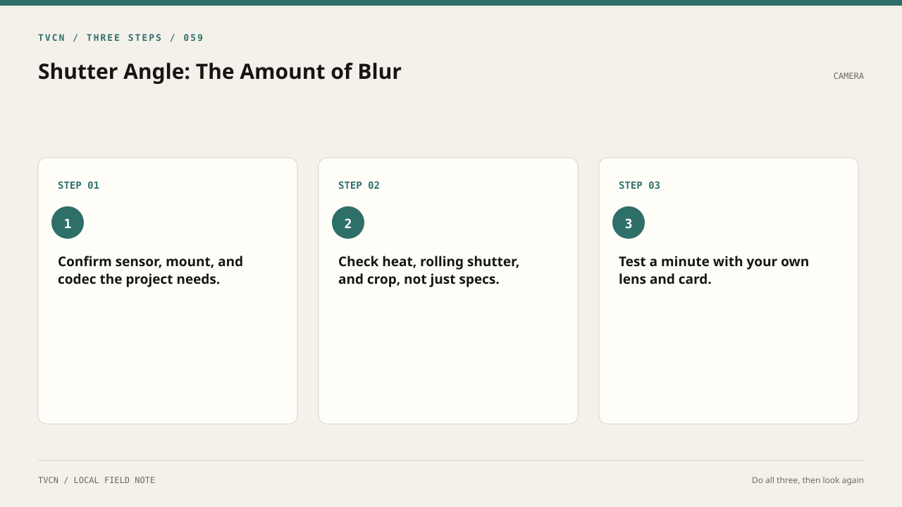

1/50 at 25p or 1/48 at 24p approximates 180 degrees and film-like motion. A faster shutter sharpens the instant; a slower one lengthens blur but risks flicker and skew.

<!-- DIAGRAM_START -->
<h2>Diagram</h2>
<figure>
  
  <figcaption>Watch “At 25p, use 180 degrees, which is 1/50.” and “Use 90 degrees for crisper action or 360”; judge whether highlights, skin and sound survive together.</figcaption>
</figure>
<!-- DIAGRAM_END -->
<section><h2 id="section-1">180 degrees is a start, not a law</h2>
Match mains: in 50Hz regions use 1/50 or 1/100, not 1/60, to avoid rolling bands.
<h2 id="section-2">Limits</h2>
Shutter is not an exposure tool. If light is low, add light or open the iris; slow shutter turns action to mud.
</section><section><h2 id="section-3">On set</h2>
At 25p use a 180-degree shutter, which is 1/50. Use 90 degrees for crisper action or 360 for more blur, but never fight the mains frequency.
</section><section><h2 id="section-4">Do this</h2>
Shutter angle controls motion blur. 180 degrees is a default, not the only answer. Calculate shutter from frame rate, then choose crisp or smeared.
<ol><li>At 25p, use 180 degrees, which is 1/50.</li><li>Use 90 degrees for crisper action or 360 degrees for more smear.</li><li>Test under 50Hz lights and confirm there is no flicker or banding.</li></ol></section><section><h2 id="section-5">Avoid</h2>
Do not use 180 degrees for every action, and do not let shutter fight 50Hz lighting.
</section><section><h2>Judge</h2>
This page passes on three observable checks, not slogans:
<ul><li><strong>1.</strong> Shutter is calculated from frame rate and angle, not guessed.</li><li><strong>2.</strong> Motion blur matches the choice: crisp action or softer smear.</li><li><strong>3.</strong> Playback under location lights shows no flicker, banding, or rolling bars.</li></ul></section><section><h2>Failures</h2>
Any one of these means stop and fix it before post:
<ul><li><strong>1.</strong> Check 1 is only staged (“Shutter is calculated from frame rate and angl…”); another camera position or location exposes it.</li><li><strong>2.</strong> Check 2 is left to post or a verbal explanation (“Motion blur matches the choice: crisp action o…”); nothing on set can be rechecked.</li><li><strong>3.</strong> Do not use 180 degrees for every action, and do not let shutter fight 50Hz lighting.</li></ul></section><section><h2>Extend</h2>
<strong>10-minute exercise:</strong> Shoot three 10-second takes by the same window, changing only “At 25p, use 180 degrees, which is 1/50.”. Compare highlights, skin and background; keep the one that is editable.
</section>
<h2>Check</h2><ul><li>Shutter is calculated from frame rate and angle, not guessed.</li><li>Motion blur matches the choice: crisp action or softer smear.</li><li>Playback under location lights shows no flicker, banding, or rolling bars.</li></ul>

<!-- DEEP_DIVE_START -->
## Deep dive

<strong>About 5 minutes.</strong> Shutter angle decides motion blur. Make movement look natural before you make it look like a style.

### Start at 180 degrees

Use 1/48 or 1/50 at 24 fps, 1/50 at 25, 1/60 at 30, 1/100 at 50, and 1/240 at 120. That 180-degree shutter gives motion a natural trail; it is not a cinematic ornament.

If the project is 25 fps, do not copy 1/48 from a 24 fps job; the difference shows in a fast pan.

### The amount of blur is information

A hand passing, a car crossing, a head turning: 180 degrees gives the audience direction. To freeze motion, go to 1/250 or 1/500; the action turns brittle. For more smear, drop to 1/25, but lights may flicker.

In 50Hz countries use 1/50 or 1/100 under fluorescents; in 60Hz use 1/60 or 1/120. Shoot a test and play it back; do not guess.

### Slow motion needs light

At 120 fps, a 180-degree shutter is 1/240, more than two stops less light; add a lamp indoors or open the aperture. LEDs can flicker too, so shoot a slow-motion test and look for rolling bands.

Do not use slow motion to rescue action that was never designed. Slowing it down only makes the emptiness clearer.

### Shoot three tests before you commit

Shoot the first at 180 degrees, the second one stop faster, the third one stop slower; repeat the same action and compare smear and flicker on playback.

If the frame has a screen, LED, or car light, check for rolling bands and flicker first. Shutter is not the only variable; lights and frame rate change the result too.

Write the chosen value on the shot sheet and do not change it by feel at the next setup. One shutter change on set means another motion match in post.

### Ten shutter checks
<ul><li>Confirm the project frame rate</li><li>Set shutter at twice the rate</li><li>Use 1/50 or 1/100 under 50Hz light</li><li>Use 1/60 or 1/120 under 60Hz light</li><li>Play back a fast-action test</li><li>Calculate light loss before high-speed</li><li>Confirm the lights do not flicker</li><li>Recalculate ND and aperture together</li><li>Keep some blur in action</li><li>Do not hide bad action behind a high shutter</li></ul>
Shutter serves movement first and style second; if the action is unclear, style is just noise.

<!-- DEEP_DIVE_END -->

<!-- SOURCES_START -->
## References and further reading

- [S31] [ARRI: Cine Systems](https://www.arri.com/en/cine-systems) — Accessed 2026-11-26. Used to check the terminology/method/rule in the “180 degrees is a start, not a law” section against ARRI camera, lens and lighting documentation, not a general shooting tutorial; it does not verify numbers, model choices or on-set conclusions derived from this page, and is not a substitute for a test.
- [S52] [ARRI: ALEXA 35](https://www.arri.com/en/camera-systems/cameras/legacy-camera-systems/alexa-35) — Accessed 2026-11-26. Used to check the terminology/method/rule in the “Limits” section against ALEXA 35 official specs, not independent testing; it does not verify numbers, model choices or on-set conclusions derived from this page, and is not a substitute for a test.
- [S53] [Sony: FX6](https://pro.sony/ue_US/products/handheld-camcorders/ilme-fx6v) — Accessed 2026-11-26. Used to check the terminology/method/rule in the “On set” section against FX6 official specs, not independent testing; it does not verify numbers, model choices or on-set conclusions derived from this page, and is not a substitute for a test.
<!-- SOURCES_END -->

