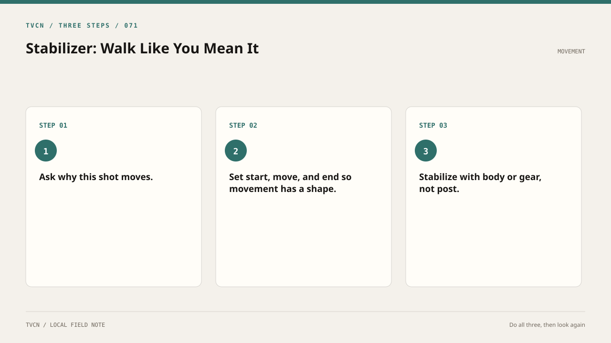

Post stabilization zooms and cuts edges. Confirm the frame has margin; without it you get black or soft edges. Handheld wide is easier to rescue than long lens.

<!-- DIAGRAM_START -->
<h2>Diagram</h2>
<figure>
  
  <figcaption>Watch “Bend the knees, land heel first, and walk” and “Walk twenty meters without the rig to find”; judge whether highlights, skin and sound survive together.</figcaption>
</figure>
<!-- DIAGRAM_END -->
<section><h2 id="section-1">Check room to crop before stabilizing</h2>
Order: lens correction, stabilization, then reframe. Do not crop before stabilizing.
<h2 id="section-2">Limits</h2>
Stabilization cannot fix motion blur or rolling shutter. Slow shutter and heavy skew become more visible; fix them on set.
</section><section><h2 id="section-3">On set</h2>
Bend the knees slightly, land on the heels, and walk a straight line. Practice twenty meters empty before mounting the camera. Slow down for turns; do not twist at the waist.
</section><section><h2 id="section-4">Do this</h2>
A gimbal hates small choppy steps. Bend the knees, land on the heel, and keep an even speed.
<ol><li>Bend the knees, land heel first, and walk a straight line.</li><li>Walk twenty meters without the rig to find an even pace.</li><li>Turn slowly with the feet, not by twisting the waist.</li></ol></section><section><h2 id="section-5">Avoid</h2>
Do not take tiny steps or twist the waist; a gimbal smooths micro-jitter, not footstep bounce.
</section><section><h2>Judge</h2>
Three signals are observable on set:
<ul><li>highlights are not clipped and shadows keep recoverable detail</li><li>skin stays consistent across camera angles</li><li>sound has an independent track, not just the on-camera mic</li></ul></section><section><h2>Failures</h2>
These three moves erase the detail you just built:
<ul><li>exposure is right but the light has no direction</li><li>sound relies on the camera mic and dies in a noisy room</li><li>crossing the line leaves the audience without a map</li></ul></section><section><h2>Extend</h2>
<strong>10-minute exercise:</strong> Shoot three 10-second takes by the same window, changing only “Bend the knees, land heel first, and walk”. Compare highlights, skin and background; keep the one that is editable.
</section>
<h2>Check</h2><ul><li>The frame does not bounce with each footstep on a straight walk.</li><li>Turns stay even with no sudden whip or lateral snap.</li><li>The twenty-meter empty walk and the rig walk share the same rhythm.</li></ul>

<!-- DEEP_DIVE_START -->
## Deep dive

<strong>About 5 minutes.</strong> A gimbal is not stable because it is on. Walking, grip, and center of gravity decide the shot.

### Three points for walking

Bend the knees, land on the heel first, and stop bouncing; walk about thirty percent slower than usual. Look ahead, not at the screen.

Walk the same path backward and play it back for vertical breathing. If it bobs, slow down again.

### Balance and modes

Balance all three axes before powering up and check that the motors stay cool. Follow mode suits walking; lock mode suits a fixed position. Do not use full follow in strong wind.

Balance is not a level reading; it means the head stays put at any angle. A small error makes the motors fight all day.

### Common bad habits

Straight arms, a death grip, and twisting the waist to turn are the usual failures. Keep the arm against the body, the gimbal near your center of gravity, and turn with your feet.

Invert the head for low angles and raise the column for high angles; do not hunch over to reach the frame.

### Find a ten-meter path

Find a ten-meter corridor or sidewalk and walk it three times: normal, thirty percent slower, then slower again. Play each back for vertical breathing and side sway.

Then practice walking backward, sidestepping, and orbiting a person half a turn; two passes each, and notice which part of your body tires first.

Walk the path empty before shooting and check for thresholds, cables, and wet patches. A gimbal fears a sudden stop more than shake. If the path includes stairs, decide whether to carry the rig or break it down before you reach the steps.

### Five-minute drill: orbit a cup

Put a cup on the floor and walk a full circle around it while keeping the rim in the same frame position. Do three circles, reversing direction each time. Play back for side drift and vertical breathing.

Then replace the cup with a person at two meters and practice a half orbit; a person will not wait like a cup, so agree on the blocking first.

### Ten gimbal checks before rolling
<ul><li>Balance three axes before power</li><li>Motors stay cool</li><li>Battery and card seated</li><li>Choose follow or lock mode</li><li>Keep the arm against the body</li><li>Walk thirty percent slower</li><li>Land on the heel</li><li>Look ahead</li><li>Turn with the feet, not the waist</li><li>Play back for vertical bob</li></ul>
Gimbal stability starts in the body, then in the machine.

<!-- DEEP_DIVE_END -->

<!-- SOURCES_START -->
## References and further reading

- [S23] [SMPTE Standards](https://www.smpte.org/standards) — Accessed 2026-11-26. Used to check the terminology and public context in the opening paragraph (“Gimbals hate tiny steps. Soft knees, heel-first, even speed.”) against Entry point for timecode, color, cinema and signal-chain standards; not a substitute for an on-set test.
- [S52] [ARRI: ALEXA 35](https://www.arri.com/en/camera-systems/cameras/legacy-camera-systems/alexa-35) — Accessed 2026-11-26. Used to check the terminology and public context in the opening paragraph (“Gimbals hate tiny steps. Soft knees, heel-first, even speed.”) against Camera specifications, Log-C and colour workflow; not a substitute for an on-set test.
- [S53] [Sony: FX6](https://pro.sony/ue_US/products/handheld-camcorders/ilme-fx6v) — Accessed 2026-11-26. Used to check the terminology and public context in the opening paragraph (“Gimbals hate tiny steps. Soft knees, heel-first, even speed.”) against Body specifications, recording formats and interfaces; not a substitute for an on-set test.
<!-- SOURCES_END -->

