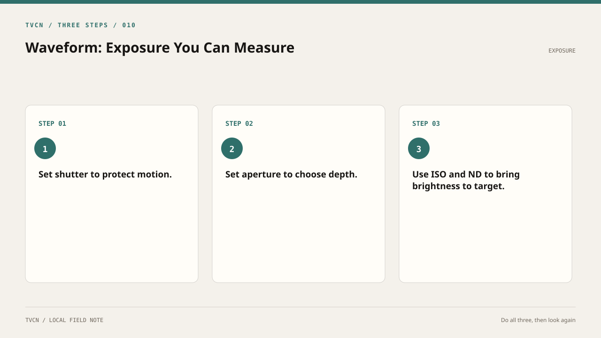

The waveform measures brightness, not beauty. Protect highlights first, then decide how much shadow to keep.

<!-- DIAGRAM_START -->
<h2>Diagram</h2>
<figure>
  
  <figcaption>Do the three steps in order, then look again at the image or file.</figcaption>
</figure>
<!-- DIAGRAM_END -->
<h2>On set</h2>

Put the face at 55 to 65 IRE and keep the sky under 95. If the trace hits the top, cut a stop of light or add ND instead of fixing it in post.

<h2>Do this</h2>

A waveform shows luminance distribution. Protect highlights first, then decide how much shadow to keep. Put skin at 55 to 65 IRE and sky below 95; if the trace hits the ceiling, cut light or add ND.
<ol><li>Place the face between 55 and 65 IRE.</li><li>Bring the sky or window below 95 IRE so detail survives.</li><li>If the trace still clips, cut a stop of light or add ND; do not plan to recover it in post.</li></ol>
<h2>Avoid</h2>

Do not let the waveform clip and plan to recover it later; clipped highlights are gone.

<h2>Check</h2>
<ul><li>Skin sits between 55 and 65 IRE with no flat white patch.</li><li>Sky or window still holds detail and the trace does not sit on the ceiling.</li><li>When exposure clips, light or ND changes first; ISO is not pushed to compensate.</li></ul>

<!-- DEEP_DIVE_START -->
## Deep dive

<strong>About 5 minutes.</strong> A waveform is not decoration. It turns “looks about right” into whether highlights clip and where skin sits.

### Brighter is not better

When the waveform touches 100, the white is gone; post cannot bring it back. Log footage sits lower by design, so do not push it as if it were Rec.709. Check clipping first, skin placement second, overall brightness last.

Exposure must match within a scene. Recheck the waveform after every setup and lens change; background brightness may shift, the face should not.

### When you have no waveform

Turn on zebras at 95 percent; if both face and window stripe, stop down. If you have false color, watch purple or red for highlights. If you have neither, shoot a test and read the histogram. Do not trust the viewfinder; ambient light lies to it.

Carry white paper or a gray card and shoot three seconds at the start. At least post will know how white looked, especially under mixed light.

### Leave headroom on log footage

Log looks flat; that is not a instruction to brighten it on set. Keep highlights under the top of the waveform and leave a stop for post. Noisy shadows can be helped; clipped highlights cannot.

Shoot a gray card at the start of a scene and match every shot to it in post. Without a card, use a white wall or paper, but keep it from specular clipping.

### Three kinds of light that lie

A window behind the subject, a practical on the table, and a white wall all make the viewfinder look brighter than the file. Read the waveform, not the screen; read highlights, not overall brightness.

Without a waveform, shoot a test and look at the right edge of the histogram. If it is pinned, the white is gone; stop down and shoot again.

### Ten exposure checks before you roll
<ul><li>Check whether highlights touch the top of the waveform</li><li>Then check where skin sits</li><li>Read overall brightness last</li><li>Match exposure across the whole scene</li><li>Recheck after every camera move</li><li>Recheck after every lens change</li><li>Without a waveform, set zebras to ninety-five</li><li>With false color, watch purple or red for highlights</li><li>Shoot three seconds of gray card or white paper first</li><li>Play back and check the right edge of the histogram</li></ul>
The waveform is not there to make you a technician; it is there so playback does not make you curse. One look on set saves an hour in post.

<!-- DEEP_DIVE_END -->
