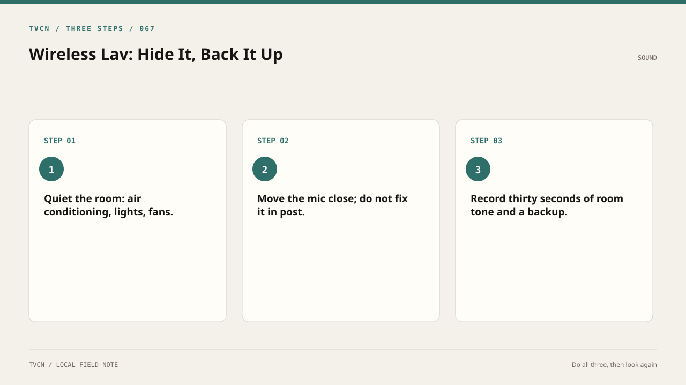

Hide the lav, secure it, and record a backup track before worrying about brand.

<!-- DIAGRAM_START -->
<h2>Diagram</h2>
<figure>
  
  <figcaption>Do the three steps in order, then look again at the image or file.</figcaption>
</figure>
<!-- DIAGRAM_END -->
<h2>On set</h2>

Hide the capsule ten centimeters below the collar and tape it with medical tape. Put the transmitter at the back waist, record a backup track, and listen for thirty seconds before rolling.

<h2>Do this</h2>

A lav is first about hiding and backup: under the collar, in the hair, taped down, plus a second track. A clean hide still fails if cloth rubs the capsule.
<ol><li>Hide the capsule ten centimeters below the collar and secure it with medical tape.</li><li>Put the transmitter at the lower back and record a backup track.</li><li>Listen for thirty seconds before rolling and check rub, AC, and plosives.</li></ol>
<h2>Avoid</h2>

Do not drop the transmitter in a pocket or record one track; rub and loss have no second chance.

<h2>Check</h2>
<ul><li>The thirty-second test has no cloth rub, AC hum, or plosive.</li><li>The transmitter is not in a pocket, the cable has slack, and the mic does not swing when the actor walks.</li><li>The backup track recorded alongside the main and can be switched in playback.</li></ul>

<!-- DEEP_DIVE_START -->
## Deep dive

<strong>About 5 minutes.</strong> A lav is not hard to buy. It is hard to hide, to keep from rustling, and to back up.

### Four places to hide a lav

A palm below the collar is safest, unless the collar is stiff. Hair works for suits and shirts but hurts on removal. A chest pocket must clear fabric, and a prop only suits short lines because low end gets muffled.

Tape the clothes first, then the skin, and leave a slack fold. Test sitting, turning, and raising a hand; if you hear cloth, move the mic.

### Backup and monitoring

Record on the transmitter, feed the receiver to camera, and run a phone backup; at least two of the three must be usable. Wear headphones on set, not in post. Capture ten seconds of room tone before each scene for patch work.

If the performer sings or shouts, do not raise gain; leave headroom and lift later. A clipped take cannot be saved by a backup.

### Wardrobe decides where the mic goes

On a stiff collar, place the mic below the points; on a sweater, use a furry wind cover at the chest; on silk, keep it off skin because it slides and rustles. Read the wardrobe before taping.

Make the performer sit, stand, and cross their arms in every position. Cloth noise is invisible on a monitor and loud as a drum in headphones.

### Choosing among three tracks

Record transmitter, camera, and phone. Do not choose on set; choose in post. On set, only confirm that a second usable track exists, and never kill one because another sounds good.

Before wrap, listen ten seconds to each and note clipping or rustle. That note is worth more than another take.

### Ten steps before you hide the lav
<ul><li>Read the fabric before choosing a position</li><li>On a stiff collar, place the mic a palm below</li><li>Use a furry cover on a sweater, not bare skin</li><li>Keep silk off skin; it slips and rustles</li><li>Tape the clothes first, then the skin</li><li>Leave a slack fold; never stretch the cable</li><li>Test sitting</li><li>Test turning</li><li>Test crossed arms</li><li>Record on the transmitter and keep camera and phone backups</li></ul>
The expensive part of a lav is not the gear; it is discovering the rustle after the performance is over. Listen ten seconds to each of the three tracks before wrap and write down the unusable one; do not wait for post.

<!-- DEEP_DIVE_END -->
