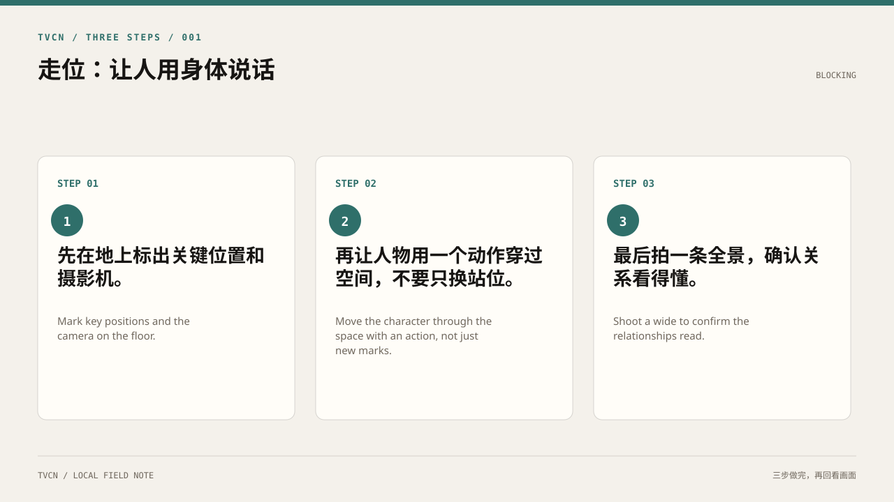

走位不是把演员摆得好看，而是让谁靠近、谁退、谁挡住谁变成画面信息。先在地上标门、椅子和摄影机，再让演员用一个动作穿过这段距离。

<!-- DIAGRAM_START -->
<h2>图解</h2>
<figure>
  
  <figcaption>看“在地上标出门、椅子和摄影机的准确位置”和“让演员从门走到椅子，在镜头前停两秒…”两处，判断高光、肤色和声音有没有被同时保住。</figcaption>
</figure>
<!-- DIAGRAM_END -->
<section><h2 id="section-1">让关系在空间里发生</h2>
拍一条全景回放：如果观众能只看身体就说出现在谁更有权力，走位成立；如果必须靠台词解释，重排。
<h2 id="section-2">边界</h2>
不要为了构图让人物站成海报。身体不动，关系也不会动。
</section><section><h2 id="section-3">现场</h2>
在地上标出门、椅子和摄影机的位置。让演员从门走到椅子，在镜头前停两秒。先拍一条全景，检查谁挡住了谁。
</section><section><h2 id="section-4">怎么做</h2>
位置先标出来，再让人用一个动作穿过空间；最后用全景检查关系是否读得出来。
<ol><li>在地上标出门、椅子和摄影机的准确位置。</li><li>让演员从门走到椅子，在镜头前停两秒，不拿台词。</li><li>先拍一条全景，回放确认谁挡住谁、距离是否说出了关系。</li></ol></section><section><h2 id="section-5">别踩</h2>
别让人物为了构图站成海报；身体一假，关系就假。
</section><section><h2>判断</h2>
现场只认三个信号：
<ul><li>高光没有死白，暗部仍保留可恢复的细节</li><li>同一条片子里肤色一致，切机位不跳</li><li>声音有独立音轨，不靠机头麦兜底</li></ul></section><section><h2>失败</h2>
下面三种做法会让页面上的细节白做：
<ul><li>曝光对了，但光没有方向，脸和背景粘在一起</li><li>声音只靠机头麦，现场一吵就废</li><li>机位越轴，观众失去空间方向</li></ul></section><section><h2>延伸</h2>
<strong>10 分钟练习：</strong>用同一扇窗拍三条 10 秒，只改“在地上标出门、椅子和摄影机的准确位置”；比较高光、肤色和背景，选一条能直接剪的。
</section>
<h2>验收</h2><ul><li>全景里能看出谁靠近、谁退、谁挡住谁，不靠台词解释。</li><li>演员走的是动作路径，不是摆姿势；起点、转身和终点都能在画面里找到。</li><li>走位图或手机视频留下后，另一个人能按图复走一遍。</li></ul>

<!-- DEEP_DIVE_START -->
## 深读

<strong>约 6 分钟。</strong> 走位是先让身体说话，再让机器记录。演员站错位置，镜头再贵也救不回来。

### 先走位，再摆机位

让演员按空间走一遍，不拿台词，只走动作。走到哪里转身、哪里停、哪里碰道具，都用胶带标下来。

机位跟着走位找，不要先架轨道再让演员挤进去。轨道是给已经成立的走位用的，不是用来逼表演的。

### 距离就是关系

两个人站得近，观众感到亲密或压迫；隔一张桌子，关系立刻变冷。镜头高度也在说话：低机位让人有压迫感，高机位让人变小。

用门框、桌沿、走廊做前景，比加滤镜更有空间感。前景不是装饰，它告诉观众“我们在门外看”。

### 走位和镜头一起改

走位挡住脸，先换镜头或挪机位，不要要求演员扭着演。身体不舒服，台词就会假。

排练时拍一条广角，回放看谁被挡、谁出画，再定最终机位。广角不是成片，是走位的检查工具。

### 画一张走位图

俯视画房间，标门、窗、桌、演员起点和终点。箭头写动作方向，数字写顺序。

图不用漂亮，场记和摄影能看懂就行。第二天换机位，图比记忆可靠。

### 群戏走位

群戏先分主次：谁做决定，谁反对，谁只看。给每个人一个动作，不要让他们站着等台词。

用三角形站位，避免所有人排成一条线。镜头从一侧拍，前后景自然分层。

### 走位确认，十项打勾
<ul><li>演员先走一遍，不拿台词</li><li>用胶带标起点、终点、转身点</li><li>机位跟着走位找，不先架轨道</li><li>距离符合人物关系</li><li>高度符合权力关系</li><li>用门框或桌沿做前景</li><li>排练拍广角回放检查</li><li>发现遮挡先换镜头或挪机位</li><li>每场只留一个主要走位</li><li>走位图拍照存档</li></ul>
走位不是把演员摆好看，是让空间替他们说话。观众先感到，再听懂。

### 只剩五分钟时
<ul><li>先走一遍，不拿台词</li><li>标出起点、终点、转身点</li><li>让演员试一次坐下和起身</li><li>确认主光不挡脸</li><li>群戏给每个人一个动作</li><li>拍一张走位图存档</li></ul>
走位对了，台词才有地方落；走位错了，演员只能用表情硬撑。

<!-- DEEP_DIVE_END -->
<!-- SOURCES_START -->
