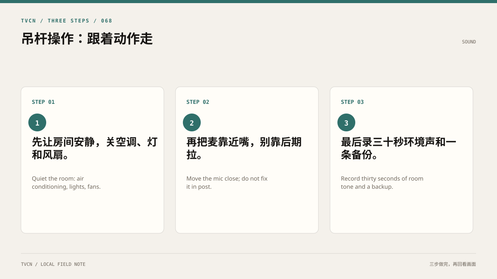

吊杆跟着动作走，不跟着台词走；台词会停，身体不会。

<!-- DIAGRAM_START -->
<h2>图解</h2>
<figure>
  
  <figcaption>把三步按顺序做完，再回看画面或文件。</figcaption>
</figure>
<!-- DIAGRAM_END -->
<h2>现场</h2>

跟着演员的手和脚步走，不要跟着台词。演员停你就停；演员转身时，杆头保持在上方和画框外。

<h2>怎么做</h2>

吊杆跟着动作走，不跟着台词走；台词会停，身体不会。杆头要一直在画框上方。
<ol><li>跟着演员的手和脚步移动，不要追着台词甩杆。</li><li>演员停你就停，演员转身时把杆头保持在头顶上方。</li><li>回放检查杆头没有入画、对白没有被衣服或呼吸声盖住。</li></ol>
<h2>别踩</h2>

别跟着台词甩杆；杆头一动，画面和声音都会穿帮。

<h2>验收</h2>
<ul><li>回放里杆头没有入画，边缘没有阴影。</li><li>演员走动和转身时，对白音量保持稳定。</li><li>杆没有跟着每句台词抽动，声音没有明显的方向变化。</li></ul>
