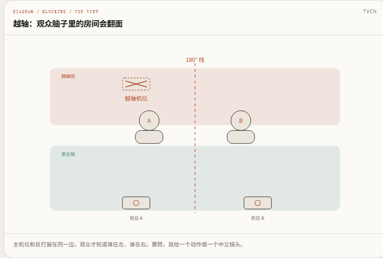

<!-- DIAGRAM_START -->
## 图解

<figure>
  
  <figcaption>主机位和反打留在同一边，观众才知道谁在左、谁在右。要跨，就给一个动作或一个中立镜头。</figcaption>
</figure>
<!-- DIAGRAM_END -->

## 先在地上画一条线

两个人面对面，把他们的连线当成一条边界。主机位在一侧，反打也在同一侧，观众就知道谁在左、谁在右。这个规则不神秘，它只是帮观众保住一张房间的地图。

拍之前用手机拍一张全景，回放看一眼：甲在画面左边，乙在右边。后面每个机位都回看这张图，比在现场凭记忆靠谱。

## 什么时候可以跨

人物走动、镜头跟着穿过房间、或者你插入一个中立镜头，观众就能接受方向改变。中立镜头可以是一双手、一杯水、一扇门，只要它不站在任何一边。

最怕的是无理由硬切。前一秒甲在左，后一秒甲在右，观众会花两秒找方向，这两秒里台词白说了。

## 一个人拍对话，先拍干净的单人

没有第二台机器，就先拍甲的单人全景，再拍乙的单人全景，最后补手和物件的特写。单人镜头拍得干净，剪的时候可以自由调换顺序，不用靠越轴制造“电影感”。

每换一次机位，重新对一次焦和白平衡。对话戏最容易翻车的地方，往往不是表演，是两条镜头颜色不一样。

## 3 条验收

- 全景里能一眼看出谁在左、谁在右。
- 每一次越轴，都有动作、移动或中立镜头作理由。
- 两条反打镜头的色温和曝光能接上。

## 轴线是关系，不是地上的线

轴线来自两个人或两个物体的相对位置。人物一移动，线就跟着移动；你盯的是关系，不是地上那条胶带。

先拍一条全景，把谁在左、谁在右、谁看谁定下来。全景就是观众的坐标系。

## 可以跨轴的三种情况

一，镜头里有中性运动：人物走过镜头，观众看到位置交换。二，摄影机移动，观众跟着越过线。三，主观视角，观众暂时站到某个人的位置上。

三种都要让观众看见“怎么跨”。直接切到对面，观众只会觉得跳。

## 跨错了怎么补救

先补一个中性镜头：正面、俯拍或人物穿过画面。再补一个全景，重新建立左右。

不要用翻转画面修。翻转会把文字、手表、口袋和光的方向一起翻掉，下一镜更乱。

<!-- V11_DEEPEN -->

<!-- SOURCES_START -->
## 参考与延伸阅读

- [S31] [ARRI：电影系统](https://www.arri.com/en/cine-systems) — 2026-11-26 访问。用于核对「先在地上画一条线」一节的术语/方法/规则（ARRI 摄影机、镜头与灯光资料，不是通用拍摄教程）；不核对其中由本页经验得出的数字、型号与现场结论，也不替代测试。
- [S52] [ARRI：ALEXA 35](https://www.arri.com/en/camera-systems/cameras/legacy-camera-systems/alexa-35) — 2026-11-26 访问。用于核对「什么时候可以跨」一节的术语/方法/规则（ALEXA 35 官方规格，不是独立测试）；不核对其中由本页经验得出的数字、型号与现场结论，也不替代测试。
- [S53] [Sony：FX6](https://pro.sony/ue_US/products/handheld-camcorders/ilme-fx6v) — 2026-11-26 访问。用于核对「一个人拍对话，先拍干净的单人」一节的术语/方法/规则（FX6 官方规格，不是独立测试）；不核对其中由本页经验得出的数字、型号与现场结论，也不替代测试。
<!-- SOURCES_END -->

