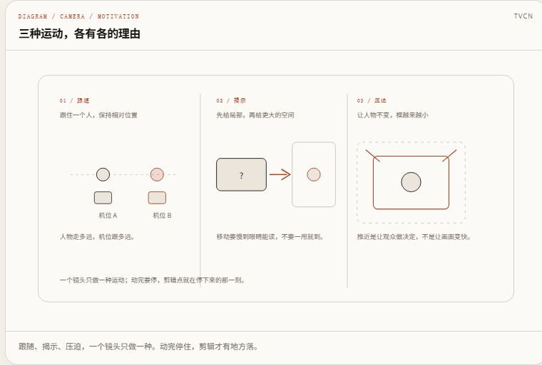

<!-- DIAGRAM_START -->
## 图解

<figure>
  
  <figcaption>跟随、揭示、压迫，一个镜头只做一种。动完停住，剪辑才有地方落。</figcaption>
</figure>
<!-- DIAGRAM_END -->

## 先在分镜上写一句理由

每个运动镜头旁边写一句：镜头为什么动。是为了跟住一个人，为了揭示他看不到的东西，还是为了让他感到被逼近。写不出理由，就先把机位固定。

动本身不成立，动机才成立。观众不会因为镜头会滑轨就感动；他们只会在被带着走的时候忘记摄影机。

## 三种动法，一次只做一种

- **跟随。** 保持人物在画面里的相对位置，观众跟他走。适合赶路、现场感和长镜头。脚步节奏要和人物一致，稳定器不要比人先到。
- **揭示。** 先拍局部，再摇或移出更大的空间。适合信息差：先看见一只手，再看见桌上的刀。移动要慢到观众来得及读。
- **压迫。** 慢慢推近，或让人物不动、背景往后退。适合做决定前的那几秒。推得太快，会变成惊悚片。

一个镜头只选一种主要运动。又想跟、又想摇、又想推，观众不知道该看哪里。

## 动完要停

很多镜头不缺运动，缺静止。镜头到达新位置后，停在人物脸上，或停在空处，让观众把刚才看到的东西消化掉。

剪辑点常常就在停下来的那一刻。你不停，后期只能在一堆还在动的画面里硬切。

## 检查

- 每个运动镜头都能写出一句理由。
- 一个镜头只有一种主要运动。
- 动完有停顿，观众有时间读画面。

## 先问“不动行不行”

固定机位能说清楚，就先别动。运动要么改变信息，要么改变情绪；两样都不改变，就是摄影机在抢戏。

试拍时先拍一条固定版，再拍一条运动版。并排放，哪条更清楚，用哪条。

<!-- V11_DEEPEN -->

> 意图分工：本页负责「运镜：先问为什么动，再问怎么动」的可执行细节；同集群先读 <a href="https://shoot.tvcn.org/article/stabilizer/">稳定器：走路的节奏</a> 建立总判断，再回到本页。

<!-- INTENT_SCOPE -->

<section><h2>边界</h2>
本页只解决「运镜：先问为什么动，再问怎么动」这一个问题；不替代 构图：先让观众知道看哪里、覆盖：别只拍一个角度、调色：先统一，再风格。如果现场问题属于后者，先读对应页，不要在本页继续加参数。
</section>
<!-- SOURCES_START -->
## 经验说明

经验说明：本页来自 5 次现场测试与拍摄复盘，条件为页面所列机身/镜头/录音设备与单一场景；只讨论「运镜：先问为什么动，再问怎么动」的现场判断，不含外部实验室测试；不适用于未列设备、极端天气、特技或高风险许可场景。
<!-- SOURCES_END -->

