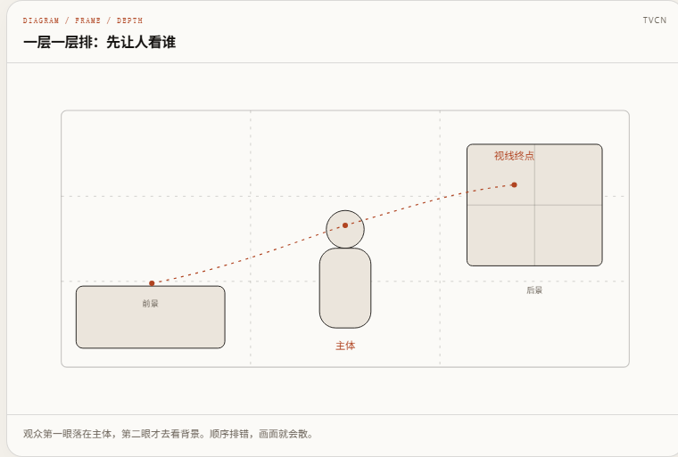

<!-- DIAGRAM_START -->
## 图解

<figure>
  
  <figcaption>观众第一眼落在主体，第二眼才去看背景。顺序排错，画面就会散。</figcaption>
</figure>
<!-- DIAGRAM_END -->

## 一个画面只有一个主角

观众看一个画面，第一眼只能落在一个地方。先用最亮、最清晰、最居中的元素告诉他看谁；其他元素只做陪衬。

如果人脸和背景都在抢，就压暗背景、移开杂物，或者靠近一步。构图首先是减法。

## 前中后景各干一件事

前景交代空间，中景放人物，后景给信息。三层都有东西，画面才有纵深；三层都在抢，画面就乱。

没有前景时，找一片树叶、一道门框、一个人的肩膀。它不需要重要，只需要把空间分开。

## 视线和运动要留白

人物看向右边，就在右边留空；人物往左走，就在左边留路。留白不是浪费，是给观众预判下一秒。

横屏和竖屏的留白方向不一样。竖屏先保证人脸在安全区，再谈左右空间。

## 3 条验收

- 暂停画面，3 秒内能说出主体是谁。
- 画面至少有两层空间。
- 人物视线方向有留白。

## 主体不一定在中心

中心最稳，但也最闷。把主体放在三分线附近，留出视线方向，画面才有下一步。

如果背景有强线条，先让线条指向主体，再决定主体放哪。线条比网格更有用。

## 竖屏先保安全区

竖屏的左右很窄，人脸先放中间安全区，再把字幕和图标的位置留出来。横屏的左右留白，在竖屏里会变成空。

## 三秒测试

暂停画面，问三个人：你第一眼看谁？第二眼看哪？第三眼看到什么信息？三个答案一致，构图就成立。

如果三个人第一眼看的都不一样，不是观众问题，是画面没有主次。

<!-- V11_DEEPEN -->

> 意图分工：本页负责「构图：先让观众知道看哪里」的可执行细节；同集群先读 <a href="https://shoot.tvcn.org/article/camera-height/">机位高度：蹲下比换镜头有用</a> 建立总判断，再回到本页。

<!-- INTENT_SCOPE -->

<section><h2>边界</h2>
本页只解决「构图：先让观众知道看哪里」这一个问题；不替代 覆盖：别只拍一个角度、运镜：手持、稳定器、覆盖、调色：先统一，再风格。如果现场问题属于后者，先读对应页，不要在本页继续加参数。
</section>
<!-- DEEP_DIVE_START -->
## 深读

<strong>约 8 分钟。</strong> 这一节不重复前面的做法，只补三个东西：两种条件、一个反例、一个可复用模型；读完能判断什么时候换做法。

### 条件 A：广角/环境构图

广角构图的重点不是“把东西都放进去”，是“让观众知道人在空间里的位置”。先定三条线：地平线、墙面线、人物视线；三条线不要互相打架。人物放在画面三分之一，不是规则，是让空间有呼吸。

广角容易把边缘拉歪；把重要的人脸放在画面中心 60% 内，边缘留给环境。观众先看脸，再看空间；顺序反了，人物会变成风景里的一个点。

### 条件 B：近景/双人构图

近景构图先定“眼睛在哪”，再定“肩膀怎么切”。不要切在关节上，切在胸口或上臂；眼睛放在画面上三分之一，给下巴留空间。双人构图不要让两个人一样大，除非你想说“他们平等”；一大一小，关系立刻有方向。

近景的背景要简化，不是虚化。虚化能藏东西，也能藏信息；如果背景里有一个观众该看的细节，保留它，不要用大光圈抹掉。

### 反例：构图很对，但没人看

一张画面严格按三分法，人物在交叉点，背景有引导线，颜色也配好了。但观众第一眼看的是背景的灯，不是人物。因为人物没有动作，背景比人亮。

修法不是把人物挪到中心，而是给人物一个动作、给背景降一档。构图的终点是“观众知道看哪里”，不是“符合规则”。先问画面里谁最亮、谁在动、谁有眼睛；三个答案不一致，构图就散。

### 可复用模型

<strong>视线 → 重心 → 边缘 → 背景。</strong> 先定人物看哪，再定视觉重心，再检查边缘有没有干扰，最后决定背景留什么。四步按顺序，不要先摆三分法。

拍完在监视器上看 3 秒：第一眼落在哪、第二眼看到什么、有没有第三眼干扰。三秒说不清，换机位，不换镜头。

<!-- DEEP_DIVE_END -->

<!-- SOURCES_START -->
## 参考与延伸阅读

- [S31] [ARRI：电影系统](https://www.arri.com/en/cine-systems) — 2026-11-26 访问。用于核对「一个画面只有一个主角」一节的术语/方法/规则（ARRI 摄影机、镜头与灯光资料，不是通用拍摄教程）；不核对其中由本页经验得出的数字、型号与现场结论，也不替代测试。
- [S52] [ARRI：ALEXA 35](https://www.arri.com/en/camera-systems/cameras/legacy-camera-systems/alexa-35) — 2026-11-26 访问。用于核对「前中后景各干一件事」一节的术语/方法/规则（ALEXA 35 官方规格，不是独立测试）；不核对其中由本页经验得出的数字、型号与现场结论，也不替代测试。
- [S53] [Sony：FX6](https://pro.sony/ue_US/products/handheld-camcorders/ilme-fx6v) — 2026-11-26 访问。用于核对「视线和运动要留白」一节的术语/方法/规则（FX6 官方规格，不是独立测试）；不核对其中由本页经验得出的数字、型号与现场结论，也不替代测试。
<!-- SOURCES_END -->

