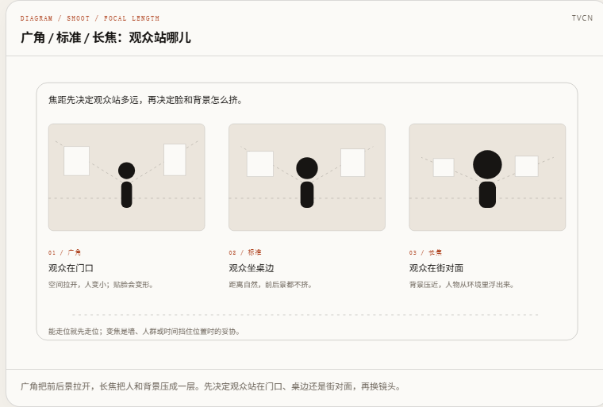

<!-- DIAGRAM_START -->
## 图解

<figure>
  
  <figcaption>广角把前后景拉开，长焦把人和背景压成一层。先决定观众站在门口、桌边还是街对面，再换镜头。</figcaption>
</figure>
<!-- DIAGRAM_END -->

焦距不是“拍得宽”和“拍得远”。它先决定观众站在哪里看这个人，再决定脸和背景怎么挤。

## 广角：把空间拉开，也会把人推远

广角装得下整个房间，也把前景和背景拉得很开。贴近人脸用广角，鼻子会变大，背景会退到很远，观众像站在人物面前被推了一把。适合走廊、车内、狭小空间，或者你要让两个人看起来离得很远。

不要为了“都拍进去”把广角开到最广。先问：这个房间里，观众该站在门口，还是坐进桌边？站门口就用广角，坐桌边就退一点，用更长的焦距。

## 长焦：把人和背景压在一起

长焦把远处的东西拉近，也把人和背景压成一层。人物从环境里“浮”出来，适合观察、偷看、人群里只认一张脸。拍长焦时，观众像站在街对面，不打扰，但看得清。

压得太狠，空间会变成一张纸，观众不知道人在哪。保留一点前景：栏杆、肩膀、树叶，让人知道自己还站在什么地方。

## 先决定距离，再选镜头

能走位就先走位。往前两步、往后退一步，比换镜头便宜，也比换镜头快。变焦是妥协：位置被墙挡住、被人群挡着、被时间挡着，才用它。

一场戏里换焦段，不要为了“丰富”而换。广角交代关系，长焦给出判断；两个镜头之间，观众的位置要说得通。

## 检查

- 广角贴脸时，脸的变形是不是你要的？
- 长焦有没有把空间压成一张纸，观众还知道人在哪吗？
- 换镜头之前，机位是不是已经试过能走的位置？
