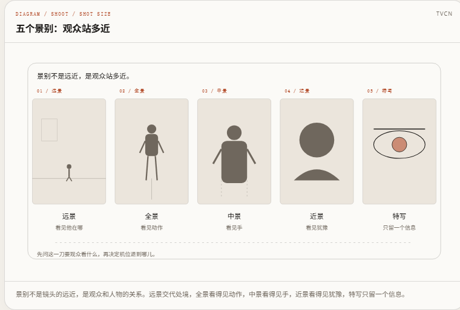

<!-- DIAGRAM_START -->
## 图解

<figure>
  
  <figcaption>景别不是镜头的远近，是观众和人物的关系。远景交代处境，全景看得见动作，中景看得见手，近景看得见犹豫，特写只留一个信息。</figcaption>
</figure>
<!-- DIAGRAM_END -->

## 远景：先交代他在哪

远景里人小，地方大。观众先看见门、路、墙、雨棚，再看见人。它不是风景照，是人物和处境的关系：他在一个多大的地方，离出口多远，旁边有没有别人。

如果人物小到认不出，观众就只看见地方，看不见人。远景可以拿来开头，也可以拿来结尾，但连续给三个远景，观众会失去抓手，不知道该跟谁。

## 全景和中景：动作与关系

全景看得见全身，观众知道他在做什么、站在哪里、和旁边的人隔多远。中景到腰，手还能做事，脸也还看得清。两个人对话，中景最常用，因为两个人都在画面里，谁往前一步都看得见。

不要为了“电影感”一直用中景。观众会忘记房间长什么样，也忘记人物从哪来。中景是工作景别，不是默认美学。

## 近景和特写：只留一个信息

近景到胸，表情开始有用。特写到脸、眼睛或手，画面只留一个信息。特写是一个承诺：接下来要有事发生。不要用特写拍一句废话，也不要让观众同时看眼睛、看背景、看字幕。

切景别不要只为了变化。同一场里跳得太勤，观众会累。先用一个主景别把关系站住，再在关键动作上换一次。

## 检查

- 这个景别让观众看见的，是这一刀最需要的信息吗？
- 远景里人物还认得出吗？中景里房间还成立吗？
- 特写之后，有没有一件值得它那么大的事发生？
