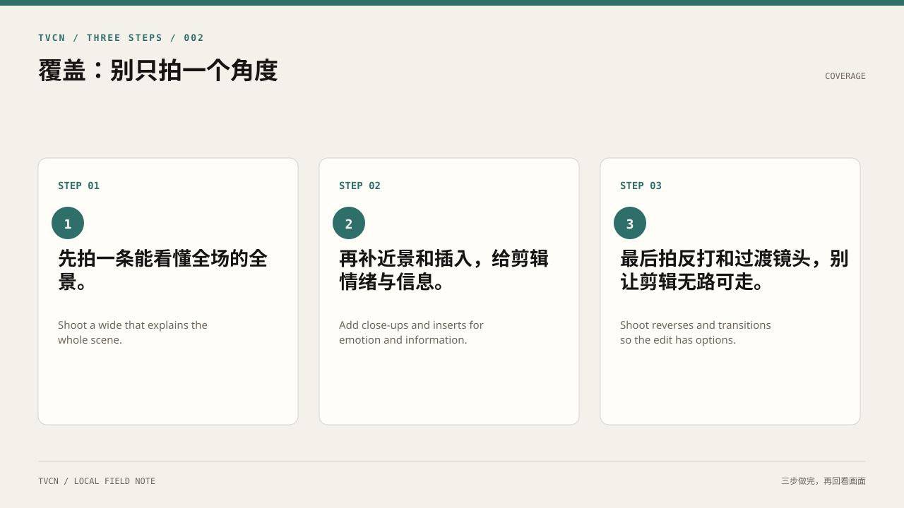

每个场景至少三种材料：一条能独立讲清空间的保底主镜头、一条反打或过肩、两三个能插入的动作特写。剪辑时需要靠它们改节奏、藏穿帮、救表演。

<!-- DIAGRAM_START -->
<h2>图解</h2>
<figure>
  
  <figcaption>看“先拍一条能看懂全场的全景，至少两条”和“再补中景、近景和手部插入，每个景别至…”两处，判断高光、肤色和声音有没有被同时保住。</figcaption>
</figure>
<!-- DIAGRAM_END -->
<section><h2 id="section-1">覆盖是给剪辑留选择，不是多拍角度</h2>
开机前按“主镜头—反打—插入”列一张覆盖表，每项写拍到什么才算过；不要现场看到什么拍什么。
<h2 id="section-2">边界</h2>
镜头多不等于能剪。所有角度必须共享同一条动作线；演员在每条里做的动作不一致，素材越多越难救。
</section><section><h2 id="section-3">现场</h2>
一场戏拍四条：全景交代空间，中景交代关系，近景交代反应，手部插入交代信息。每条至少拍两条，按顺序在监视器上回放。
</section><section><h2 id="section-4">怎么做</h2>
覆盖不是同一条拍十遍，而是给剪辑留下不同信息：全景交代空间，中景交代关系，近景交代反应，插入交代细节。
<ol><li>先拍一条能看懂全场的全景，至少两条。</li><li>再补中景、近景和手部插入，每个景别至少两条。</li><li>最后拍反打和过渡镜头，按顺序回放，确认每个信息点都有替代。</li></ol></section><section><h2 id="section-5">别踩</h2>
别用同一种景别拍完整场；那不叫覆盖，叫重复。
</section><section><h2>判断</h2>
现场只认三个信号：
<ul><li>高光没有死白，暗部仍保留可恢复的细节</li><li>同一条片子里肤色一致，切机位不跳</li><li>声音有独立音轨，不靠机头麦兜底</li></ul></section><section><h2>失败</h2>
下面三种做法会让页面上的细节白做：
<ul><li>曝光对了，但光没有方向，脸和背景粘在一起</li><li>声音只靠机头麦，现场一吵就废</li><li>机位越轴，观众失去空间方向</li></ul></section><section><h2>延伸</h2>
<strong>10 分钟练习：</strong>用同一扇窗拍三条 10 秒，只改“先拍一条能看懂全场的全景，至少两条”；比较高光、肤色和背景，选一条能直接剪的。
</section>
<h2>验收</h2><ul><li>全景、中景、近景、插入四类素材都至少有一条可用。</li><li>手部或道具插入能独立交代一个信息点，不依赖旁白。</li><li>剪辑台上每个信息点都有两个景别可选，缺一条就要补拍。</li></ul>

<!-- DEEP_DIVE_START -->
## 深读

<strong>约 6 分钟。</strong> 覆盖不是把每个角度都拍一遍，而是让剪辑在关键时刻有得选。少一个反打，整场戏就只能听声音。

### 先保完整动作，再补角度

主机位先把一场戏从进门到坐下完整拍一遍。这场戏的情绪靠它托底，其他角度都是从这里拆出去。

时间只够两条时，先保主机位和反打。反打不是正反打的全部，但没有它，对话只能切单边。

### 四种镜头，各有各的活

全景交代空间和人物关系，中景保表演，近景保情绪，插入保剪辑。每组至少两条，现场一慌才有替代。

不要用运动镜头代替覆盖。运动好看，但剪的时候没有静止点，观众会累，剪辑也没有地方下刀。

### 什么时候可以少拍

十秒的短视频不需要八个角度。一个主视角、一个细节、一个反打，足够把一件事说清。

长对话才需要正反打和反应。先问这场戏要观众看谁，再决定把镜头给谁；不是每个角色都需要同等覆盖。

### 覆盖也有优先级

时间和预算有限时，顺序是：完整主机位、反打、关键插入、气氛镜头。前三个保叙事，最后一个保质感。

不要先拍空镜。空镜再美，剪不进对话也白拍；主机位缺一条，整场戏就残。

### 少一条的代价

现场觉得“这条以后补”，后期往往补不了：演员换了衣服、光变了、场景拆了。补拍成本是现场的三倍。

收工前翻表，缺的反打和插入当场补。宁可晚半小时收工，不要三个月后重拍。

### 覆盖拍完，对照这十项
<ul><li>主机位完整覆盖整场动作</li><li>每组都有全景、中景、近景、插入</li><li>每个角度至少两条</li><li>反打和反应镜头单独列</li><li>运动镜头没有替代覆盖</li><li>检查演员是否被前景挡住</li><li>记录每个镜头实际条数</li><li>收工前补拍缺失的插入</li><li>镜头表拍照发给剪辑</li><li>确认备份后再格式化卡</li></ul>
覆盖不是拍得多，是拍得全。剪辑需要的那一条，现场往往只差一个角度。

<!-- DEEP_DIVE_END -->

<!-- SOURCES_START -->
## 参考与延伸阅读

- [S23] [SMPTE 标准入口](https://www.smpte.org/standards) — 2026-11-26 访问。用于核对首段“覆盖不是多拍几条，而是给剪辑留下能救场的不同信息：全景、近景、插入、反打。”中的术语与公开背景（时间码、色彩、影院与信号链标准的机构入口）；不替代现场测试。
- [S31] [ARRI Cine Systems](https://www.arri.com/en/cine-systems) — 2026-11-26 访问。用于核对首段“覆盖不是多拍几条，而是给剪辑留下能救场的不同信息：全景、近景、插入、反打。”中的术语与公开背景（摄影机、镜头与灯光的技术资料入口）；不替代现场测试。
- [S32] [Sony 专业影像支持](https://pro.sony/ue_US/support) — 2026-11-26 访问。用于核对首段“覆盖不是多拍几条，而是给剪辑留下能救场的不同信息：全景、近景、插入、反打。”中的术语与公开背景（专业摄影机与镜头的支持、固件与文档）；不替代现场测试。
- [S33] [Canon 支持](https://www.usa.canon.com/support) — 2026-11-26 访问。用于核对首段“覆盖不是多拍几条，而是给剪辑留下能救场的不同信息：全景、近景、插入、反打。”中的术语与公开背景（相机、镜头与固件的官方支持入口）；不替代现场测试。
- [S52] [ARRI：ALEXA 35](https://www.arri.com/en/camera-systems/cameras/legacy-camera-systems/alexa-35) — 2026-11-26 访问。用于核对首段“覆盖不是多拍几条，而是给剪辑留下能救场的不同信息：全景、近景、插入、反打。”中的术语与公开背景（摄影机规格、Log-C 与色彩流程）；不替代现场测试。
<!-- SOURCES_END -->

