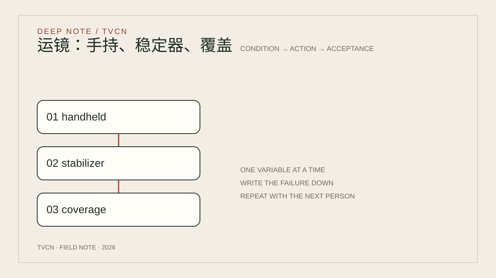

运镜不是让画面动起来，而是让运动服务走位、覆盖和剪辑点。 单看《手持：让呼吸进画面》只能解决一个局部；把《手持：让呼吸进画面》《稳定器：走路的节奏》《覆盖：别只拍一个角度》接成一条链，才会暴露“条件没写、变量太多、结果无法复现”的真问题。

<!-- DEEP_DIVE_START -->
<!-- DIAGRAM_START -->
<h2>图解</h2>
<figure>
  
  <figcaption>看“手持：让呼吸进画面”和“稳定器：走路的节奏”两处，先定条件，再看失败能不能被记录下来。</figcaption>
</figure>
<!-- DIAGRAM_END -->

<section><h2 id="section-1">问题</h2>
这一页的问题不是“方法不够多”，而是三个环节各自成立、合起来却不成立：条件没写、变量太多、结果不能复现。

本页按“先定条件—再做判断—只改一个变量—留下证据”的顺序；每一步都能被下一个人复述，才算完成。
</section>
<section><h2 id="section-2">判断</h2><ul><li>《手持：让呼吸进画面》的第一道门槛：24mm 和 50mm 各拍 10 秒三步；回放时地平线漂移不超过画面高度 2%</li><li>《稳定器：走路的节奏》的第二道门槛：人物头部保持在画面上三分之一附近，上下漂移不超过 2% 画幅高</li><li>《覆盖：别只拍一个角度》的第三道门槛：呼吸节奏 3–4 秒一次，没有无理由的急停或突然加速</li></ul>
三条里有一条不成立，就先回到对应单页；不要用整条链掩盖一个没解决的单点。
</section>
<section><h2 id="section-3">做法</h2><ol><li>先写条件：把《手持：让呼吸进画面》里“双脚与肩同宽，手肘贴住肋骨，两条之间换气”落到一张三行表：素材、环境、验收。</li><li>再做一次最小动作：只按《手持：让呼吸进画面》的步骤做 30 秒，不加入第二页的方法。</li><li>把《稳定器：走路的节奏》的步骤接上：十秒走三步，让身体带着机器走，不要用手臂甩。</li><li>用《覆盖：别只拍一个角度》做对照：回放检查：要像呼吸，不要像地震。</li><li>每改一次只动一个变量；其他条件写进记录，不靠记忆。</li><li>把失败也拍下来：失败版本和成功版本并排，才知道哪一步不能省。</li><li>让下一个人按记录复现一次；他做不出来，说明记录还不够。</li></ol></section>
<section><h2 id="section-4">现场案例</h2>
可复现实验（不是客户案例）：拿 30 秒素材，先按《手持：让呼吸进画面》的“24mm 和 50mm 各拍 10 秒三步；回放时地平线漂移不超过画面高度 2%”做 A 版；再按《稳定器：走路的节奏》的“人物头部保持在画面上三分之一附近，上下漂移不超过 2% 画幅高”做 B 版；两版只允许一个变量不同。把两版并排看，记录《覆盖：别只拍一个角度》里最先崩的是哪一项：条件、动作还是验收。如果一次就成功，说明变量还不够多，再加一个现实限制重做。
</section>
<section><h2 id="section-5">失败表</h2>
<table class="data-table"><thead><tr><th>现象</th><th>原因</th><th>替换动作</th></tr></thead><tbody><tr><td>别碎步、别拧腰；稳定器只能消小抖，消不掉脚步的上下跳</td><td>条件没写清</td><td>回到第一页重写三行表</td></tr><tr><td>别用同一种景别拍完整场；那不叫覆盖，叫重复</td><td>条件没写清</td><td>回到第一页重写三行表</td></tr><tr><td>只看结果，不记条件</td><td>条件没写清</td><td>回到第一页重写三行表</td></tr></tbody></table>
</section>
<section><h2 id="section-6">验收</h2><ul><li>24mm 和 50mm 各拍 10 秒三步；回放时地平线漂移不超过画面高度 2%。</li><li>人物头部保持在画面上三分之一附近，上下漂移不超过 2% 画幅高。</li><li>呼吸节奏 3–4 秒一次，没有无理由的急停或突然加速。</li><li>记录机器、镜头、焦段、帧率、快门、防抖模式；同一条镜头换人拍，能复现同样节奏。</li><li>直线行走时画面没有随脚步上下起伏。</li><li>转弯速度均匀，没有突然甩头或横移。</li><li>二十米空走和带机器走的节奏一致。</li><li>三轴调平再开机</li><li>电机不烫手</li><li>电池和卡都装好</li></ul></section>
<section><h2 id="section-7">替代方案</h2><ul><li>只处理《手持：让呼吸进画面》里的单点问题：回到<a href="https://shoot.tvcn.org/article/handheld/">《手持：让呼吸进画面》</a>，不要用整条链。</li><li>只比较两个动作：看<a href="https://shoot.tvcn.org/article/stabilizer/">《稳定器：走路的节奏》</a>，先不改第三页。</li><li>只做验收：看<a href="https://shoot.tvcn.org/article/coverage/">《覆盖：别只拍一个角度》</a>，把判断表拿去做自测。</li></ul></section>

<!-- SOURCES_START -->
## 参考与延伸阅读

- [S16] [BBC 编辑准则](https://www.bbc.co.uk/editorialguidelines/) — 2026-11-26 访问。用于核对首段“运镜不是让画面动起来，而是让运动服务走位、覆盖和剪辑点。”中的术语与公开背景（准确性、公正、隐私与隐蔽拍摄的编辑标准）；不替代现场测试。
- [S23] [SMPTE 标准入口](https://www.smpte.org/standards) — 2026-11-26 访问。用于核对首段“运镜不是让画面动起来，而是让运动服务走位、覆盖和剪辑点。”中的术语与公开背景（时间码、色彩、影院与信号链标准的机构入口）；不替代现场测试。
- [S31] [ARRI Cine Systems](https://www.arri.com/en/cine-systems) — 2026-11-26 访问。用于核对首段“运镜不是让画面动起来，而是让运动服务走位、覆盖和剪辑点。”中的术语与公开背景（摄影机、镜头与灯光的技术资料入口）；不替代现场测试。
- [S52] [ARRI：ALEXA 35](https://www.arri.com/en/camera-systems/cameras/legacy-camera-systems/alexa-35) — 2026-11-26 访问。用于核对首段“运镜不是让画面动起来，而是让运动服务走位、覆盖和剪辑点。”中的术语与公开背景（摄影机规格、Log-C 与色彩流程）；不替代现场测试。
- [S53] [Sony：FX6](https://pro.sony/ue_US/products/handheld-camcorders/ilme-fx6v) — 2026-11-26 访问。用于核对首段“运镜不是让画面动起来，而是让运动服务走位、覆盖和剪辑点。”中的术语与公开背景（机身规格、录制格式与接口）；不替代现场测试。
<!-- SOURCES_END -->

