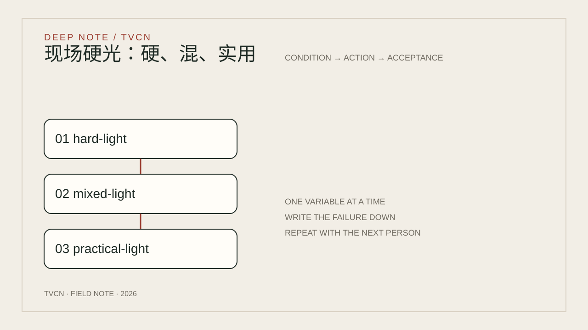

硬光不是缺点；问题是硬光、实用光和色温三种来源有没有被安排在同一张脸上。 单看《硬光：影子也是构图》只能解决一个局部；把《硬光：影子也是构图》《混合光：两种色温别打平》《实用光：画面里的灯怎么用》接成一条链，才会暴露“条件没写、变量太多、结果无法复现”的真问题。

<!-- DEEP_DIVE_START -->
<!-- DIAGRAM_START -->
<h2>图解</h2>
<figure>
  
  <figcaption>看“硬光：影子也是构图”和“混合光：两种色温别打平”两处，先定条件，再看失败能不能被记录下来。</figcaption>
</figure>
<!-- DIAGRAM_END -->

<section><h2 id="section-1">问题</h2>
这一页的问题不是“方法不够多”，而是三个环节各自成立、合起来却不成立：条件没写、变量太多、结果不能复现。

本页按“先定条件—再做判断—只改一个变量—留下证据”的顺序；每一步都能被下一个人复述，才算完成。
</section>
<section><h2 id="section-2">判断</h2><ul><li>《硬光：影子也是构图》的第一道门槛：影子落在背景或墙面上，成为构图的一部分</li><li>《混合光：两种色温别打平》的第二道门槛：眼睛和嘴没有被影子切断，五官仍读得清</li><li>《实用光：画面里的灯怎么用》的第三道门槛：调整只动了灯或演员十厘米，不是换柔光箱把硬光毁掉</li></ul>
三条里有一条不成立，就先回到对应单页；不要用整条链掩盖一个没解决的单点。
</section>
<section><h2 id="section-3">做法</h2><ol><li>先写条件：把《硬光：影子也是构图》里“把硬光放在侧面，让影子落在背景或墙上”落到一张三行表：素材、环境、验收。</li><li>再做一次最小动作：只按《硬光：影子也是构图》的步骤做 30 秒，不加入第二页的方法。</li><li>把《混合光：两种色温别打平》的步骤接上：盯住影子是否切过眼睛或嘴。</li><li>用《实用光：画面里的灯怎么用》做对照：切到五官时，把灯或演员移动十厘米，再拍一条。</li><li>每改一次只动一个变量；其他条件写进记录，不靠记忆。</li><li>把失败也拍下来：失败版本和成功版本并排，才知道哪一步不能省。</li><li>让下一个人按记录复现一次；他做不出来，说明记录还不够。</li></ol></section>
<section><h2 id="section-4">现场案例</h2>
可复现实验（不是客户案例）：拿 30 秒素材，先按《硬光：影子也是构图》的“影子落在背景或墙面上，成为构图的一部分”做 A 版；再按《混合光：两种色温别打平》的“眼睛和嘴没有被影子切断，五官仍读得清”做 B 版；两版只允许一个变量不同。把两版并排看，记录《实用光：画面里的灯怎么用》里最先崩的是哪一项：条件、动作还是验收。如果一次就成功，说明变量还不够多，再加一个现实限制重做。
</section>
<section><h2 id="section-5">失败表</h2>
<table class="data-table"><thead><tr><th>现象</th><th>原因</th><th>替换动作</th></tr></thead><tbody><tr><td>别用硬光正面直打；影子会变成脸上的污点</td><td>条件没写清</td><td>回到第一页重写三行表</td></tr><tr><td>别把所有色温打成白；两种光打架，空间就平了</td><td>条件没写清</td><td>回到第一页重写三行表</td></tr><tr><td>别让画面里的灯泡当唯一主光；它照不亮脸，只会过曝</td><td>条件没写清</td><td>回到第一页重写三行表</td></tr></tbody></table>
</section>
<section><h2 id="section-6">验收</h2><ul><li>影子落在背景或墙面上，成为构图的一部分。</li><li>眼睛和嘴没有被影子切断，五官仍读得清。</li><li>调整只动了灯或演员十厘米，不是换柔光箱把硬光毁掉。</li><li>画面里能同时看出窗光偏冷、灯泡偏暖，层次是有意保留的。</li><li>人脸肤色中性，没有一半青一半黄。</li><li>没有用统一白平衡把两种光抹成一种。</li><li>实际灯在画面里亮着，但没有过曝成白块。</li><li>人脸由另一盏灯打出形状，实际灯只解释背景。</li><li>关掉实际灯后，人物仍能被主光支撑。</li><li>把 硬光：影子也是构图 的条件写成一行，能复述给下一个人。</li></ul></section>
<section><h2 id="section-7">替代方案</h2><ul><li>只处理《硬光：影子也是构图》里的单点问题：回到<a href="https://shoot.tvcn.org/article/hard-light/">《硬光：影子也是构图》</a>，不要用整条链。</li><li>只比较两个动作：看<a href="https://shoot.tvcn.org/article/mixed-light/">《混合光：两种色温别打平》</a>，先不改第三页。</li><li>只做验收：看<a href="https://shoot.tvcn.org/article/practical-light/">《实用光：画面里的灯怎么用》</a>，把判断表拿去做自测。</li></ul></section>
