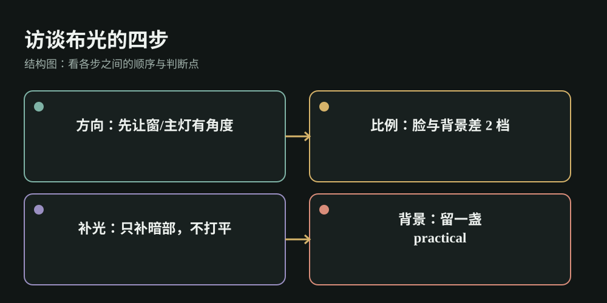

访谈布光最常见的错误，是两盏灯从左右同时打平。脸是亮了，但人物没有立体感，眼睛没有眼神光，剪辑时也找不到反应。访谈不是肖像，人物要说话，光要让他愿意说。

<!-- DIAGRAM_START -->
<h2 id="diagram">图解</h2>
<figure class="diagram">
  
  <figcaption>看“方向、比例、补光、背景”四步；如果脸和背景一样亮、眼神没有光点，人物就会被压成一张证件照。</figcaption>
</figure>
<!-- DIAGRAM_END -->

<section><h2 id="section-1">现场</h2>
一个小房间，下午三点，一扇朝西的窗，一个人物，两台机器。窗光随着时间从侧前方转到侧后方，背景是一面白墙。导演要求“自然、像没打灯”，但访谈要录 90 分钟，不能中途停。
</section>
<section><h2 id="section-2">判断</h2><ul><li><strong>眼神光：</strong>人物眼睛里有一个稳定的光点；没有光点，观众会觉得人“没神”。</li><li><strong>脸与背景的比例：</strong>脸比背景亮 1.5–2 档；一样亮，人物会贴到墙上。</li><li><strong>色温是否混：</strong>窗光 5600K、室内灯 3200K，如果脸一半冷一半暖，后期很难救。</li></ul></section>
<section><h2 id="section-3">怎么做</h2><ol><li>先定方向：让窗光或主灯与人物成 30–45 度，不要从正前方打平；人物稍微转向光，不要正对镜头。</li><li>定比例：先只开窗光拍 10 秒，看脸和背景差多少；不够就用一块反光板补暗部，不急着加第二盏灯。</li><li>加一盏柔光主灯：放在窗光同方向，色温调到和窗光一致；主灯只负责稳定，不负责变亮。</li><li>背景留一盏 practical：台灯、壁灯或屏幕，让背景有层次；背景亮度低于脸，不要抢眼神。</li><li>拍前留 5 分钟：让被访者坐定，看回放里的眼睛、额头高光和背景，确认光在 90 分钟内不会变。</li></ol></section>
<section><h2 id="section-4">失败</h2><ul><li><strong>双灯打平：</strong>左右各一盏，脸没有阴影，鼻子和脸颊连成一片，人物显得不真实。</li><li><strong>色温混：</strong>窗光冷、台灯暖，脸上一半蓝一半黄；后期调一边，另一边又坏。</li><li><strong>背景亮过脸：</strong>白墙或窗户把观众的眼睛拉走，人物说话时观众在看墙。</li></ul></section>
<section><h2 id="section-5">边界</h2>
这套布光适合单人坐访、双人对谈和小型纪录片，不适合剧情片那种需要塑造戏剧阴影的场面，也不替代录音。访谈的声音比光更容易毁掉片子：先把领夹和房间底噪处理好，再谈眼神光。
</section>
<section><h2 id="section-6">验收</h2><ul><li>人物眼睛里有一个稳定光点，且 90 分钟内没有消失。</li><li>脸比背景亮 1.5–2 档，背景还能看见细节。</li><li>皮肤高光没有过曝，额头和鼻尖没有死白。</li><li>被访者看回放时说自己“看起来像自己”，不是“像电视里的人”。</li></ul></section>
<!-- DEEP_DIVE_START -->
## 深读

<strong>约 8 分钟。</strong> 下面把同一套判断放进两个不同条件，再看一个反例和一个可复用模型；不是重复前文，而是决定什么时候该换做法。

### 条件 A：只有一扇窗

只有一扇窗时，窗就是主光，不要再用一盏灯去“补平”。先让人物坐到窗光能照到鼻梁和一侧脸颊的位置，再用一块白反光板把暗部提半档。反光板离脸越近，光越柔；越远，反差越大。拍 10 秒对比，找到“还能看见皮肤纹理”的那一档。

窗光会随时间变。上午冷、下午暖，阴天更柔；如果访谈超过一小时，先拍一个固定参照：让被访者把手放在膝上，拍一张手背，记录色温和曝光。中途光变了，用主灯追到同一档，不要凭眼睛。

### 条件 B：双人对谈

双人对谈不要给两个人各自打一套完整的光，否则剪到一起像两个节目。先定一个共享方向：窗或主灯从两人侧后方来，让两张脸都有同一方向的光；再用一块反光板补近侧的人。两人之间的亮度差控制在半档内，观众才会觉得他们在同一个房间。

如果两人肤色差很大，不要用两盏灯分别“调白”；用同一光源，让肤色差保留。观众相信肤色差，不相信两张被调成一样亮的脸。需要分离时，用背景灯或景别，不要用色温。

### 反例：窗光变了，没有补

一个 70 分钟的访谈，开头窗光在人物左脸，拍到第 40 分钟，太阳转过去，左脸暗了，右脸亮了。摄影师没有发现，因为监视器太小；后期把整段调亮，结果前半段过曝，后半段噪点。人物看起来像换了个人。

修法不是后期调，是现场每 20 分钟拍一张同位置的手背参照，和开机时对比。发现差半档，就把主灯推半档；差一档，停下来重设。访谈可以剪，光不能剪。

### 可复用模型

<strong>方向 → 比例 → 补光 → 背景。</strong> 方向决定人物有没有立体感；比例决定他和墙是不是分开；补光决定暗部有没有细节；背景决定观众会不会分心。四步按顺序做，不要先买灯。

每次布光只改一个变量，拍 10 秒回看。先改方向，再改比例，再改补光；一次改三个，回看时不知道是哪一个起了作用。访谈布光的终点不是“好看”，是“他愿意继续说”。

<!-- DEEP_DIVE_END -->
<!-- SOURCES_START -->
## 参考与延伸阅读

- [S31] [ARRI Cine Systems：ARRI Cine Systems](https://www.arri.com/en/cine-systems) — 2026-11-26 访问。用于核对“判断”一节的术语、方法或规则；不核对本页由经验得出的数字、型号与现场结论，也不替代测试或合同。
- [S52] [ARRI：ALEXA 35](https://www.arri.com/en/camera-systems/cameras/legacy-camera-systems/alexa-35) — 2026-11-26 访问。用于核对“边界”一节的术语、方法或规则；不核对本页由经验得出的数字、型号与现场结论，也不替代测试或合同。
<!-- SOURCES_END -->
