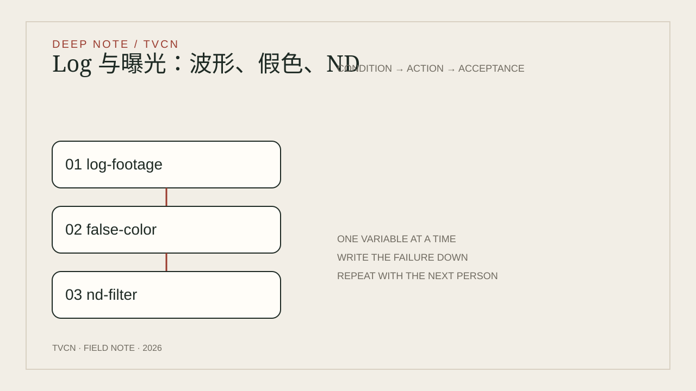

Log 不是万能；曝光、ND 和假色要一起定，否则后期只剩一张灰片。 单看《Log 素材：拍的时候想后期》只能解决一个局部；把《Log 素材：拍的时候想后期》《伪色：一眼看高光》《ND 滤镜：白天大光圈怎么拍》接成一条链，才会暴露“条件没写、变量太多、结果无法复现”的真问题。

<!-- DEEP_DIVE_START -->
<!-- DIAGRAM_START -->
<h2>图解</h2>
<figure>
  
  <figcaption>看“Log 素材：拍的时候想后期”和“伪色：一眼看高光”两处，先定条件，再看失败能不能被记录下来。</figcaption>
</figure>
<!-- DIAGRAM_END -->

<section><h2 id="section-1">问题</h2>
这一页的问题不是“方法不够多”，而是三个环节各自成立、合起来却不成立：条件没写、变量太多、结果不能复现。

本页按“先定条件—再做判断—只改一个变量—留下证据”的顺序；每一步都能被下一个人复述，才算完成。
</section>
<section><h2 id="section-2">判断</h2><ul><li>《Log 素材：拍的时候想后期》的第一道门槛：人脸略高于中灰，暗部没有死黑，高光没有贴顶</li><li>《伪色：一眼看高光》的第二道门槛：每个场景都拍了色卡，后期能按同一 Transform 还原</li><li>《ND 滤镜：白天大光圈怎么拍》的第三道门槛：回放时能说出这张 Log 素材的曝光意图，而不是“先拍了再说”</li></ul>
三条里有一条不成立，就先回到对应单页；不要用整条链掩盖一个没解决的单点。
</section>
<section><h2 id="section-3">做法</h2><ol><li>先写条件：把《Log 素材：拍的时候想后期》里“让人脸曝光略高于中灰，用波形确认”落到一张三行表：素材、环境、验收。</li><li>再做一次最小动作：只按《Log 素材：拍的时候想后期》的步骤做 30 秒，不加入第二页的方法。</li><li>把《伪色：一眼看高光》的步骤接上：把高光压在顶棚以下，不要为了亮把天空打爆。</li><li>用《ND 滤镜：白天大光圈怎么拍》做对照：开机前拍一张色卡，给后期留 Transform 参考。</li><li>每改一次只动一个变量；其他条件写进记录，不靠记忆。</li><li>把失败也拍下来：失败版本和成功版本并排，才知道哪一步不能省。</li><li>让下一个人按记录复现一次；他做不出来，说明记录还不够。</li></ol></section>
<section><h2 id="section-4">现场案例</h2>
可复现实验（不是客户案例）：拿 30 秒素材，先按《Log 素材：拍的时候想后期》的“人脸略高于中灰，暗部没有死黑，高光没有贴顶”做 A 版；再按《伪色：一眼看高光》的“每个场景都拍了色卡，后期能按同一 Transform 还原”做 B 版；两版只允许一个变量不同。把两版并排看，记录《ND 滤镜：白天大光圈怎么拍》里最先崩的是哪一项：条件、动作还是验收。如果一次就成功，说明变量还不够多，再加一个现实限制重做。
</section>
<section><h2 id="section-5">失败表</h2>
<table class="data-table"><thead><tr><th>现象</th><th>原因</th><th>替换动作</th></tr></thead><tbody><tr><td>别把灰片当风格；曝光不对、没有色彩管理，Log 只会更难救</td><td>条件没写清</td><td>回到第一页重写三行表</td></tr><tr><td>别把伪色当滤镜；红色是警告，不是风格</td><td>条件没写清</td><td>回到第一页重写三行表</td></tr><tr><td>别用 ND 压暗后不回调光圈或快门；可变 ND 也别一拧到最黑</td><td>条件没写清</td><td>回到第一页重写三行表</td></tr></tbody></table>
</section>
<section><h2 id="section-6">验收</h2><ul><li>人脸略高于中灰，暗部没有死黑，高光没有贴顶。</li><li>每个场景都拍了色卡，后期能按同一 Transform 还原。</li><li>回放时能说出这张 Log 素材的曝光意图，而不是“先拍了再说”。</li><li>人脸在伪色里落在肤色区，没有红色斑块；鼻尖和额头不先爆。</li><li>窗户、灯泡、白墙保留层次；高光不是一片纯白。</li><li>暗部黑衣服还能看到褶子，不糊成一块。</li><li>记录 EI、ND 档位、光位、监视器型号；换镜头后重新看一遍。</li><li>白天大光圈下快门仍在 1/50 左右，没有为了曝光牺牲景深。</li><li>可变 ND 没有出现十字暗纹或偏色。</li><li>高光没有爆，画面也不是整体欠曝。</li></ul></section>
<section><h2 id="section-7">替代方案</h2><ul><li>只处理《Log 素材：拍的时候想后期》里的单点问题：回到<a href="https://shoot.tvcn.org/article/log-footage/">《Log 素材：拍的时候想后期》</a>，不要用整条链。</li><li>只比较两个动作：看<a href="https://shoot.tvcn.org/article/false-color/">《伪色：一眼看高光》</a>，先不改第三页。</li><li>只做验收：看<a href="https://shoot.tvcn.org/article/nd-filter/">《ND 滤镜：白天大光圈怎么拍》</a>，把判断表拿去做自测。</li></ul></section>

<!-- SOURCES_START -->
## 参考与延伸阅读

- [S31] [ARRI：电影系统](https://www.arri.com/en/cine-systems) — 2026-11-26 访问。用于核对「问题」一节的术语/方法/规则（ARRI 摄影机、镜头与灯光资料，不是通用拍摄教程）；不核对其中由本页经验得出的数字、型号与现场结论，也不替代测试。
- [S52] [ARRI：ALEXA 35](https://www.arri.com/en/camera-systems/cameras/legacy-camera-systems/alexa-35) — 2026-11-26 访问。用于核对「判断」一节的术语/方法/规则（ALEXA 35 官方规格，不是独立测试）；不核对其中由本页经验得出的数字、型号与现场结论，也不替代测试。
- [S53] [Sony：FX6](https://pro.sony/ue_US/products/handheld-camcorders/ilme-fx6v) — 2026-11-26 访问。用于核对「做法」一节的术语/方法/规则（FX6 官方规格，不是独立测试）；不核对其中由本页经验得出的数字、型号与现场结论，也不替代测试。
<!-- SOURCES_END -->

