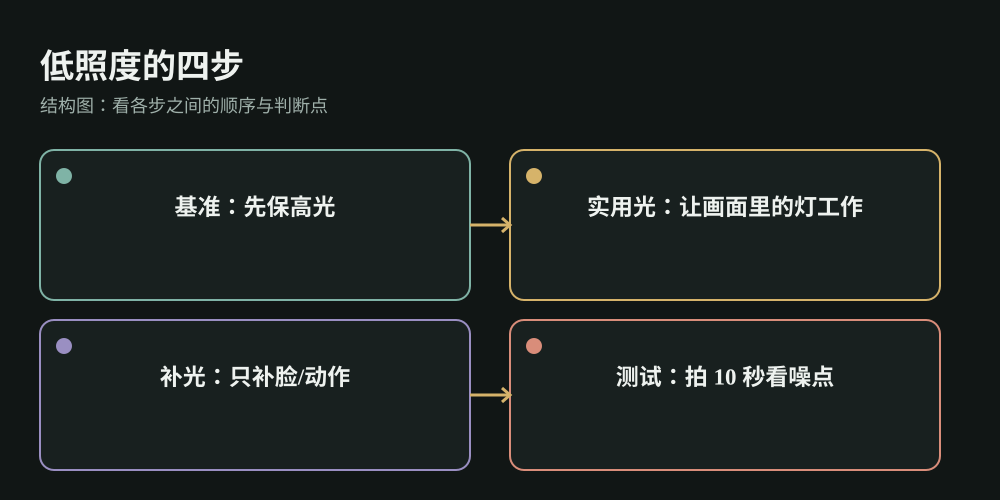

低照度拍摄最容易走进一个循环：画面暗，升 ISO；噪点出来，降噪；细节没了，再加锐化；最后画面又脏又假。问题不在相机，在开机前没有决定“这块黑要不要看见”。

<!-- DIAGRAM_START -->
<h2 id="diagram">图解</h2>
<figure class="diagram">
  
  <figcaption>看“基准、实用光、补光、测试”四步；只靠 ISO 的夜景，黑位会糊成一片，人物也没有方向。</figcaption>
</figure>
<!-- DIAGRAM_END -->

<section><h2 id="section-1">现场</h2>
夜里十点，街边两个人对话，现场只有钠灯和一家关门的店铺灯箱。导演不要大灯，说“要真实”。相机只能开 3200 ISO，快门 1/50，画面里高光保住了，但人脸噪点明显，背景的招牌过曝。
</section>
<section><h2 id="section-2">判断</h2><ul><li><strong>高光是否保住：</strong>招牌、车窗、路灯不要死白；高光一爆，后期拉不回来。</li><li><strong>噪点落在哪：</strong>暗部噪点可以接受，脸和衣服上的噪点会让人显得脏。</li><li><strong>快门是否拖影：</strong>人物走动时手脚糊成一片，说明快门太慢，不是 ISO 太高。</li><li><strong>色温是否统一：</strong>钠灯橙、灯箱绿、手机屏蓝，脸被三种颜色切开。</li></ul></section>
<section><h2 id="section-3">怎么做</h2><ol><li>先定基准：用波形或假色保住高光，允许暗部掉到 10–20 IRE；不要先把整张画面提亮。</li><li>让实用光工作：换灯泡、调灯箱、把手机屏转向人物；画面里的光源比外接灯更可信。</li><li>只补一个面光：用一支小 LED 或反光板，把人物眼窝和鼻梁提半档；不要照亮整个背景。</li><li>用快门换运动：人物走动时保持 1/50；静态对话可以降到 1/40，但不要低于 1/30。</li><li>拍 10 秒测试：回放看脸、暗部、高光、运动；噪点不能靠后期降，先换机位或加实用光。</li></ol></section>
<section><h2 id="section-4">失败</h2><ul><li><strong>全开 ISO：</strong>把 ISO 拉到 12800，脸亮了，但颜色和细节都散了；后期降噪后像塑料。</li><li><strong>快门太慢：</strong>为了亮，把快门降到 1/25；人物一走，手脚拖成影子。</li><li><strong>把路灯当主光：</strong>路灯在头顶，眼窝全黑；观众看不见人物在看谁。</li></ul></section>
<section><h2 id="section-5">边界</h2>
这套方法适合纪实、街头、夜间对话；不适合需要干净商业画面的广告，也不替代灯光。低照度不是“越暗越高级”：如果观众看不清人物在做什么，暗就是失败。安全也要算进去：夜拍先确认路线、电源和撤离点。
</section>
<section><h2 id="section-6">验收</h2><ul><li>高光有细节，招牌和车窗没有死白。</li><li>人脸噪点可接受，暗部噪点不抢注意力。</li><li>人物走动时手脚没有明显拖影。</li><li>画面里至少有一个实用光在承担方向，不是全靠外接灯。</li></ul></section>
<!-- DEEP_DIVE_START -->
## 深读

<strong>约 8 分钟。</strong> 下面把同一套判断放进两个不同条件，再看一个反例和一个可复用模型；不是重复前文，而是决定什么时候该换做法。

### 条件 A：纪实夜景

纪实夜景的第一原则是“先拍到，再拍好”。把相机放在能保住高光的最低 ISO，让暗部自然掉下去；不要为了干净把整条街打亮，观众会立刻知道你在拍。人物的脸只要比背景亮半档，观众就能跟上；剩下的交给实用光和声音。

纪实可以接受噪点，但不能接受看不清动作。如果人物在暗处开门、付钱、看手机，给这些动作一个局部光：门缝、收银台、手机屏。光不用大，只要让动作可读。拍完先回放动作，不要先看画质。

### 条件 B：广告/剧情夜景

广告和剧情夜景可以设计，但不能假。先定“黑位”：背景要黑到能分离人物，又不能黑成一片；用一盏背景 practical 或逆光把轮廓拉出来。再定“脸位”：脸只亮到能看见皮肤，不要亮到没有夜感。两个位置分开算，不要用一个大灯同时解决。

这类夜景通常需要更干净的暗部，所以灯比 ISO 值钱。与其把 ISO 拉到 6400，不如加一盏 60W 的小灯放在画外，给人物一个方向。灯越少，夜越真；灯越多，夜越像棚。

### 反例：降噪之后，细节没了

一个夜景片段用 12800 ISO 拍，脸很亮，噪点很重。后期用强力降噪，噪点没了，但皮肤变成一块平滑的色块，头发边缘也糊了。导演说“像游戏画面”，观众说“像假人”。

问题不在降噪，在拍摄时把噪点留给了后期。正确顺序是：先换机位，让实用光进入画面；再补半档面光；最后才升 ISO。每升一档，拍 10 秒回放，看脸和头发边缘；边缘一糊，就停下来。

### 可复用模型

<strong>基准 → 实用光 → 补光 → 测试。</strong> 基准决定高光，实用光决定可信，补光决定人物可读，测试决定你有没有自欺。四步都做完再开机，不要拍到一半才想“后期能不能救”。

夜拍前写一张三行表：哪些黑必须看见、哪些高光必须保住、人物动作必须读到什么。三行写不出，说明这场夜戏还没有设计，只是天黑了。

<!-- DEEP_DIVE_END -->
<!-- SOURCES_START -->
## 参考与延伸阅读

- [S52] [ARRI：ALEXA 35](https://www.arri.com/en/camera-systems/cameras/legacy-camera-systems/alexa-35) — 2026-11-26 访问。用于核对“判断”一节的术语、方法或规则；不核对本页由经验得出的数字、型号与现场结论，也不替代测试或合同。
- [S53] [Sony：FX6](https://pro.sony/ue_US/products/handheld-camcorders/ilme-fx6v) — 2026-11-26 访问。用于核对“边界”一节的术语、方法或规则；不核对本页由经验得出的数字、型号与现场结论，也不替代测试或合同。
<!-- SOURCES_END -->
