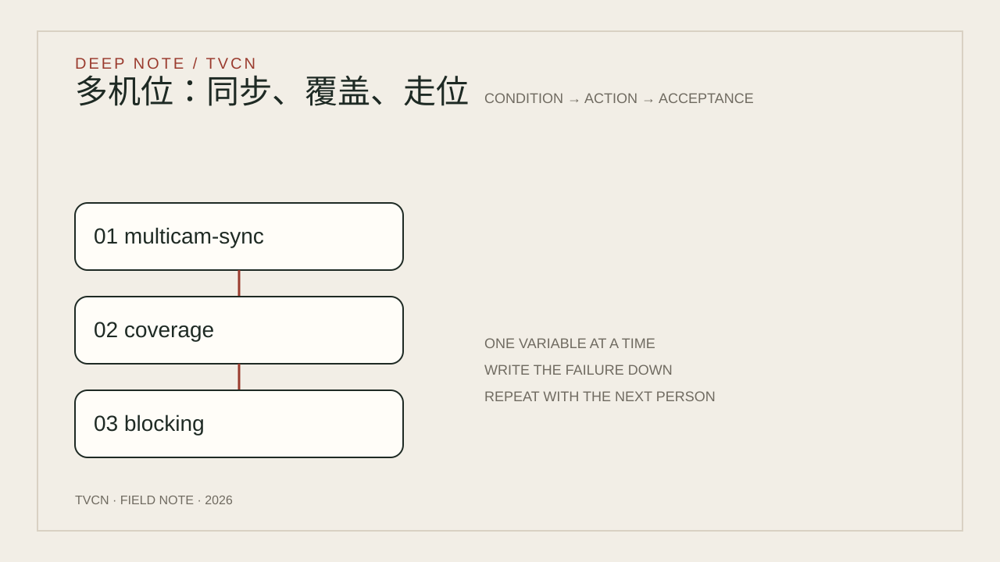

多机位不是多开几台机器；同步、景别分工和走位重复，缺一个就剪不起来。 单看《多机位同步：时间码与机位图》只能解决一个局部；把《多机位同步：时间码与机位图》《覆盖：别只拍一个角度》《走位：让人用身体说话》接成一条链，才会暴露“条件没写、变量太多、结果无法复现”的真问题。

<!-- DEEP_DIVE_START -->
<!-- DIAGRAM_START -->
<h2>图解</h2>
<figure>
  
  <figcaption>看“多机位同步：时间码与机位图”和“覆盖：别只拍一个角度”两处，先定条件，再看失败能不能被记录下来。</figcaption>
</figure>
<!-- DIAGRAM_END -->

<section><h2 id="section-1">问题</h2>
这一页的问题不是“方法不够多”，而是三个环节各自成立、合起来却不成立：条件没写、变量太多、结果不能复现。

本页按“先定条件—再做判断—只改一个变量—留下证据”的顺序；每一步都能被下一个人复述，才算完成。
</section>
<section><h2 id="section-2">判断</h2><ul><li>《多机位同步：时间码与机位图》的第一道门槛：机位图能看出 A、B、C 各自拍什么，没有两台重复</li><li>《覆盖：别只拍一个角度》的第二道门槛：三路素材在时间线上逐帧对齐，没有偏移</li><li>《走位：让人用身体说话》的第三道门槛：剪辑时每个机位都能提供不同信息，切起来有理由</li></ul>
三条里有一条不成立，就先回到对应单页；不要用整条链掩盖一个没解决的单点。
</section>
<section><h2 id="section-3">做法</h2><ol><li>先写条件：把《多机位同步：时间码与机位图》里“画一张俯视机位图，标清 A、B、C 各拍什么景别”落到一张三行表：素材、环境、验收。</li><li>再做一次最小动作：只按《多机位同步：时间码与机位图》的步骤做 30 秒，不加入第二页的方法。</li><li>把《覆盖：别只拍一个角度》的步骤接上：用时间码或拍手同步，确认三路都能对齐。</li><li>用《走位：让人用身体说话》做对照：检查每个机位都提供不同信息，没有重复景别。</li><li>每改一次只动一个变量；其他条件写进记录，不靠记忆。</li><li>把失败也拍下来：失败版本和成功版本并排，才知道哪一步不能省。</li><li>让下一个人按记录复现一次；他做不出来，说明记录还不够。</li></ol></section>
<section><h2 id="section-4">现场案例</h2>
可复现实验（不是客户案例）：拿 30 秒素材，先按《多机位同步：时间码与机位图》的“机位图能看出 A、B、C 各自拍什么，没有两台重复”做 A 版；再按《覆盖：别只拍一个角度》的“三路素材在时间线上逐帧对齐，没有偏移”做 B 版；两版只允许一个变量不同。把两版并排看，记录《走位：让人用身体说话》里最先崩的是哪一项：条件、动作还是验收。如果一次就成功，说明变量还不够多，再加一个现实限制重做。
</section>
<section><h2 id="section-5">失败表</h2>
<table class="data-table"><thead><tr><th>现象</th><th>原因</th><th>替换动作</th></tr></thead><tbody><tr><td>别让两台机器拍同一个景别；多机位不是重复机位</td><td>条件没写清</td><td>回到第一页重写三行表</td></tr><tr><td>别用同一种景别拍完整场；那不叫覆盖，叫重复</td><td>条件没写清</td><td>回到第一页重写三行表</td></tr><tr><td>别让人物为了构图站成海报；身体一假，关系就假</td><td>条件没写清</td><td>回到第一页重写三行表</td></tr></tbody></table>
</section>
<section><h2 id="section-6">验收</h2><ul><li>机位图能看出 A、B、C 各自拍什么，没有两台重复。</li><li>三路素材在时间线上逐帧对齐，没有偏移。</li><li>剪辑时每个机位都能提供不同信息，切起来有理由。</li><li>全景、中景、近景、插入四类素材都至少有一条可用。</li><li>手部或道具插入能独立交代一个信息点，不依赖旁白。</li><li>剪辑台上每个信息点都有两个景别可选，缺一条就要补拍。</li><li>主机位完整覆盖整场动作</li><li>每组都有全景、中景、近景、插入</li><li>每个角度至少两条</li><li>反打和反应镜头单独列</li></ul></section>
<section><h2 id="section-7">替代方案</h2><ul><li>只处理《多机位同步：时间码与机位图》里的单点问题：回到<a href="https://shoot.tvcn.org/article/multicam-sync/">《多机位同步：时间码与机位图》</a>，不要用整条链。</li><li>只比较两个动作：看<a href="https://shoot.tvcn.org/article/coverage/">《覆盖：别只拍一个角度》</a>，先不改第三页。</li><li>只做验收：看<a href="https://shoot.tvcn.org/article/blocking/">《走位：让人用身体说话》</a>，把判断表拿去做自测。</li></ul></section>
