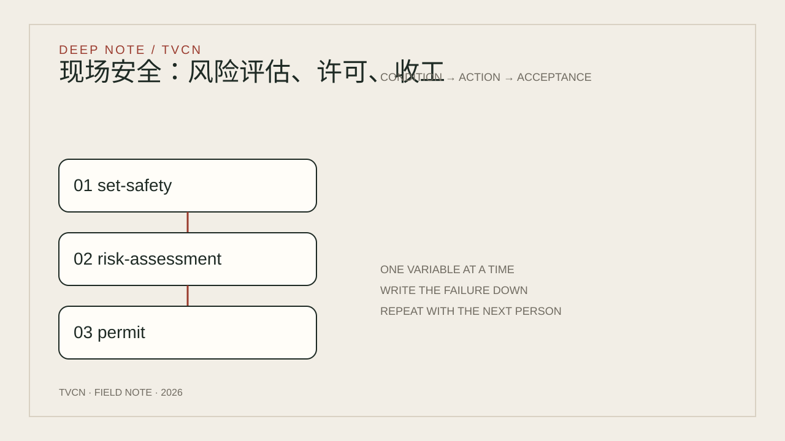

现场安全不是一张签字表；风险评估、许可和收工检查要落到每一个会动的人。 单看《现场安全：电线、高处、道路》只能解决一个局部；把《现场安全：电线、高处、道路》《风险评估：开机前填一张表》《拍摄许可：公园、地铁、商铺》接成一条链，才会暴露“条件没写、变量太多、结果无法复现”的真问题。

<!-- DEEP_DIVE_START -->
<!-- DIAGRAM_START -->
<h2>图解</h2>
<figure>
  
  <figcaption>看“现场安全：电线、高处、道路”和“风险评估：开机前填一张表”两处，先定条件，再看失败能不能被记录下来。</figcaption>
</figure>
<!-- DIAGRAM_END -->

<section><h2 id="section-1">问题</h2>
这一页的问题不是“方法不够多”，而是三个环节各自成立、合起来却不成立：条件没写、变量太多、结果不能复现。

本页按“先定条件—再做判断—只改一个变量—留下证据”的顺序；每一步都能被下一个人复述，才算完成。
</section>
<section><h2 id="section-2">判断</h2><ul><li>《现场安全：电线、高处、道路》的第一道门槛：走道上没有可绊人的电缆，灯架都有沙袋</li><li>《风险评估：开机前填一张表》的第二道门槛：高处灯架有人扶，道路旁的组员穿着反光背心</li><li>《拍摄许可：公园、地铁、商铺》的第三道门槛：任何组员都能说出最近医院、集合点和现场联系人</li></ul>
三条里有一条不成立，就先回到对应单页；不要用整条链掩盖一个没解决的单点。
</section>
<section><h2 id="section-3">做法</h2><ol><li>先写条件：把《现场安全：电线、高处、道路》里“把过道电缆用胶带压平，每个灯架压上沙袋”落到一张三行表：素材、环境、验收。</li><li>再做一次最小动作：只按《现场安全：电线、高处、道路》的步骤做 30 秒，不加入第二页的方法。</li><li>把《风险评估：开机前填一张表》的步骤接上：高处的灯架安排人扶，靠道路时全员穿反光背心。</li><li>用《拍摄许可：公园、地铁、商铺》做对照：把最近医院、集合点和联系人写进通告，开机前读给全组。</li><li>每改一次只动一个变量；其他条件写进记录，不靠记忆。</li><li>把失败也拍下来：失败版本和成功版本并排，才知道哪一步不能省。</li><li>让下一个人按记录复现一次；他做不出来，说明记录还不够。</li></ol></section>
<section><h2 id="section-4">现场案例</h2>
可复现实验（不是客户案例）：拿 30 秒素材，先按《现场安全：电线、高处、道路》的“走道上没有可绊人的电缆，灯架都有沙袋”做 A 版；再按《风险评估：开机前填一张表》的“高处灯架有人扶，道路旁的组员穿着反光背心”做 B 版；两版只允许一个变量不同。把两版并排看，记录《拍摄许可：公园、地铁、商铺》里最先崩的是哪一项：条件、动作还是验收。如果一次就成功，说明变量还不够多，再加一个现实限制重做。
</section>
<section><h2 id="section-5">失败表</h2>
<table class="data-table"><thead><tr><th>现象</th><th>原因</th><th>替换动作</th></tr></thead><tbody><tr><td>别让一个人搬灯架；倒下来没人接</td><td>条件没写清</td><td>回到第一页重写三行表</td></tr><tr><td>别把表填完就锁进抽屉；没人听过，等于没做</td><td>条件没写清</td><td>回到第一页重写三行表</td></tr><tr><td>别用“拍一下就走”当许可；保安来了，机器和素材都可能保不住</td><td>条件没写清</td><td>回到第一页重写三行表</td></tr></tbody></table>
</section>
<section><h2 id="section-6">验收</h2><ul><li>走道上没有可绊人的电缆，灯架都有沙袋。</li><li>高处灯架有人扶，道路旁的组员穿着反光背心。</li><li>任何组员都能说出最近医院、集合点和现场联系人。</li><li>电缆全部压边</li><li>过道保持清空</li><li>不用椅子当灯架</li><li>插排不超载</li><li>梯子有人扶</li><li>四格都填了具体内容，不是“注意安全”这种空话。</li><li>每个风险点都有名字负责，组员能说出自己那一项。</li></ul></section>
<section><h2 id="section-7">替代方案</h2><ul><li>只处理《现场安全：电线、高处、道路》里的单点问题：回到<a href="https://shoot.tvcn.org/article/set-safety/">《现场安全：电线、高处、道路》</a>，不要用整条链。</li><li>只比较两个动作：看<a href="https://shoot.tvcn.org/article/risk-assessment/">《风险评估：开机前填一张表》</a>，先不改第三页。</li><li>只做验收：看<a href="https://shoot.tvcn.org/article/permit/">《拍摄许可：公园、地铁、商铺》</a>，把判断表拿去做自测。</li></ul></section>

<!-- SOURCES_START -->
## 参考与延伸阅读

- [S18] [CMSI：危险纪录片手册](https://cmsimpact.org/wp-content/uploads/2015/12/dangerousdocs-feb2015.pdf) — 2026-11-26 访问。用于核对「问题」一节的术语/方法/规则（纪录片风险与伦理手册，不是法律意见）；不核对其中由本页经验得出的数字、型号与现场结论，也不替代测试。
- [S36] [国家广播电视总局：官网](https://www.nrta.gov.cn/) — 2026-11-26 访问。用于核对「判断」一节的术语/方法/规则（广电总局官网，不是具体许可代办）；不核对其中由本页经验得出的数字、型号与现场结论，也不替代测试。
<!-- SOURCES_END -->

