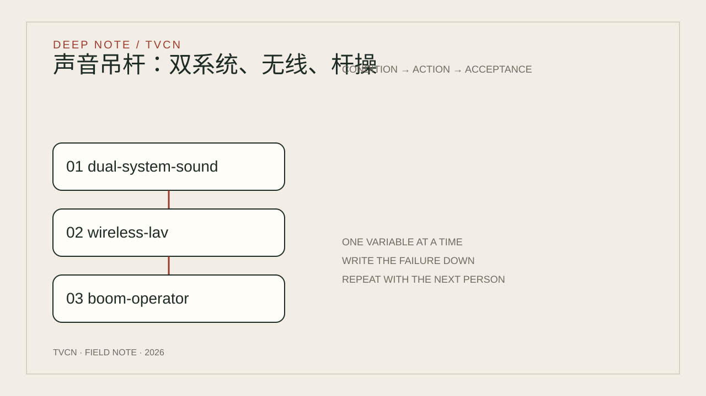

现场声音的可靠性来自双系统、无线备份和杆操位置，不是某一个贵麦克风。 单看《双系统录音：合板不靠猜》只能解决一个局部；把《双系统录音：合板不靠猜》《无线领夹：藏麦与备份》《吊杆操作：跟着动作走》接成一条链，才会暴露“条件没写、变量太多、结果无法复现”的真问题。

<!-- DEEP_DIVE_START -->
<!-- DIAGRAM_START -->
<h2>图解</h2>
<figure>
  
  <figcaption>看“双系统录音：合板不靠猜”和“无线领夹：藏麦与备份”两处，先定条件，再看失败能不能被记录下来。</figcaption>
</figure>
<!-- DIAGRAM_END -->

<section><h2 id="section-1">问题</h2>
这一页的问题不是“方法不够多”，而是三个环节各自成立、合起来却不成立：条件没写、变量太多、结果不能复现。

本页按“先定条件—再做判断—只改一个变量—留下证据”的顺序；每一步都能被下一个人复述，才算完成。
</section>
<section><h2 id="section-2">判断</h2><ul><li>《双系统录音：合板不靠猜》的第一道门槛：每条素材的开头有三次拍手，画面和声音都能看到</li><li>《无线领夹：藏麦与备份》的第二道门槛：时间码或场号记录完整，后期能按场次找到对应音频</li><li>《吊杆操作：跟着动作走》的第三道门槛：对齐后整条播放，唇音没有越走越偏</li></ul>
三条里有一条不成立，就先回到对应单页；不要用整条链掩盖一个没解决的单点。
</section>
<section><h2 id="section-3">做法</h2><ol><li>先写条件：把《双系统录音：合板不靠猜》里“开机时拍三次手，让摄影机和录音机都收到”落到一张三行表：素材、环境、验收。</li><li>再做一次最小动作：只按《双系统录音：合板不靠猜》的步骤做 30 秒，不加入第二页的方法。</li><li>把《无线领夹：藏麦与备份》的步骤接上：让录音机对时间码，或每条结尾报一次场号和镜号。</li><li>用《吊杆操作：跟着动作走》做对照：后期先对拍手帧或时码，再逐条检查声画偏移。</li><li>每改一次只动一个变量；其他条件写进记录，不靠记忆。</li><li>把失败也拍下来：失败版本和成功版本并排，才知道哪一步不能省。</li><li>让下一个人按记录复现一次；他做不出来，说明记录还不够。</li></ol></section>
<section><h2 id="section-4">现场案例</h2>
可复现实验（不是客户案例）：拿 30 秒素材，先按《双系统录音：合板不靠猜》的“每条素材的开头有三次拍手，画面和声音都能看到”做 A 版；再按《无线领夹：藏麦与备份》的“时间码或场号记录完整，后期能按场次找到对应音频”做 B 版；两版只允许一个变量不同。把两版并排看，记录《吊杆操作：跟着动作走》里最先崩的是哪一项：条件、动作还是验收。如果一次就成功，说明变量还不够多，再加一个现实限制重做。
</section>
<section><h2 id="section-5">失败表</h2>
<table class="data-table"><thead><tr><th>现象</th><th>原因</th><th>替换动作</th></tr></thead><tbody><tr><td>别指望后期靠波形自动对齐；没有拍手或时码，漂移会越修越大</td><td>条件没写清</td><td>回到第一页重写三行表</td></tr><tr><td>别把发射器放口袋、别只录一条；摩擦和丢失都没有第二次</td><td>条件没写清</td><td>回到第一页重写三行表</td></tr><tr><td>别跟着台词甩杆；杆头一动，画面和声音都会穿帮</td><td>条件没写清</td><td>回到第一页重写三行表</td></tr></tbody></table>
</section>
<section><h2 id="section-6">验收</h2><ul><li>每条素材的开头有三次拍手，画面和声音都能看到。</li><li>时间码或场号记录完整，后期能按场次找到对应音频。</li><li>对齐后整条播放，唇音没有越走越偏。</li><li>换场先拍手，手要清楚、脆、离麦近</li><li>再拍板，板上的字要能读</li><li>再拍摄影机上的时间码</li><li>场记板写场次、镜号、条数</li><li>相机机头麦一定开着</li><li>三十秒测试里没有衣服摩擦、空调声或喷麦。</li><li>发射器不在口袋，线没有拉紧，演员走动时麦不晃。</li></ul></section>
<section><h2 id="section-7">替代方案</h2><ul><li>只处理《双系统录音：合板不靠猜》里的单点问题：回到<a href="https://shoot.tvcn.org/article/dual-system-sound/">《双系统录音：合板不靠猜》</a>，不要用整条链。</li><li>只比较两个动作：看<a href="https://shoot.tvcn.org/article/wireless-lav/">《无线领夹：藏麦与备份》</a>，先不改第三页。</li><li>只做验收：看<a href="https://shoot.tvcn.org/article/boom-operator/">《吊杆操作：跟着动作走》</a>，把判断表拿去做自测。</li></ul></section>

<!-- SOURCES_START -->
## 参考与延伸阅读

- [S17] [Reuters Trust Principles](https://reutersagency.com/about/our-trust-principles/) — 2026-11-26 访问。用于核对首段“现场声音的可靠性来自双系统、无线备份和杆操位置，不是某一个贵麦克风。”中的术语与公开背景（通讯社对独立、准确与不带偏见的公开承诺）；不替代现场测试。
- [S23] [SMPTE 标准入口](https://www.smpte.org/standards) — 2026-11-26 访问。用于核对首段“现场声音的可靠性来自双系统、无线备份和杆操位置，不是某一个贵麦克风。”中的术语与公开背景（时间码、色彩、影院与信号链标准的机构入口）；不替代现场测试。
- [S31] [ARRI Cine Systems](https://www.arri.com/en/cine-systems) — 2026-11-26 访问。用于核对首段“现场声音的可靠性来自双系统、无线备份和杆操位置，不是某一个贵麦克风。”中的术语与公开背景（摄影机、镜头与灯光的技术资料入口）；不替代现场测试。
- [S52] [ARRI：ALEXA 35](https://www.arri.com/en/camera-systems/cameras/legacy-camera-systems/alexa-35) — 2026-11-26 访问。用于核对首段“现场声音的可靠性来自双系统、无线备份和杆操位置，不是某一个贵麦克风。”中的术语与公开背景（摄影机规格、Log-C 与色彩流程）；不替代现场测试。
- [S53] [Sony：FX6](https://pro.sony/ue_US/products/handheld-camcorders/ilme-fx6v) — 2026-11-26 访问。用于核对首段“现场声音的可靠性来自双系统、无线备份和杆操位置，不是某一个贵麦克风。”中的术语与公开背景（机身规格、录制格式与接口）；不替代现场测试。
<!-- SOURCES_END -->

